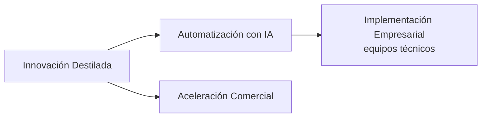

# Metodologías Distilled Innovation para tu asistente de IA

<!-- estado:en-construccion -->
> **Estado:** las instalaciones por línea de comandos (Claude Code, Cowork y `npx skills`) funcionan hoy. Los archivos descargables (los `.zip` "todo en uno" y de copiar y pegar) aparecerán en **Releases** cuando se publique la primera Release (v1.0.0).
<!-- /estado:en-construccion -->

Este proyecto convierte las metodologías de **Distilled Innovation** en ayudantes que viven dentro del asistente de IA que tu equipo ya usa (Claude, ChatGPT, Copilot, Gemini y otros).

Tú escribes con tus palabras lo que quieres lograr. El ayudante te hace **una pregunta a la vez**, separa lo que sabes de lo que estás suponiendo y te entrega lienzos, mapas y tableros listos para usar en tu equipo.

Primero lo usas con nosotros en el taller. Después lo repites tú solo con otro reto, sin depender de nadie.

## Instalar (elige UNA línea)

Hay cuatro metodologías (abajo las explicamos). Elige tu caso y copia lo que dice.

**Claude Code o Claude Cowork** (escribe esto en el chat):

```
/plugin marketplace add DistilledInnovation/ai-plugin
/plugin install innovacion-destilada@distilled-innovation
/plugin install automatizacion-con-ia@distilled-innovation
/plugin install implementacion-empresarial@distilled-innovation
/plugin install aceleracion-comercial@distilled-innovation
```

Puedes instalar solo las metodologías que necesites. Más detalle en la [guía de Claude](docs/instalacion/claude.md).

**Codex, opencode/OpenWork, Gemini CLI, GitHub Copilot, Cursor y otros agentes de código** (necesitas [Node.js](https://nodejs.org)):

```
npx skills add DistilledInnovation/ai-plugin
```

Te muestra una lista para que elijas las skills y el agente donde instalarlas. Si ya sabes cuál quieres: `npx skills add DistilledInnovation/ai-plugin --skill priorizar-flujos` (agrega `-g` para instalarla en tu usuario y no solo en el proyecto). Guía: [OpenWork y opencode](docs/instalacion/openwork-opencode.md).

**Aplicaciones web y de empresa sin terminal (Claude.ai, ChatGPT, Microsoft 365 Copilot, Amazon Quick):** sube **un solo archivo por metodología**. En **Releases** descarga el `<metodologia>-todo-en-uno-v*.zip` (son 4 archivos en total): una sola carga, la metodología completa adentro, y el asistente lee la guía de cada etapa cuando la necesita. Lo ideal es que el administrador de tu empresa lo suba una vez para todos. Los clics exactos están en la guía de tu plataforma: [Claude](docs/instalacion/claude.md), [ChatGPT](docs/instalacion/chatgpt.md), [Microsoft 365 Copilot](docs/instalacion/microsoft-365-copilot.md), [Amazon Quick](docs/instalacion/amazon-quick.md).

**Gemini (Gems), ChatGPT Projects, Grok y cualquier chat:** usa el paquete de copiar y pegar de la metodología (`<metodologia>-copiar-pegar-v*.zip`): pegas un archivo de instrucciones y subes los archivos de conocimiento. Guías: [Gemini](docs/instalacion/gemini.md), [Grok](docs/instalacion/grok.md), [ChatGPT](docs/instalacion/chatgpt.md).

Las rutas de menú de las aplicaciones web cambian seguido: las que no pudimos confirmar están marcadas con "(verificar)". Verificado: 2026-10-25. ¿Vas a usarlo en un taller? Revisa la [guía de taller](docs/guia-taller.md).

## ¿Y cómo sé que funcionó?

Escribe: "Quiero priorizar qué procesos de mi área conviene automatizar."
El facilitador debe contestarte con **una sola pregunta**, no con una lista ni un cuestionario.
Si te responde con un texto largo sin preguntarte nada, revisa que el archivo o plugin quedó activado.

## Las cuatro metodologías

| Metodología | Para qué sirve | Para quién |
|---|---|---|
| **Innovación Destilada** | Entender un reto, investigar a las personas, generar ideas y probar la mejor con poco riesgo | Cualquier equipo |
| **Automatización con IA** | Descubrir qué procesos conviene automatizar, priorizarlos y diseñar el flujo y un piloto | Equipos de operaciones y negocio |
| **Implementación Empresarial** | Llevar un flujo ya diseñado a operación real, con controles, aprobaciones y pruebas | **Equipos técnicos** (TI, implementación) |
| **Aceleración Comercial** | Ordenar y hacer crecer las ventas: segmentos, oferta, proceso, CRM y forecast | Equipos comerciales |

Se encadenan así:



Cada metodología tiene un **facilitador**: si no sabes por dónde empezar, pídele ayuda a él y te lleva a la etapa correcta.

## Cómo empezar

Cuando el ayudante esté disponible, escribe una frase como estas:

- "Quiero priorizar qué procesos de mi área conviene automatizar."
- "Ayúdame a entender bien el reto que tiene mi equipo antes de buscar soluciones."
- "Tenemos clientes, pero las ventas no son predecibles. ¿Por dónde empiezo?"

Responde a la pregunta que te haga, de a una. En cualquier momento puedes escribir **"Muéstrame el avance"**, **"¿Qué falta?"** o **"Finalizar"**.

## Para quien mantiene el repositorio

Las reglas, comandos y la receta para agregar skills están en [`AGENTS.md`](AGENTS.md). El diseño completo está en [`docs/superpowers/specs/`](docs/superpowers/specs/2026-10-25-plugin-metodologias-distilled-design.md). Los cambios se registran en [`CHANGELOG.md`](CHANGELOG.md).

## Licencia y créditos

- El contenido (skills, plantillas y documentación) se publica bajo **CC BY 4.0**; al reutilizarlo, cita la atribución **"Distilled Innovation"**. Ver [`LICENSE`](LICENSE).
- Los scripts de la carpeta `scripts/` se publican bajo licencia **MIT**. Ver [`LICENSE-scripts`](LICENSE-scripts).
- Las metodologías se apoyan en Design Thinking, Business Model Canvas, Lean Startup y trabajo propio de Distilled Innovation.
