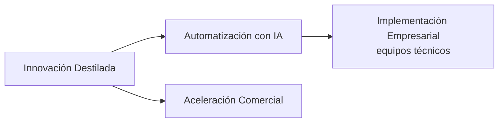

# Metodologías Distilled Innovation para tu asistente de IA

<!-- estado:en-construccion -->
> **Estado: en construcción.** La primera Release (v1.0.0) aún no está publicada; las skills descritas son el catálogo objetivo. Los nombres de archivos y frases de ejemplo de esta página muestran cómo será la instalación cuando la Release exista.
<!-- /estado:en-construccion -->

Este proyecto convierte (en cuanto salga la primera Release) las metodologías de **Distilled Innovation** en ayudantes que viven dentro del asistente de IA que tu equipo ya usa (Claude, ChatGPT, Copilot, Gemini y otros).

Tú escribes con tus palabras lo que quieres lograr. El ayudante te hace **una pregunta a la vez**, separa lo que sabes de lo que estás suponiendo y te entrega lienzos, mapas y tableros listos para usar en tu equipo.

Primero lo usas con nosotros en el taller. Después lo repites tú solo con otro reto, sin depender de nadie.

## ¿Qué asistente usas?

Busca tu asistente y sigue la guía. En la mayoría de los casos **no tienes que instalar nada**: el administrador de tu empresa lo carga una vez para todos.

| Tu asistente | Guía | Nivel | Qué haces |
|---|---|---|---|
| Claude (Claude.ai, Cowork o Claude Code) | [Claude](docs/instalacion/claude.md) | 1, 1b y 2 | El admin lo carga para todos, o agregas el catálogo con un clic, o subes un zip |
| ChatGPT | [ChatGPT](docs/instalacion/chatgpt.md) | 1, 2 y 3 | Skills del espacio de trabajo (Business/Enterprise) o un Proyecto con copiar y pegar |
| Microsoft 365 Copilot | [Microsoft 365 Copilot](docs/instalacion/microsoft-365-copilot.md) | 2 | Un agente con hasta 8 skills, publicado por el admin |
| Amazon Quick | [Amazon Quick](docs/instalacion/amazon-quick.md) | 1 y 2 | Importas la skill y la compartes con tu equipo |
| Gemini | [Gemini](docs/instalacion/gemini.md) | 3 | Un Gem con instrucciones y archivos de conocimiento (Gemini CLI: desarrolladores) |
| Grok | [Grok](docs/instalacion/grok.md) | 3 | Copiar y pegar (Grok Build: desarrolladores) |
| OpenWork / opencode | [OpenWork y opencode](docs/instalacion/openwork-opencode.md) | 1b | Copias las carpetas o agregas el catálogo |

**Niveles:** 1 = sin instalar (lo carga tu admin) · 1b = un clic · 2 = subir un zip · 3 = copiar y pegar (respaldo, con menos calidad y actualización manual).

Las descargas estarán en la sección **Releases** de este repositorio cuando se publique la primera. ¿Vas a usarlo en un taller? Revisa la [guía de taller](docs/guia-taller.md).

## Las cuatro metodologías

| Metodología | Para qué sirve | Para quién |
|---|---|---|
| **Innovación Destilada** | Entender un reto, investigar a las personas, generar ideas y probar la mejor con poco riesgo | Cualquier equipo |
| **Automatización con IA** | Descubrir qué procesos conviene automatizar, priorizarlos y diseñar el flujo y un piloto | Equipos de operaciones y negocio |
| **Implementación Empresarial** | Llevar un flujo ya diseñado a operación real, con controles, aprobaciones y pruebas | **Equipos técnicos** (TI, implementación) |
| **Aceleración Comercial** | Ordenar y hacer crecer las ventas: segmentos, oferta, proceso, CRM y forecast | Equipos comerciales |

Se encadenan así:

Cada metodología tiene un **facilitador**: si no sabes por dónde empezar, pídele ayuda a él y te lleva a la etapa correcta.

## Cómo empezar

Cuando el ayudante esté disponible, escribe una frase como estas:

- "Quiero priorizar qué procesos de mi área conviene automatizar."
- "Ayúdame a entender bien el reto que tiene mi equipo antes de buscar soluciones."
- "Tenemos clientes, pero las ventas no son predecibles. ¿Por dónde empiezo?"

Responde a la pregunta que te haga, de a una. En cualquier momento puedes escribir **"Muéstrame el avance"**, **"¿Qué falta?"** o **"Finalizar"**.

## Para quien mantiene el repositorio

Las reglas, comandos y la receta para agregar skills están en [`AGENTS.md`](AGENTS.md). El diseño completo está en [`docs/superpowers/specs/`](docs/superpowers/specs/2026-10-25-plugin-metodologias-distilled-design.md). Los cambios se registran en [`CHANGELOG.md`](CHANGELOG.md).

## Licencia y créditos

- El contenido (skills, plantillas y documentación) se publica bajo **CC BY 4.0**; al reutilizarlo, cita la atribución **"Distilled Innovation"**. Ver [`LICENSE`](LICENSE).
- Los scripts de la carpeta `scripts/` se publican bajo licencia **MIT**. Ver [`LICENSE-scripts`](LICENSE-scripts).
- Las metodologías se apoyan en Design Thinking, Business Model Canvas, Lean Startup y trabajo propio de Distilled Innovation.
