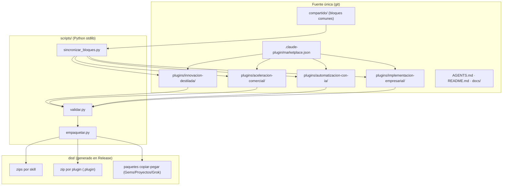
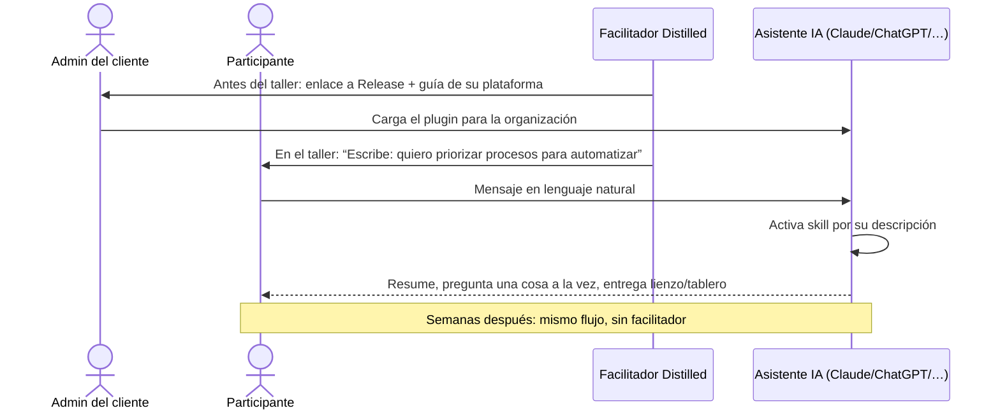
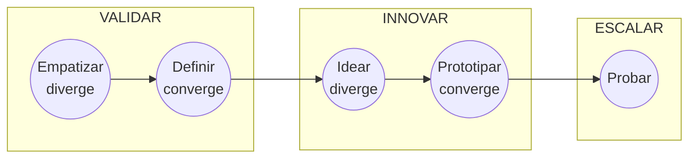
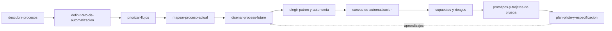
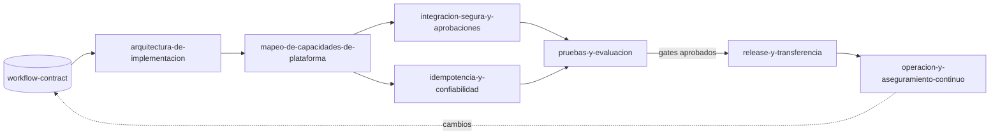

# Diseño: Plugin de metodologías Distilled Innovation para asistentes de IA

**Fecha:** 25 de octubre de 2026 · **Estado:** borrador para aprobación · **Repo:** `github.com/DistilledInnovation/ai-plugin`

## 1. Intención

Distilled Innovation acompaña a sus clientes en talleres y sesiones en vivo con tres metodologías propias. Queremos que el cliente **use esas metodologías dentro de su propio asistente de IA** (Claude, ChatGPT, Copilot, Gemini, Amazon Quick, Grok, OpenWork/opencode): primero guiado por nosotros en el taller, y después por su cuenta, sin depender de nosotros ni de una plataforma nuestra.

El plugin es **la esencia de la metodología empaquetada como skills**: facilitan una pregunta a la vez, separan hechos de supuestos, producen los mismos entregables (lienzos, mapas, tableros) que usamos en los talleres y conservan la trazabilidad entre reto → evidencia → solución → prueba.

**Éxito se ve así:**
- Un participante novato instala el plugin en menos de 5 minutos (o lo encuentra ya instalado por su admin) y en el taller escribe algo como *"quiero priorizar qué procesos automatizar"* y la skill correcta arranca.
- Una semana después, solo, repite el ejercicio con otro proceso y obtiene un entregable de la misma calidad.
- Distilled mantiene **una sola fuente** y publica versiones para todas las plataformas sin trabajo manual.

## 2. Metas, no-metas y anti-metas

**Metas**
1. Cuatro plugins en español latinoamericano (tono de negocios, cercano): **Innovación Destilada**, **Automatización con IA**, **Implementación Empresarial** (continuación técnica de Automatización, antes “Pack B”) y **Aceleración Comercial**.
2. Formato fuente único: **Agent Skills abierto** (`SKILL.md`, agentskills.io), empaquetado como **marketplace de plugins de Claude**.
3. Instalación en tres niveles para novatos (ver §5) y guías por plataforma.
4. Repo *AI-first*: `AGENTS.md` como contrato para agentes que mantengan el repo, validación automática y empaquetado reproducible.
5. Recuperar del libro lo que faltaba en los borradores: herramientas completas, plantillas y las visualizaciones del proceso (recreadas como Mermaid/tablas).

**No-metas (por ahora)**
- Servidor MCP, app web de Conversational Canvas, runtime de workflows (son P1/P2 de la oferta).
- Generar o desplegar automáticamente un workflow en una plataforma: Implementación Empresarial guía la adaptación, **no convierte** entre proveedores.
- Custom GPTs (en retiro según fuentes secundarias) y cualquier formato que requiera backend.

**Anti-metas (fracaso aunque “funcione”)**
- Que aparezca **cualquier dato, nombre o caso de un cliente real** en el repo.
- Que las skills inventen datos del cliente o presenten supuestos como hechos.
- Que empujen IA/agentes autónomos cuando simplificar, reglas o dejarlo humano es mejor.
- Que un novato tenga que usar terminal, Git o editar JSON para instalar.
- Que haya que mantener a mano copias divergentes por plataforma.

## 3. Restricciones

| Restricción | Origen | Implicación |
|---|---|---|
| Frontmatter solo `name` + `description` | Gemini CLI ignora el resto; portabilidad | Nada de campos propietarios en `SKILL.md` |
| `name` = nombre de la carpeta, kebab-case, sin número | Estándar Agent Skills | Carpetas `skills/priorizar-flujos/`, no `01-...` |
| `SKILL.md` ≤ 20.000 caracteres | Límite de Microsoft 365 (el más estricto encontrado) | Contenido largo en `references/` de la misma skill |
| Solo archivos de texto (.md, .txt, .json, .yaml, .csv) dentro de plugins | Carga de admin en Claude rechaza scripts/binarios | Las imágenes del libro se recrean en Mermaid/tablas; PNG solo en `docs/` |
| Cada skill autocontenida | Las cargas por zip son por skill | Sin rutas `../`; reglas, esquemas y plantillas comunes se copian en cada skill (sincronizadas por script) |
| Sin secretos ni datos de clientes | Políticas de Boss y de la agencia | Verificación con lista de términos prohibidos local (gitignored) |
| Descripción ≤ 1.024 caracteres, con disparadores en español | Estándar + activación correcta | Fórmula: *qué hace* + *“Úsala cuando…”* + frases típicas del usuario |

## 4. Arquitectura del repositorio



```text
ai-plugin/
├── AGENTS.md                      # contrato para agentes (fuente de verdad del “cómo”)
├── CLAUDE.md                      # una línea: @AGENTS.md
├── README.md                      # para humanos: qué es, instalación por plataforma, catálogo
├── .claude-plugin/marketplace.json
├── compartido/                    # fuente única de lo que se copia dentro de las skills
│   ├── reglas-facilitacion.md
│   ├── etiquetas-y-trazabilidad.md
│   ├── archivos/                  # archivos completos compartidos (p. ej. workflow-contract.schema.json)
│   └── archivos-compartidos.json  # qué archivo se copia a qué carpeta de skill
├── plugins/
│   └── <metodologia>/
│       ├── .claude-plugin/plugin.json
│       ├── README.md
│       ├── evals/<skill>/          # prompt.md + graders/*.md (claude plugin eval); no se empaqueta
│       └── skills/<skill>/
│           ├── SKILL.md
│           ├── references/        # guías, herramientas, ejemplos ficticios
│           └── assets/            # plantillas .md/.yaml que la skill rellena
├── scripts/                       # sincronizar, validar, empaquetar
├── docs/
│   ├── instalacion/<plataforma>.md
│   ├── guia-taller.md             # cómo usar el plugin en un taller en vivo
│   └── imagenes/                  # PNG originales, solo documentación
└── .github/workflows/             # validar en PR, empaquetar en tag
```

**Bloques compartidos:** cada `SKILL.md` lleva marcadores `<!-- inicio:reglas-facilitacion -->…<!-- fin:reglas-facilitacion -->`. `sincronizar_bloques.py` reemplaza el contenido entre marcadores desde `compartido/`; `validar.py` falla si alguno está desincronizado. Así la fuente se puede instalar tal cual (sin build) y sigue siendo una sola verdad. El mismo script copia los **archivos completos** declarados en `compartido/archivos-compartidos.json` (esquemas, plantillas que usan dos plugins) a cada skill destino, y `validar.py` exige que las copias sean idénticas.

**Reglas comunes (contenido de `compartido/`)**, destiladas del prompt maestro del Canvas y de los borradores:
- Una pregunta principal por turno; la de mayor impacto. No interrogar si ya hay evidencia.
- Etiquetar **Hecho / Supuesto / Recomendación / Pendiente por validar**; registrar *riesgo → impacto → mitigación* y *línea base → meta*.
- No inventar datos; si falta información, entregar borrador provisional + lista corta de vacíos.
- Preferir lo más simple: eliminar, simplificar, reglas, automatización determinística antes de IA o agentes.
- Comandos universales: **“Muéstrame el avance”**, **“¿Qué falta?”**, **“Finalizar”**.
- Salidas en Markdown + Mermaid (con tabla equivalente por si la plataforma no renderiza Mermaid) + YAML simple.
- Sugerir la siguiente skill al terminar (la cadena metodológica).

## 5. Distribución e instalación para novatos

| Nivel | Cómo | Plataformas | Uso en taller |
|---|---|---|---|
| **1. Sin instalar** | El admin del cliente carga el `.plugin` una vez en la organización | Claude (Team/Enterprise), ChatGPT Business/Enterprise (Skills de workspace), Amazon Quick (compartir skill) | **Recomendado:** paso previo al taller; los participantes no hacen nada |
| **1b. Un clic** | “Agregar marketplace desde GitHub” → `DistilledInnovation/ai-plugin` | Claude Cowork / Claude Code, OpenWork | Para equipos con Claude |
| **2. Subir un zip** | Descargar zip de la skill desde Releases y subirlo | Claude.ai (Configuración › Skills), ChatGPT Skills, Amazon Quick, Microsoft 365 Copilot (Agent Builder, máx. 8 skills por agente) | Guía con capturas, 1 página por plataforma |
| **3. Copiar y pegar** | Paquete generado: instrucciones condensadas + ≤10 archivos de conocimiento por metodología | Gemini Gems, Proyectos de ChatGPT, Grok, cualquier otro chat | Respaldo; menor calidad, actualización manual |
| Desarrolladores | Copiar carpetas a `.agents/skills`, `.opencode/skills`, `.gemini/skills` | Codex, opencode, Gemini CLI, Grok Build | Fuera del flujo de novatos |



**Versionado:** semver en `plugin.json` y en el nombre de cada zip (`priorizar-flujos-v1.2.0.zip`); `CHANGELOG.md` en español; Releases de GitHub como canal de descarga.

## 6. Catálogo de skills

Cada metodología tiene un **facilitador** (punto de entrada que diagnostica dónde está el usuario y enruta) y skills por etapa. Las skills de una metodología pueden recomendar skills de otra por nombre (p. ej., Automatización usa `identificar-reto` de Innovación Destilada).

### 6.1 Innovación Destilada (Design Thinking + Business Canvas + Lean Startup)

Proceso del libro (recreado de `innovacion-destilada-proceso.png`):



| Skill | Etapa | Fuente / qué se agrega respecto al borrador |
|---|---|---|
| `facilitador-innovacion-destilada` | Orquestador | Borrador 12 + estado YAML del proyecto; diagrama del proceso |
| `alinear-equipo` | Preparar | + Línea de tiempo, Modelo de Negocio Personal, Círculo Dorado, MEGA |
| `identificar-reto` | Validar | + Lienzo de Modelo de Negocio, Fuerzas del entorno (zoom out), Canvas de Propuesta de Valor (zoom in), 11 preguntas “¿Cómo podemos…?” |
| `investigar-y-empatizar` | Validar · Empatizar | + Escalera de profundidad (dicen/hacen/sienten → entrevista/observación/generativas → explícito/tácito/latente), Perfil de Usuario, Diario, Collage, Mapa Mental, guía de entrevista |
| `sintetizar-y-redefinir-reto` | Validar · Definir | + Hallazgos/Necesidades/Tensiones, Mapa de Empatía, plantilla Perfil del Cliente (tareas, dolores, beneficios) |
| `facilitar-ideacion` | Innovar · Idear | + Agenda de sesión (tiempo, actividad, reglas, materiales), calentamiento, “ideas con vida”, cómo aplicar cada técnica (SCAMPER completo, 6-5-3, Sombreros, ¿Qué tal si…?, Historieta, Dramatización), brain-writing y votación |
| `construir-concepto-fuerte` | Innovar | + Empaquetamiento de ideas |
| `disenar-prototipo` | Innovar · Prototipar | + Mapa de Valor, Encaje Problema-Solución, prototipos rápidos, Pitch A.I.D.A. |
| `validar-supuestos-y-mvp` | Escalar | + MVP de Kniberg (tabla “no así / sino así”), tarjeta de prueba |
| `probar-y-aprender` | Escalar · Probar | Tablero de Validación + 6 métricas de evaluación |
| `modelo-de-negocio-y-escalamiento` | Escalar | + definición de los 9 bloques, de Product/Market Fit a Business Model Fit |
| `innovacion-abierta-y-ecosistema` | Transversal | + definición de los 7 patrones y las 7 prácticas |

Casos de estudio del libro: se reescriben como **ejemplos ficticios** en `references/` (ver §10).

### 6.2 Automatización con IA (sobre Innovación Destilada; etapas A–B de la oferta)



| Skill | Etapa | Base |
|---|---|---|
| `facilitador-automatizacion-con-ia` | Orquestador | Prompt maestro del Canvas + 4 puntos de entrada de la oferta |
| `descubrir-procesos` | A | Kit de entrevistas; captura de señales (contexto, situación, magnitud, intención); agrupar reportes del mismo problema |
| `definir-reto-de-automatizacion` | A | Scoping Canvas de 6 preguntas (objetivo SMART, “¿Cómo podríamos…?”) — reemplaza `diagnostico-reto` |
| `priorizar-flujos` | A | Inventario + mapa Valor × Factibilidad + 5 cubetas (Victorias rápidas, Pilotos estratégicos, Requiere bases, Asistir no automatizar, No automatizar); variante de matriz ponderada impacto/esfuerzo |
| `mapear-proceso-actual` | B | As-Is en tabla + Mermaid + RACI (fusiona `mapeo-as-is` y `actores-responsabilidades`) |
| `disenar-proceso-futuro` | B | To-Be funcional: eliminar / simplificar / asistir / automatizar / mantener humano; sin herramientas |
| `elegir-patron-y-autonomia` | B | Árbol de decisión de 5 patrones + escalera de autoridad 0–5 + catálogo de guardrails (pilotos en niveles 1–3) |
| `canvas-de-automatizacion` | B | Canvas de 12 bloques conversacional (redacción canónica del PNG en español), vista A3 en Markdown |
| `supuestos-y-riesgos` | B | Supuestos falsables, impacto × incertidumbre, riesgos con mitigación |
| `prototipos-y-tarjetas-de-prueba` | B | Tarjeta de prueba (Creemos que… / Haremos… / Mediremos… / Acertamos si…), tipos de prueba, decisión (iterar/escalar/pausar/descartar/redefinir) |
| `plan-piloto-y-especificacion` | B→C | Plan piloto, línea base → meta, costo y esfuerzo (Bajo/Medio/Alto), especificación portable de la solución (reemplaza `mvp-prototipado`) |
| `crear-skill-de-flujo` | Después del taller | Del prompt “CreaFlujo”: el cliente convierte su propio proceso repetitivo en una skill — lo que se queda usando |

`plan-piloto-y-especificacion` entrega la especificación portable **en el formato `workflow-contract`** (esquema compartido con Implementación Empresarial), de modo que el paso de diseño a implementación no requiere reescribir nada.

Patrones genéricos de los casos reales que se incorporan **anonimizados** como `references/` (ejemplos ficticios): señales internas vs. fuerzas externas (zoom in / zoom out), tarjeta de prueba con resultado “falso” que revela variantes del proceso, y patrón de pipeline de vigilancia (configurar alcance → recolectar → anonimizar antes del LLM → puntuar → filtrar → generar → revisión humana).

### 6.3 Implementación Empresarial (continuación de Automatización con IA; etapas C–D de la oferta)

Para el equipo de TI/implementación del cliente y los consultores de Distilled. Recibe un workflow ya definido (el `workflow-contract`) y lo lleva a una implementación gobernada en la plataforma que el cliente elija, sin prometer conversión automática ni equivalencia funcional entre proveedores.



| Skill | Resultado obligatorio (de Pack B) |
|---|---|
| `facilitador-implementacion-empresarial` | Verifica que exista un `workflow-contract` (si no, remite a Automatización con IA), elige ruta y mantiene el registro de decisiones |
| `arquitectura-de-implementacion` | Arquitectura lógica trazable al contrato, límites de componentes, decisiones registradas; sin elegir plataforma por defecto |
| `mapeo-de-capacidades-de-plataforma` | `capability-map`: requisito → opciones → decisión → brecha → dueño → aprobación; cada mapeo es una decisión revisable, nunca una equivalencia supuesta. Incluye 4 perfiles: Microsoft (Copilot Studio + Dataverse + Power Automate), AWS (Bedrock + Step Functions), Google (Gemini/Vertex + Cloud Workflows), self-hosted (opencode + Workflows MCP + SQLite) |
| `integracion-segura-y-aprobaciones` | Modelo de amenazas, mínimo privilegio, secretos fuera de artefactos, matriz de aprobación humana, auditoría |
| `idempotencia-y-confiabilidad` | Registro de claves idempotentes, clasificación de reintentos, compensaciones, cola de errores, recuperación |
| `pruebas-y-evaluacion` | `evaluation-plan` con 4 categorías obligatorias (funcional, seguridad, resiliencia, calidad de IA), casos positivos y negativos, criterios de aceptación |
| `release-y-transferencia` | Checklist de salida; prohíbe liberar sin dueños, aprobación y rollback; runbook y transferencia de propiedad |
| `operacion-y-aseguramiento-continuo` | Observabilidad, alertas, KPIs de valor (prototipo vs. producción), control de cambios, recertificación periódica |

Esquemas JSON (Draft 2020-12, con bloque `extensions`): `workflow-contract`, `capability-map`, `evaluation-plan`. Plantillas: plan de implementación, revisión de amenazas y aprobaciones, registro de idempotencia, registro de evidencia de pruebas, preparación de release, runbook. Ejemplo de punta a punta **ficticio** (radar de señales regulatorias de una empresa inventada) donde las recomendaciones de IA siempre pasan por un responsable antes de producir efectos externos. Los perfiles de plataforma llevan fecha de verificación y declaran explícitamente que no hay conversión automática.

### 6.4 Aceleración Comercial (sobre Innovación Destilada)

Ocho etapas (0–7) con ciclos de retroalimentación (7→1 aprendizaje de mercado, 7→3 fricción de proceso, 7→4 mejoras de herramientas). Se publica como metodología completa (ver §10); las evidencias de casos con nombres de clientes **no** entran.

| Skill | Etapa |
|---|---|
| `facilitador-aceleracion-comercial` | Orquestador (diagnóstico de modalidad A/B/C y etapa) |
| `diagnostico-comercial` | 0 · Madurez, as-is comercial, embudo y línea base |
| `segmentacion-e-icp` | 1 · Segmentos, ficha ICP, mapa de actores de compra, cuentas objetivo |
| `oferta-y-propuesta-de-valor` | 2 · Oferta por segmento, argumentario, pitch (reusa Perfil del Cliente y Mapa de Valor) |
| `proceso-de-ventas-y-pipeline` | 3 · Etapas con criterios de entrada/salida, calificación, responsables |
| `crm-y-tableros` | 4 · Campos mínimos, diccionario de datos, tableros, higiene de datos (sin elegir proveedor) |
| `kit-comercial-y-entrenamiento` | 5 · Playbook, guiones, cadencias, matriz de objeciones, plan de práctica |
| `canales-y-generacion-de-demanda` | 6 · Plan de canales, calendario, experimentos (reusa Tablero de Validación) |
| `gobierno-comercial-y-forecast` | 7 · Rituales, tablero semanal, forecast con supuestos, backlog de mejoras, KPIs con fórmulas |

## 7. Anatomía de una skill

```markdown
---
name: priorizar-flujos
description: Ayuda a un equipo a inventariar sus procesos y elegir cuáles conviene automatizar, asistir con IA o dejar humanos, con un mapa Valor × Factibilidad. Úsala cuando el usuario diga "qué procesos automatizo", "priorizar flujos", "por dónde empezar con IA" o comparta una lista de tareas repetitivas.
---
# Priorizar flujos
<!-- inicio:reglas-facilitacion --> … <!-- fin:reglas-facilitacion -->
## Cuándo usarla / cuándo no
## Antes de empezar (qué pedir al usuario)
## Proceso (pasos numerados, una pregunta por turno)
## Entregables (usa assets/…)
## Criterio de salida
## Siguiente paso sugerido
```

Cada skill trae un ejemplo ficticio completo en `references/ejemplo.md` (empresa inventada) para que el asistente imite el nivel de calidad.

## 8. Repo AI-first

- **`AGENTS.md`** (español): propósito, mapa del repo, convenciones de skills, comandos (`python scripts/validar.py`, `sincronizar_bloques.py`, `empaquetar.py`), reglas duras (sin datos de clientes, sin secretos, solo texto en plugins, límites de tamaño), cómo agregar una skill, definición de “terminado”.
- **`CLAUDE.md`** contiene solo `@AGENTS.md`.
- **CI (GitHub Actions):** en PR → sincronización + validación; en tag `v*` → empaquetar y publicar Release.
- **Lista de términos prohibidos:** `.terminos-prohibidos.txt` (gitignored, local) leída por `validar.py` y por un hook de pre-commit; en CI se inyecta desde un secreto del repo.
- **Evals:** cada skill tiene un caso en `plugins/<metodologia>/evals/<skill>/` (`prompt.md` con mensaje y contexto ficticio + `graders/*.md` con criterios), ejecutable con `claude plugin eval` (incluye brazo sin plugin para medir el aporte). Se excluye de los zips. Antes de cada release se prueba además manualmente un nivel 3 (Gem o Proyecto).
- **Validación de manifiestos:** `claude plugin validate .` además de `scripts/validar.py`.

## 9. Lo que decide quien construya

- Redacción final de cada skill, ejemplos ficticios y plantillas, respetando §3, §4 y §7.
- Formato exacto de los paquetes copiar-pegar mientras quepan en ≤10 archivos.
- Implementación de los scripts (Python 3 stdlib, sin dependencias).

## 10. Decisiones tomadas

| Decisión | Quién | Detalle |
|---|---|---|
| Repo **público**, metodologías abiertas | Boss | El valor de Distilled está en la formación, consultoría, transferencia y ejecución, no en ocultar el método |
| Licencia **CC BY 4.0** para contenido y **MIT** para `scripts/` | Claude (a confirmar) | Coherente con “metodologías abiertas”; exige atribución a Distilled Innovation |
| Aceleración Comercial se publica **como producto final**, completando lo que falte | Boss | Se resuelven las preguntas abiertas del documento fuente (ver abajo); sin etiquetas [OFICIAL]/[PROPUESTO] en el plugin |
| Orden: **Innovación Destilada** primero | Boss | Es la base de las demás |
| Luego **Automatización con IA → Implementación Empresarial → Aceleración Comercial** | Claude | Implementación continúa directamente a Automatización (comparten `workflow-contract`) |
| Solo **español** (mercado Latam); sin i18n por ahora | Boss | Si se agrega inglés luego: plugins separados por idioma, español como fuente, glosario |
| Pack B entra como cuarto plugin **Implementación Empresarial** | Boss | Nombres en español sin números; esquemas y perfiles dentro de las skills; ejemplo real reemplazado por uno ficticio |
| Casos del libro y de clientes se reescriben como **ejemplos ficticios** | Claude | Anti-meta de datos de clientes; aplica también a los casos de estudio del libro |

**Vacíos de Aceleración Comercial que se completan (decisión de Claude, revisables):**
- Calificación de oportunidades: **BANT simplificado** como base, con preguntas de MEDDICC opcionales para ventas complejas B2B.
- CRM: la skill define campos, etapas y tableros de forma agnóstica; ofrece una tabla de “cómo se ve en una hoja de cálculo” como mínimo viable.
- Uso de IA en ventas: cada etapa incluye una sección “Cómo te ayuda la IA aquí” (investigación de cuentas, borradores de mensajes, resumen de llamadas), siempre con revisión humana.
- Cronograma: guía de 8–12 semanas como referencia, no como compromiso.
- Transferencia: la etapa 7 termina con un “manual del sistema comercial” que el equipo mantiene sin consultor.
