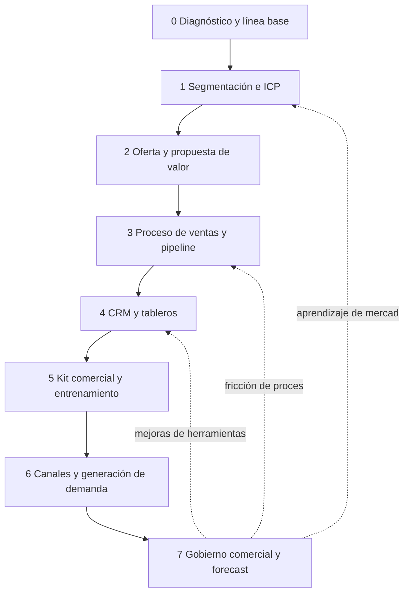

# Aceleración Comercial

Plugin de Distilled Innovation que te acompaña, con un facilitador de IA y paso a paso, a **diseñar y poner a funcionar un sistema de ventas repetible y medible**: que las ventas dejen de depender de una persona, de la improvisación o de una hoja que nadie actualiza.

## Qué es la metodología

Aceleración Comercial es una guía de referencia (no una camisa de fuerza) para pasar de "vendemos, pero no sabemos bien cómo" a un sistema comercial con a quién venderle, qué ofrecer, cómo avanza una oportunidad, qué se mide y cómo se gestiona cada semana. Su idea central: **sistema antes que campaña**. Más contactos sobre un proceso roto producen más desorden; primero se entiende y se ordena la venta completa.

La metodología tiene seis componentes que se reparten en ocho etapas (0 a 7); la etapa 0 es el diagnóstico que ordena las prioridades.

| Componente | Etapas |
|---|---|
| Segmentación e ICP | 1 Segmentación e ICP y 2 Oferta y propuesta de valor |
| Proceso comercial y pipeline | 3 Proceso de ventas y pipeline |
| CRM y ecosistema digital | 4 CRM y tableros |
| Kit comercial | 5 Kit comercial y entrenamiento |
| Generación de demanda | 6 Canales y generación de demanda |
| Gestión y mejora | 7 Gobierno comercial y forecast |

| Etapa | Skill | Qué produce | Estado |
|---|---|---|---|
| 0 | `diagnostico-comercial` | Madurez, mapa as-is, embudo actual, línea base de KPIs y backlog | Disponible |
| 1 | `segmentacion-e-icp` | Segmentos, ficha ICP, actores de compra y lista de cuentas | Disponible |
| 2 | `oferta-y-propuesta-de-valor` | Propuesta por segmento, oferta simplificada, argumentario y hoja comercial | Disponible |
| 3 | `proceso-de-ventas-y-pipeline` | Proceso to-be, etapas con criterios, calificación y manual corto | Disponible |
| 4 | `crm-y-tableros` | Campos mínimos, diccionario de datos, tableros e higiene de datos | Próximamente |
| 5 | `kit-comercial-y-entrenamiento` | Playbook, guiones, cadencias, objeciones y plan de práctica | Próximamente |
| 6 | `canales-y-generacion-de-demanda` | Plan de canales, calendario y experimentos | Próximamente |
| 7 | `gobierno-comercial-y-forecast` | Rituales, tablero semanal, forecast con supuestos, KPIs y manual del sistema comercial | Próximamente |

| Ciclo de retroalimentación | Qué lo dispara | Etapa que se reabre |
|---|---|---|
| 7 a 1 | Aprendizaje de mercado | 1 Segmentación e ICP |
| 7 a 3 | Fricción de proceso | 3 Proceso de ventas y pipeline |
| 7 a 4 | Mejoras de herramientas | 4 CRM y tableros |

## Modalidades

| Modalidad | Qué se intenta resolver | Por dónde se entra |
|---|---|---|
| A. Estructurar las ventas de un negocio existente | Ordenar proceso, conversión, canales y gestión | `diagnostico-comercial` |
| B. Validar y lanzar una oferta nueva | Confirmar que alguien paga antes de construir un sistema de ventas | Primero Innovación Destilada, luego `segmentacion-e-icp` |
| C. Fortalecer a un colectivo o sector | Transferir capacidades comerciales a varios negocios | Diagnóstico ligero por miembro y vista agregada |

Un cronograma de referencia de 8 a 12 semanas orienta el trabajo; no es un compromiso, porque depende del tamaño del equipo y de los datos disponibles. La etapa 7 termina con un manual del sistema comercial que el equipo mantiene sin consultor.

## Skills

Escribe la frase de arranque en tu asistente y la skill se activa sola.

| Skill | Para qué sirve | Frase de arranque | Estado |
|---|---|---|---|
| `facilitador-aceleracion-comercial` | Punto de entrada: identifica la modalidad y la etapa, y te manda a la skill correcta | "Quiero vender más pero no tengo un proceso" | Disponible |
| `diagnostico-comercial` | Madurez, as-is, embudo, línea base de KPIs y backlog priorizado | "No sé por qué no vendemos más" | Disponible |
| `segmentacion-e-icp` | Matriz de segmentos, ficha ICP, actores de compra y cuentas objetivo | "No sé a quién venderle" | Disponible |
| `oferta-y-propuesta-de-valor` | Propuesta por segmento, oferta simple, argumentario, pitch y hoja comercial | "Mi oferta es confusa y compito por precio" | Disponible |
| `proceso-de-ventas-y-pipeline` | Etapas con criterios de entrada y salida, calificación (BANT) y manual corto | "Quiero ordenar mi pipeline" | Disponible |
| `crm-y-tableros` | Campos, diccionario de datos y tableros sin elegir proveedor | "¿Qué debo registrar de cada oportunidad?" | Próximamente |
| `kit-comercial-y-entrenamiento` | Playbook, guiones, objeciones y práctica | "Quiero que mi equipo venda con el mismo mensaje" | Próximamente |
| `canales-y-generacion-de-demanda` | Plan de canales y experimentos | "¿Cómo consigo más oportunidades?" | Próximamente |
| `gobierno-comercial-y-forecast` | Rituales, tablero semanal, forecast y manual del sistema comercial | "Quiero una rutina semanal de ventas" | Próximamente |

Si necesitas una skill Próximamente, el facilitador te lo dice con claridad y puede avanzar contigo en borrador, sin presentarlo como una plantilla terminada.

## Cómo se construye sobre Innovación Destilada

- **Antes** (modalidad B): `identificar-reto`, `investigar-y-empatizar`, `facilitar-ideacion`, `disenar-prototipo`, `validar-supuestos-y-mvp` y `probar-y-aprender` validan una oferta nueva antes de acelerar su venta.
- **Durante**: la etapa 2 reutiliza por nombre el Perfil del Cliente (`sintetizar-y-redefinir-reto`), el Mapa de Valor y el pitch A.I.D.A. (`disenar-prototipo`); los experimentos de oferta y de canales se registran en el Tablero de Validación (`probar-y-aprender`).

## Cómo ayuda la IA

Cada etapa trae una sección "Cómo te ayuda la IA aquí": investigar cuentas, redactar borradores de mensajes, resumir llamadas y detectar oportunidades estancadas. Siempre con revisión humana: la IA propone, una persona decide, y **nada se envía a un cliente en tu nombre** sin que lo revises y lo envíes tú.

## Para quién es

Para dueños y líderes de pequeñas y medianas empresas B2B, líderes comerciales, consultores y entidades que coordinan a varios negocios y quieren un sistema de ventas que su equipo pueda mantener. No necesitas conocimientos técnicos ni una herramienta específica: la metodología define campos, etapas y tableros, y una hoja de cálculo basta para empezar.

## Cómo trabaja el facilitador

- Una pregunta principal por turno.
- Cada dato queda marcado como Hecho, Supuesto, Recomendación o Pendiente por validar, con un ID estable.
- Todo diagrama viene con una tabla equivalente.
- No se prometen porcentajes de mejora ni se recomiendan herramientas concretas.
- Puedes escribir en cualquier momento: "Muéstrame el avance", "¿Qué falta?" o "Finalizar".

Contenido bajo licencia CC BY 4.0 (atribución: Distilled Innovation).
