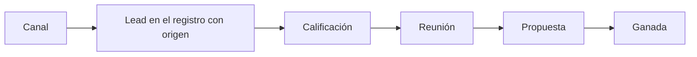

# Plan de canales

Organización: ___  Fecha: ___  Versión: borrador 1

Máximo tres canales para empezar. Cada canal se justifica con el comportamiento del ICP y se prueba antes de escalar.

## 1. Origen real de los clientes (línea base)

| Origen | Leads | Clientes ganados | Calidad del dato (contada, estimada, no medido) |
|---|---|---|---|
| | | | |

## 2. Canales candidatos y decisión (`CAN-nn`)

| ID | Canal | ¿Mi ICP busca o pregunta aquí? (evidencia) | Papel (generar, convertir, retener) | Decisión (priorizar, probar en pequeño, pausar) | Motivo |
|---|---|---|---|---|---|
| CAN-01 | | | | | |

## 3. Detalle de los canales priorizados

| Canal | Responsable | Volumen sostenible por semana | Presupuesto | Cómo llega el lead al registro (`CAM-04`) | Indicador de éxito |
|---|---|---|---|---|---|
| | | | | | |

Capacidad total: ___ horas por semana de ___ personas; presupuesto: ___ al mes.

## 4. Embudo por canal

Equivalente en tabla:

| Paso | Qué se mide (por canal) | KPI |
|---|---|---|
| Lead | Leads por canal | `KPI-01` |
| Calificación | Leads que cumplen el ICP | `KPI-02` |
| Reunión | Lead a oportunidad | `KPI-04` |
| Propuesta y ganada | Oportunidad a venta | `KPI-05` |
| Esfuerzo | Costo por oportunidad | `KPI-11` |

## 5. Meta de demanda (hipótesis)

Cálculo: ___ (qué meta de clientes, qué conversión actual y cuántos leads se necesitan). Es un **Supuesto** hasta medir.

## 6. Riesgos y pendientes por validar

| ID | Riesgo | Impacto | Mitigación |
|---|---|---|---|
| RIE-__ | | | |
