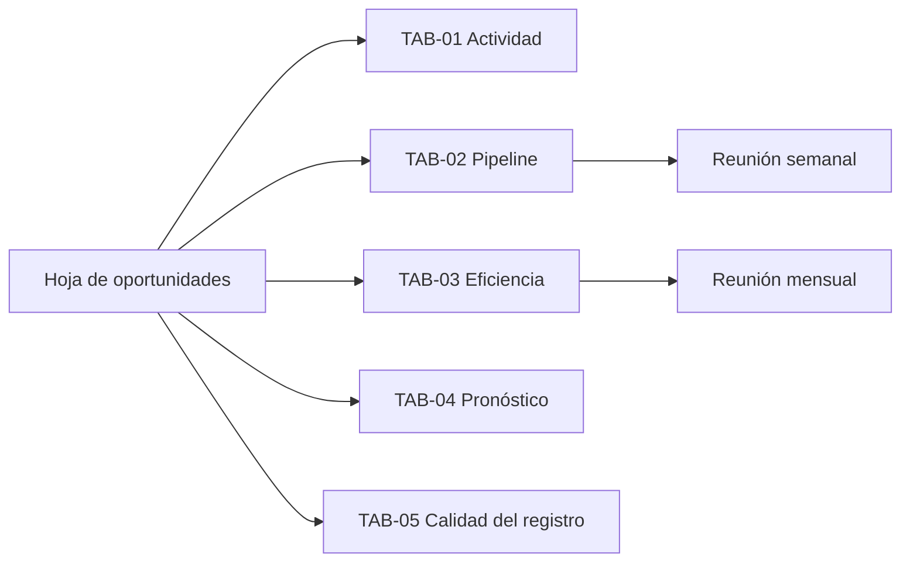

# Tablero comercial

Organización: ___  Fecha: ___  Versión: borrador 1

Un tablero existe para contestar una pregunta en una reunión. Si nadie lo mira, se elimina.

## 1. Tableros (`TAB-nn`)

| ID | Tablero | Pregunta que responde | Datos (`CAM-nn`) y KPIs | Frecuencia | Quién lo usa y dónde |
|---|---|---|---|---|---|
| TAB-01 | Actividad | ¿Qué se hizo esta semana y qué vence? | `CAM-08`, `CAM-09`, `CAM-10`; `KPI-08` | Semanal | Equipo, reunión semanal |
| TAB-02 | Pipeline | ¿Cuántas oportunidades hay por etapa, cuánto valen y cuáles están estancadas? | `CAM-06`, `CAM-11`, `CAM-08`; `KPI-07` | Semanal | Responsable comercial, reunión semanal |
| TAB-03 | Eficiencia | ¿Cuánto convierte y en cuántos días? ¿Cuánto cuesta una oportunidad por canal? | `CAM-14` a `CAM-16`; `KPI-04`, `KPI-05`, `KPI-06`, `KPI-11` | Mensual | Dirección, reunión mensual |
| TAB-04 | Pronóstico | ¿Cuánto esperamos cerrar el mes y el trimestre, y con qué supuestos? | `CAM-06`, `CAM-11`, `CAM-12`; `KPI-10` | Mensual | Dirección, reunión mensual |
| TAB-05 | Calidad del registro | ¿Se puede confiar en los datos? | `HIG-nn`; `KPI-12` | Semanal | Dueño de la calidad |

## 2. Diseño de cada tablero

| ID | Indicador | Fórmula (de la línea base de KPIs) | Umbral o meta | Color si se incumple |
|---|---|---|---|---|
| TAB-__ | | | | |

Colores: verde (dentro de la meta), amarillo (cerca), rojo (fuera). Mostrar siempre el denominador, no solo el porcentaje.

## 3. Flujo de datos

| Origen | Tablero | Se lee en |
|---|---|---|
| Hoja de oportunidades | TAB-01 Actividad y TAB-02 Pipeline | Reunión semanal |
| Hoja de oportunidades | TAB-03 Eficiencia y TAB-04 Pronóstico | Reunión mensual |
| Hoja de oportunidades | TAB-05 Calidad del registro | Revisión semanal de higiene |

## 4. Límites

- Los KPIs sin dato se muestran "No medido", nunca con cero.
- Una muestra pequeña se anota ("n = ___"): no se sacan conclusiones con pocas oportunidades.
- Los porcentajes de la línea base se comparan con la misma definición de oportunidad.
