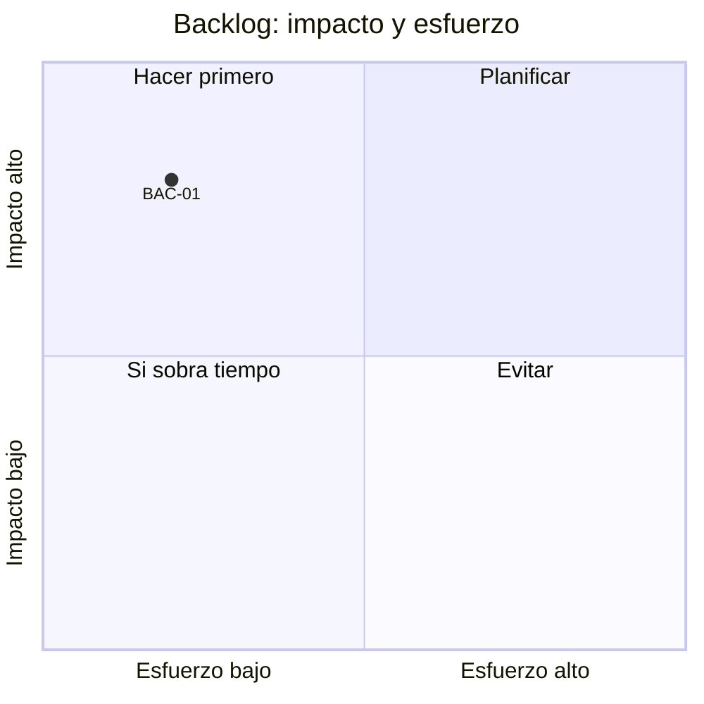

# Backlog priorizado

Organización: ___  Fecha: ___  Versión: borrador 1

## 1. Problemas prioritarios (de dos a cuatro)

| ID | Problema | Evidencia (`HAL-nn`) | Hipótesis de causa (**Supuesto**) | Cómo se verifica |
|---|---|---|---|---|
| PRO-01 | | | | |

## 2. Metas medibles

| ID | Meta (línea base → meta, plazo) | Problema que ataca | Indicador (`KPI-nn`) |
|---|---|---|---|
| OBJ-01 | | PRO-__ | |

## 3. Acciones priorizadas

Impacto y esfuerzo en Alto, Medio o Bajo. Orden sugerido: primero impacto alto con esfuerzo bajo.

| ID | Acción | Etapa de la metodología | Problema | Impacto | Esfuerzo | Responsable | Fecha objetivo | Estado |
|---|---|---|---|---|---|---|---|---|
| BAC-01 | | | PRO-__ | | | | | Pendiente |

## 4. Mapa impacto × esfuerzo (Mermaid con tabla equivalente)

Equivalente en tabla: la sección 3 (impacto y esfuerzo de cada `BAC-nn`; "Hacer primero" es impacto alto con esfuerzo bajo).

## 5. Riesgos y dependencias

| ID | Riesgo | Impacto | Mitigación |
|---|---|---|---|
| RIE-01 | | | |

## 6. Acuerdo

Decisión (`DEC-nn`): ___  Quién decide: ___  Fecha: ___  Datos pendientes: ___
