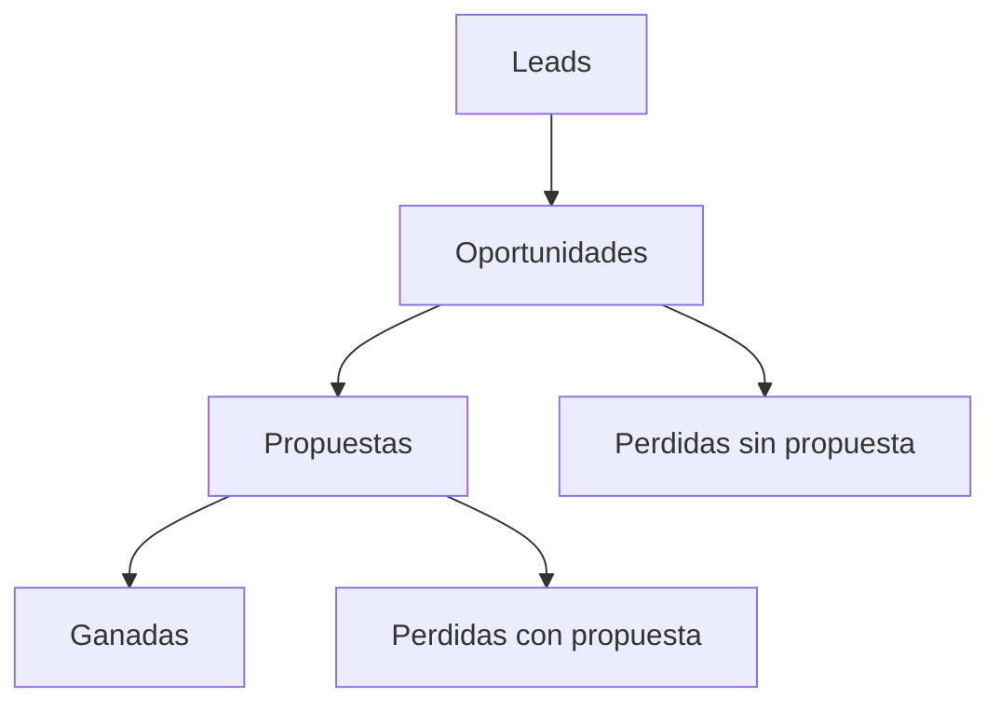

# Embudo actual

Organización: ___  Periodo: ___ a ___  Versión: borrador 1

Definiciones (escríbelas antes de contar): lead = ___; oportunidad = ___; propuesta = ___; ganada = ___.

## 1. Conteos y tasas

| Etapa | Cantidad | Tasa de paso (cantidad / etapa anterior) | Tiempo mediano en la etapa (días) | Calidad del dato (contada, estimada, desconocida) |
|---|---|---|---|---|
| Leads | | n/a | | |
| Oportunidades | | | | |
| Propuestas | | | | |
| Ganadas | | | | |
| Perdidas | | | | |
| Abiertas hoy (dentro de las oportunidades) | | n/a (no entran en las tasas de cierre) | | |

Oportunidades cerradas = ganadas + perdidas = ___; tasa de cierre de oportunidades = ganadas / cerradas = ___ %. Lead a venta = ganadas / leads = ___ %. Ciclo = días entre la reunión (o calificación) y el cierre, con la misma definición en todo el periodo.

## 2. Origen de los leads

| Canal | Leads | % del total | Ganadas | % de ganadas |
|---|---|---|---|---|
| | | | | |

## 3. Motivos de pérdida (según lo que dijo el cliente)

| Motivo | Cantidad | Evidencia |
|---|---|---|
| | | |

## 4. Embudo (Mermaid con tabla equivalente)

Equivalente en tabla: la sección 1 (cada etapa pasa a la siguiente con la tasa indicada; las perdidas salen de oportunidades y propuestas).

## 5. Datos faltantes

| Dato | Quién lo consigue | Para cuándo |
|---|---|---|
| | | |
