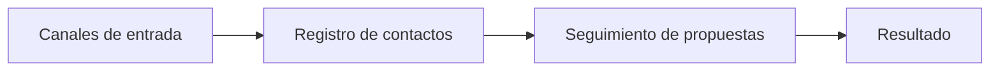

# Inventario de herramientas y canales

Organización: ___  Fecha: ___  Versión: borrador 1

Describe qué se hace hoy, no qué se debería usar. No se recomienda ni se evalúa ningún producto en esta etapa.

## 1. Inventario

| ID | Canal o herramienta | Para qué se usa | Quién la usa | Qué dato guarda | ¿Se actualiza? (siempre, a veces, nunca) | Procedencia |
|---|---|---|---|---|---|---|
| HER-01 | | | | | | Dicho por participante / Evidencia |

## 2. Por dónde llegan las oportunidades

| Canal | Cómo llega el lead | Dónde queda anotado | Evidencia (`HAL-nn`) |
|---|---|---|---|
| | | | |

## 3. Lectura

- ¿Hay un solo lugar donde ver el estado de cada oportunidad? (sí / no): ___
- Datos que viven solo en la memoria de una persona (riesgo → impacto → mitigación): ___

## 4. Mapa (Mermaid con tabla equivalente)

Equivalente en tabla: la sección 2 (canal, dónde queda anotado) y la sección 1 (qué herramienta guarda cada dato).

## 5. Pendientes por validar

- ___
