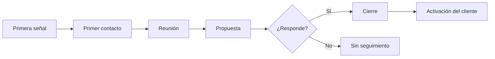

# Mapa as-is del proceso comercial

Organización: ___  Fecha: ___  Venta reconstruida: ___ (`OPO-nn`)  Versión: borrador 1

Se reconstruye de la primera señal a la activación del cliente, tal como ocurrió, no como debería. Una fila por paso.

## 1. Pasos actuales

| Paso | Qué ocurre | Quién | Dónde queda registrado | Tiempo típico | Fricción (espera, repetición, pérdida de información) | Procedencia |
|---|---|---|---|---|---|---|
| 1 | | | | | | Dicho por participante / Evidencia |
| 2 | | | | | | |

## 2. Diagrama (Mermaid con tabla equivalente)

Equivalente en tabla: ver la sección 1; cada fila es un nodo y el orden de los pasos es el sentido de las flechas. Las ramas (por ejemplo "No responde") se anotan en la columna de fricción.

## 3. Puntos de fricción

| ID | Dónde | Qué pasa | Evidencia (`HAL-nn`) | Efecto probable |
|---|---|---|---|---|
| PRO-__ | | | | |

## 4. Traspasos

Cada vez que el trabajo cambia de manos (marketing a ventas, ventas a servicio) anota qué información se pierde: ___

## 5. Pendientes por validar

- ___
