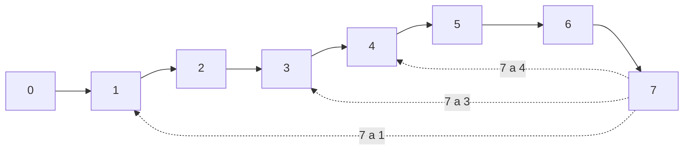

# Diagnóstico de modalidad y etapa

Organización: ___  Fecha: ___  Facilitador: ___  Versión: borrador 1

## 1. Modalidad

| Modalidad | Señales de que estás aquí | Señales de que todavía no | Por dónde se entra |
|---|---|---|---|
| A. Estructurar las ventas de un negocio existente | Ya vende, pero irregular, dependiente de personas o sin números por etapa | No hay clientes que hayan pagado | `diagnostico-comercial` |
| B. Validar y lanzar una oferta nueva | Idea o producto nuevo, casi sin clientes que hayan pagado | Ya hay ventas repetidas y se quiere ordenarlas | Innovación Destilada (`identificar-reto`, `investigar-y-empatizar`, `facilitar-ideacion`, `disenar-prototipo`, `validar-supuestos-y-mvp`, `probar-y-aprender`) y luego `segmentacion-e-icp` |
| C. Colectivo o sector | Se coordina a varios negocios que venden por separado | Es un solo negocio con un solo equipo | `diagnostico-comercial` en versión ligera por miembro más vista agregada |

Modalidad diagnosticada: ___  Evidencia (**Hecho**): ___

## 2. Etapa (primera con criterio de salida sin cumplir)

| Etapa | Criterio de salida | ¿Se cumple con evidencia? (sí / no / parcial) | Evidencia o vacío |
|---|---|---|---|
| 0 Diagnóstico | Problemas prioritarios, metas medibles y línea base acordados | | |
| 1 Segmentación e ICP | Se sabe a quién vender, qué problema resuelve y quién participa en la compra | | |
| 2 Oferta y propuesta de valor | Cada segmento prioritario tiene oferta, mensaje y razón de compra verificables | | |
| 3 Proceso y pipeline | Una persona nueva puede explicar cómo se vende y qué cuenta como avance real | | |
| 4 CRM y tableros | Las oportunidades reales están registradas con responsable, etapa y próximo paso | | |
| 5 Kit comercial | El equipo usa mensajes, herramientas y etapas en situaciones reales | | |
| 6 Canales y demanda | Hay un mecanismo repetible para generar oportunidades, con responsable y datos | | |
| 7 Gobierno y forecast | El equipo gestiona sus ventas sin depender del consultor para cada decisión | | |

Las etapas 4 a 7 están en estado Próximamente: si la etapa diagnosticada es una de ellas, dilo con claridad y avanza conversando con borradores marcados como tales.

## 3. Resultado

- Modalidad y etapa diagnosticadas: ___
- Evidencia que lo respalda (**Hecho**): ___
- Lo que asumo (**Supuesto**): ___
- Incertidumbre principal: ___
- Ciclos de retroalimentación abiertos (7 a 1, 7 a 3, 7 a 4), si aplica: ___
- Siguiente skill y por qué (**Recomendación**): ___

## 4. Resumen de apertura (máximo 5 puntos)

1. ___
2. ___
3. ___
4. ___
5. ___

## 5. Diagrama de etapas (con tabla equivalente)

| Ciclo | Significado | Etapa que se reabre |
|---|---|---|
| 7 a 1 | Aprendizaje de mercado | 1 Segmentación e ICP |
| 7 a 3 | Fricción de proceso | 3 Proceso y pipeline |
| 7 a 4 | Mejoras de herramientas | 4 CRM y tableros |
