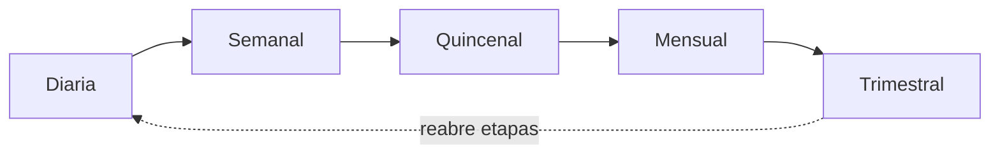

# Agenda de la reunión semanal

Organización: ___  Día y hora: ___  Duración: ___ min  Conduce: ___  Suplente: ___  Versión: borrador 1

Regla: el registro se actualiza antes de la reunión. Una reunión sin decisión no cuenta como reunión.

## 1. Rituales del equipo

| Frecuencia | Reunión o actividad | Decisión a tomar | Responsable | Duración |
|---|---|---|---|---|
| Diaria o por jornada | Actualización breve del registro y siguientes acciones | Qué oportunidad atender, a quién y cuándo | | |
| Semanal | Revisión de pipeline, actividad, leads, etapas y bloqueos | Qué destrabar, qué canal ajustar y quién responde | | |
| Quincenal | Coaching y revisión de llamadas, propuestas y objeciones | Qué conducta entrenar o qué mensaje corregir | | |
| Mensual | Forecast, rentabilidad de canales y experimento de mejora | Dónde invertir, qué dejar de hacer y qué estandarizar | | |
| Trimestral | Revisión de segmentos, posicionamiento y capacidad | Qué estrategia adaptar para seguir creciendo | | |

Equivalente en tabla: el orden de la tabla anterior; el trimestral puede reabrir etapas.

## 2. Agenda semanal con tiempos

| Bloque | Tiempo | Datos que se miran | Pregunta | Salida |
|---|---|---|---|---|
| Resultados de la semana | | Cerradas, perdidas y leads nuevos | ¿Qué pasó? | |
| Pipeline | | Estancadas, vencidos y oportunidades por etapa (`TAB-02`) | ¿Qué se destraba y quién lo hace? | |
| Demanda | | Leads por canal y experimentos | ¿Qué canal se ajusta? | |
| Bloqueos | | Lo que impide avanzar | ¿Quién ayuda? | |
| Compromisos | | Acuerdos de la reunión | ¿Quién hace qué y para cuándo? | |

## 3. Acta de la reunión

| Fecha | Asistentes | Decisiones (`DEC-nn`) | Compromisos (quién, qué, cuándo) | Pendiente por validar |
|---|---|---|---|---|
| | | | | |

## 4. Reglas

1. Se empieza y se termina a tiempo.
2. Se habla de las oportunidades por orden de riesgo, no por orden de la hoja.
3. Toda oportunidad con siguiente paso vencido o estancada recibe una acción con responsable.
4. Lo que se decide queda en el acta con responsable y fecha.
5. Si falta quien conduce, la suplente conduce.

## 5. Revisión de la propia reunión (mensual)

¿Se tomaron decisiones? ¿Se cumplieron los compromisos? ¿Hay un bloque que sobra o falta?: ___
