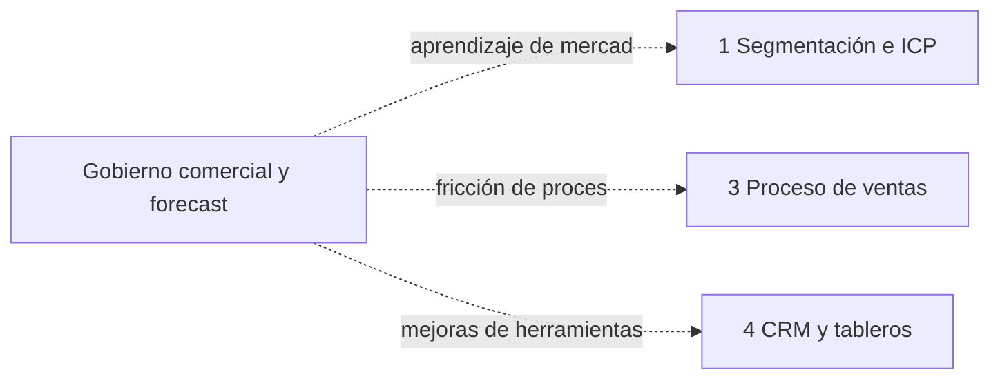

# Backlog de mejoras

Organización: ___  Revisado el: ___  Versión: borrador 1  Dueño del backlog: ___

Cada mejora trae su evidencia y la etapa que reabre. Se revisa en la reunión mensual.

## 1. Ciclos de retroalimentación

| Ciclo | Qué lo dispara | Etapa que se reabre | Skill |
|---|---|---|---|
| 7 a 1 | Aprendizaje de mercado | 1 Segmentación e ICP | `segmentacion-e-icp` |
| 7 a 3 | Fricción de proceso | 3 Proceso de ventas y pipeline | `proceso-de-ventas-y-pipeline` |
| 7 a 4 | Mejoras de herramientas | 4 CRM y tableros | `crm-y-tableros` |

Equivalente en tabla: la de esta sección.

## 2. Backlog (`BAC-nn`)

| ID | Mejora | Evidencia (dato o patrón) | Ciclo (7 a 1, 7 a 3, 7 a 4 u Operación) | Impacto | Esfuerzo | Responsable | Fecha objetivo | Estado |
|---|---|---|---|---|---|---|---|---|
| BAC-__ | | | | | | | | |

## 3. Reglas de prioridad

- Primero lo que tiene evidencia repetida y se resuelve con bajo esfuerzo.
- Máximo ___ mejoras en curso al mismo tiempo.
- Una mejora descartada se anota con el motivo.

## 4. Aprendizajes del periodo

| Aprendizaje | Evidencia | Qué cambia |
|---|---|---|
| | | |
