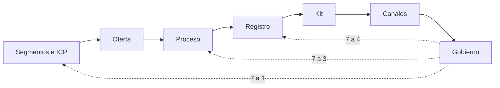

# Manual del sistema comercial

Organización: ___  Versión: ___  Dueño del manual: ___  Suplente: ___  Última revisión: ___  Próxima revisión: ___

Este manual permite que el equipo mantenga y mejore su sistema de ventas sin el consultor.

## 1. Mapa del sistema

| Pieza | Qué contiene | Documento y versión | Dueño | Suplente | Frecuencia de revisión |
|---|---|---|---|---|---|
| ICP y segmentos | A quién vendemos y a quién no | | | | |
| Oferta y argumentario | Qué ofrecemos y por qué | | | | |
| Proceso y pipeline | Etapas, reglas de entrada y calificación | | | | |
| Registro y tableros | Campos, diccionario, automatizaciones y tableros | | | | |
| Kit comercial | Playbook, guiones, cadencias y objeciones | | | | |
| Canales y experimentos | Plan, calendario, atribución y reporte | | | | |
| Rituales y KPIs | Reuniones, tablero y fórmulas | | | | |
| Forecast | Método, supuestos y seguimiento del error | | | | |
| Backlog | Mejoras y ciclos de retroalimentación | | | | |

Equivalente en tabla: las nueve piezas de la tabla anterior en orden de etapa; los ciclos 7 a 1, 7 a 3 y 7 a 4 vuelven desde el gobierno a segmentos, proceso y registro.

## 2. Cómo vendemos (resumen)

ICP: ___. Oferta: ___. Etapas: ___. Calificación: ___. Reglas fijas: ___

## 3. Rutina

| Frecuencia | Qué se hace | Quién conduce | Dónde queda el acta |
|---|---|---|---|
| Diaria | | | |
| Semanal | | | |
| Quincenal | | | |
| Mensual | | | |
| Trimestral | | | |

## 4. Los KPIs que mandan

Los de `references/kpis.md` que el equipo mira, con su fórmula y su meta: ___

## 5. Calendario de mantenimiento

| Cuándo | Qué se actualiza | Quién |
|---|---|---|
| Cada semana | Registro y reunión semanal | |
| Cada mes | Forecast, backlog, objeciones y calidad del registro | |
| Cada trimestre | Segmentos, oferta, canales y este manual | |
| Cuando cambia una definición | Este manual y la línea base | |

## 6. Cómo reabrir una etapa

Qué evidencia hace falta, quién decide y cómo se registra: ___ (ciclos 7 a 1, 7 a 3 y 7 a 4).

## 7. Primera semana de una persona nueva

| Día | Qué hace | Con quién |
|---|---|---|
| 1 | Leer el manual y el playbook | |
| 2 a 3 | Escuchar o ver conversaciones reales con permiso | |
| 4 | Ensayar guiones | |
| 5 | Registrar una oportunidad y explicar las etapas con sus palabras | |

## 8. Prueba de transferencia

| Prueba | Fecha | Quién la condujo | Resultado | Ajuste al manual |
|---|---|---|---|---|
| Reunión semanal conducida sin el consultor (tres veces) | | | | |
| Reunión mensual conducida sin el consultor | | | | |
| Persona nueva usa el manual | | | | |

## 9. Límites y pendientes por validar

- ___
