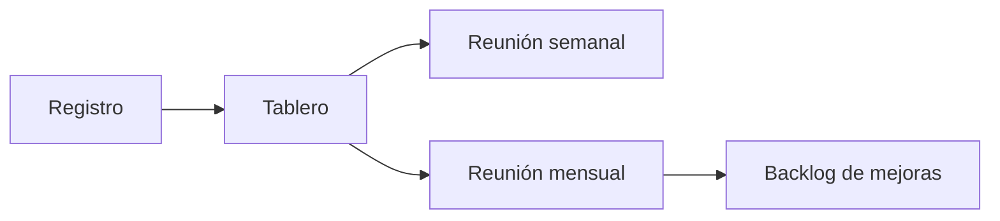

# Tablero gerencial

Organización: ___  Periodo: ___ a ___  Versión: borrador 1

Los KPIs vienen de `references/kpis.md`. Un indicador sin dato se muestra "No medido".

## 1. KPIs elegidos para este tablero

| ID | KPI | Fórmula (de `references/kpis.md`) | Línea base | Valor actual (numerador / denominador) | Meta y plazo (`OBJ-nn`) | Color | Calidad del dato | Ritual de lectura |
|---|---|---|---|---|---|---|---|---|
| KPI-__ | | | | | | | | |

Colores: verde (dentro de la meta), amarillo (cerca), rojo (fuera). Los umbrales se escriben antes de leer el dato.

## 2. Definiciones que cambiaron

| Definición | Antes | Ahora | Cómo se mantiene la comparabilidad (`DEC-nn`) |
|---|---|---|---|
| | | | |

## 3. Lectura

- Qué mejoró (con denominador): ___
- Qué empeoró o no se movió: ___
- Muestra pequeña ("n = ___"): ___
- Qué no se puede concluir todavía: ___

## 4. Decisiones del periodo

| Decisión (`DEC-nn`) | KPI que la motiva | Responsable | Fecha |
|---|---|---|---|
| | | | |

## 5. Flujo de lectura

Equivalente en tabla:

| Origen | Se lee en | Qué produce |
|---|---|---|
| Registro | Tablero | Indicadores con denominador |
| Tablero | Reunión semanal y mensual | Decisiones |
| Reunión mensual | Backlog de mejoras | Mejoras con responsable y fecha |
