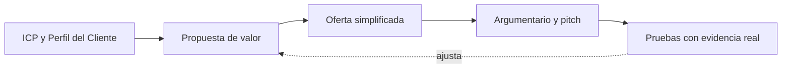

# Matriz propuesta-ICP

Organización: ___  Fecha: ___  Versión: borrador 1
Perfil del Cliente usado: de la skill `sintetizar-y-redefinir-reto` / versión mínima (**Supuesto**)

## 1. Propuesta por segmento

| ID | ICP | Problema (en palabras del cliente) | Resultado concreto | Diferenciador | Prueba hoy | Estado de la prueba (Hecho / Supuesto / Pendiente por validar) |
|---|---|---|---|---|---|---|
| PRP-01 | ICP-__ | | | | | |

## 2. Contraste con el Perfil del Cliente (Mapa de Valor de `disenar-prototipo`)

| Tarea, dolor o beneficio del cliente (orden de importancia) | Aliviador o creador en la oferta | Cubierto / Parcial / No cubierto |
|---|---|---|
| | | |

## 3. Evidencia de validación y plan de pruebas

Usa el Tablero de Validación de `probar-y-aprender`. La métrica se escribe antes de la prueba.

| Prueba (`PRU-nn`) | Supuesto (`SUP-nn`) | Experimento (conversaciones, propuestas reales, piloto, pre-venta) | Muestra | Métrica de éxito (número y umbral) | Resultado | Decisión (`DEC-nn`) |
|---|---|---|---|---|---|---|
| PRU-01 | SUP-01 | | | | | |

## 4. Relación (Mermaid con tabla equivalente)

Equivalente en tabla: ICP y Perfil alimentan la propuesta (`PRP`), que se concreta en la oferta (`OFE`), se cuenta en el argumentario y se prueba; los resultados ajustan la propuesta.

## 5. Pendientes por validar

- ___
