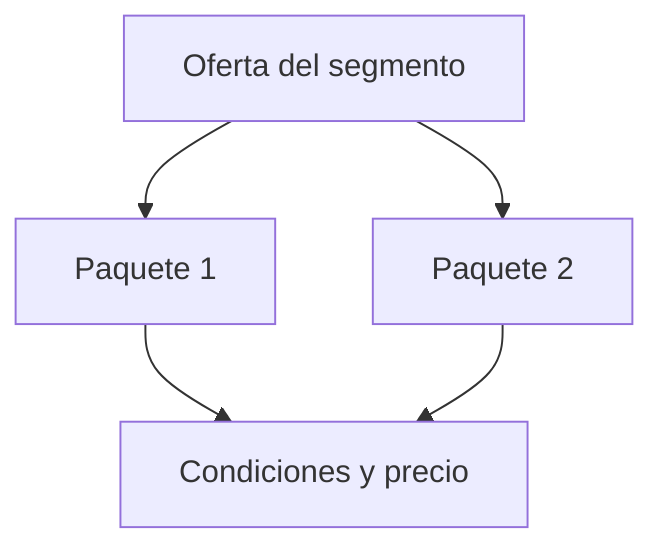

# Oferta simplificada

Organización: ___  Fecha: ___  ICP: ICP-__  Versión: borrador 1

Máximo tres paquetes por segmento. Cada uno se explica en dos frases a alguien ajeno al negocio.

## 1. Paquetes

| ID | Paquete | Para quién (`ICP-nn`) | Qué incluye (alcance) | Qué no incluye | Condiciones (plazos, mínimos, permanencia) | Lógica de precio | Procedencia del precio |
|---|---|---|---|---|---|---|---|
| OFE-01 | | | | | | | Contrastado con propuestas reales / Supuesto |

## 2. Compromisos medibles de servicio

| Compromiso | Cómo se mide | Quién responde | Qué pasa si no se cumple |
|---|---|---|---|
| | | | |

Solo compromisos que el negocio controla y puede cumplir. Sin garantías de resultados que dependen del cliente o del mercado.

## 3. Riesgos de la oferta

| ID | Riesgo | Impacto | Mitigación |
|---|---|---|---|
| RIE-__ | | | |

## 4. Cómo se ve (Mermaid con tabla equivalente)

Equivalente en tabla: la sección 1 (una fila por paquete con alcance, condiciones y precio).

## 5. Pendientes por validar

- ___
