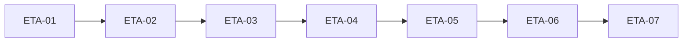

# Definiciones por etapa

Organización: ___  Fecha: ___  Versión: borrador 1

Una oportunidad está en una sola etapa. La regla de entrada se puede verificar con un dato anotado. Umbral de estancamiento: ___ días sin avance.

## 1. Definiciones de términos

| Término | Definición (en una frase, verificable) |
|---|---|
| Lead | |
| Oportunidad calificada | |
| Propuesta | |
| Ganada | |
| Perdida | |

## 2. Etapas

| ID | Etapa | Regla de entrada | Dato obligatorio | Salida (qué la hace avanzar o salir) | Responsable | Tiempo máximo en la etapa |
|---|---|---|---|---|---|---|
| ETA-01 | Lead identificado | | | | | |
| ETA-02 | Primer contacto | | | | | |
| ETA-03 | Oportunidad calificada | | | | | |
| ETA-04 | Descubrimiento y solución | | | | | |
| ETA-05 | Propuesta presentada | | | | | |
| ETA-06 | Negociación y decisión | | | | | |
| ETA-07 | Ganado o perdido | | | | | |

Si el negocio usa menos etapas (ciclo corto) o más (venta consultiva), se ajusta la tabla: cada etapa debe cambiar lo que se hace o lo que se mide.

## 3. Reglas transversales

- Siguiente acción con fecha obligatoria en toda oportunidad abierta.
- Motivo de pérdida obligatorio, con la frase del cliente o "sin respuesta".
- Retroceso permitido con motivo anotado.
- Quién puede mover una oportunidad de etapa: ___

## 4. Pipeline (Mermaid con tabla equivalente)

Equivalente en tabla: la sección 2 (cada fila es una etapa; el orden es el de las flechas).

## 5. Prueba con casos reales

| Oportunidad (`OPO-nn`) | Resultado conocido (ganada, perdida, abierta) | Etapa en la que cae | ¿Cae en una sola etapa? | Ajuste necesario |
|---|---|---|---|---|
| OPO-01 | | | | |
| OPO-02 | | | | |
| OPO-03 | | | | |

## 6. Pendientes por validar

- ___
