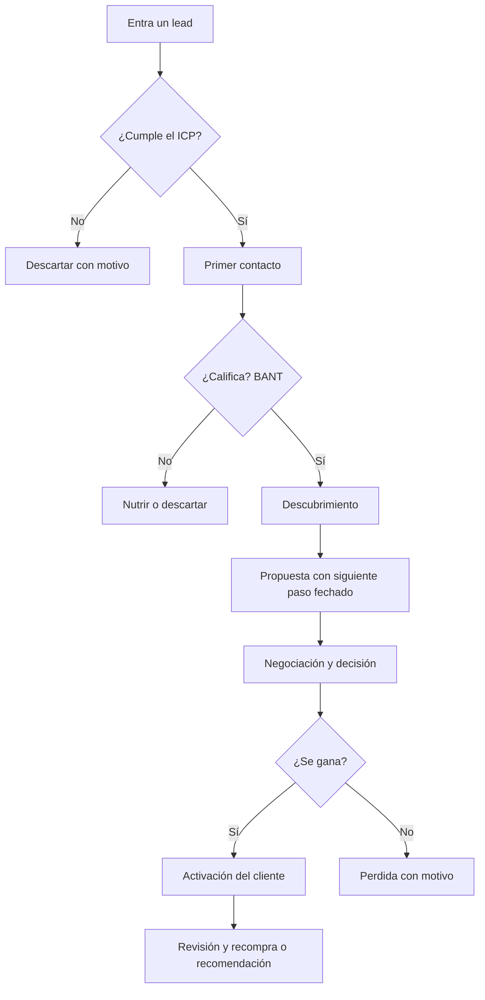

# Proceso de ventas to-be

Organización: ___  Fecha: ___  ICP: ICP-__  Versión: borrador 1

Del primer contacto a la activación y la recompra. Cada paso con responsable y registro.

## 1. Pasos del proceso futuro

| Paso | Qué ocurre | Quién | Qué se registra | Tiempo máximo | Etapa (`ETA-nn`) |
|---|---|---|---|---|---|
| 1 | | | | | ETA-__ |

## 2. Diagrama (Mermaid con tabla equivalente)

Equivalente en tabla:

| Decisión | Si sí | Si no |
|---|---|---|
| ¿Cumple el ICP? | Primer contacto | Descartar con motivo |
| ¿Califica (BANT)? | Descubrimiento | Nutrir o descartar |
| ¿Se gana? | Activación del cliente, luego revisión y recompra | Perdida con motivo registrado |

## 3. Traspasos

| De | A | Qué información debe viajar | Cuándo |
|---|---|---|---|
| Quien capta | Quien vende | | |
| Quien vende | Quien atiende al cliente | | |

## 4. Diferencias con el as-is

| Qué cambia | Antes | Ahora | Problema que ataca (`PRO-nn`) |
|---|---|---|---|
| | | | |

## 5. Pendientes por validar

- ___
