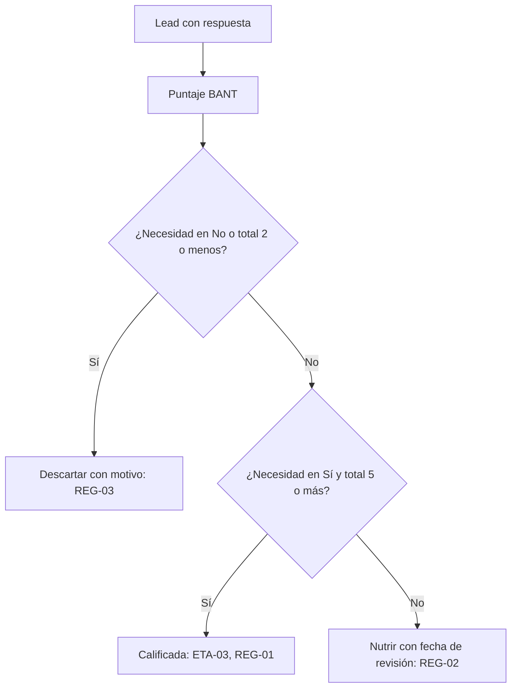

# Reglas de calificación

Organización: ___  Fecha: ___  ICP: ICP-__  Versión: borrador 1

Base: BANT simplificado (Budget, Authority, Need, Timing; junto con MEDDICC, un marco de calificación de ventas muy usado y de uso general, no una invención de esta metodología). Para ventas complejas B2B (varios decisores, ciclo largo, ticket alto) se suman las preguntas MEDDICC como notas opcionales.

## 1. BANT simplificado

Sí = 2, Parcial = 1, No = 0.

| Criterio | Pregunta | Qué cuenta como Sí | Qué cuenta como Parcial | Qué cuenta como No |
|---|---|---|---|---|
| Presupuesto | | | | |
| Autoridad | | | | |
| Necesidad | | | | |
| Tiempo | | | | |

## 2. Regla de decisión (`REG-nn`)

| ID | Resultado | Condición | Siguiente acción |
|---|---|---|---|
| REG-01 | Calificada: pasa a ETA-03 | | |
| REG-02 | Nutrir (total de 3 o 4, o Necesidad en Parcial con total de 5 o más, hasta aclarar la necesidad) | | |
| REG-03 | Descartar (Necesidad en No o total de 2 o menos) | | |

Las tres reglas cubren todos los casos: Necesidad en No o total de 2 o menos descarta; con total de 3 o 4 se nutre; con total de 5 o más, Necesidad en Sí califica y Necesidad en Parcial se nutre.

Los umbrales son una guía: se ajustan con los resultados y el cambio se registra como decisión (`DEC-nn`).

## 3. Preguntas MEDDICC opcionales

| Letra | Qué se averigua | Pregunta | Respuesta (notas de la oportunidad) |
|---|---|---|---|
| Métricas | Qué resultado medirán | | |
| Comprador económico | Quién controla el presupuesto | | |
| Criterios de decisión | Con qué comparan | | |
| Proceso de decisión | Pasos y fechas | | |
| Identificación del dolor | Qué cuesta no resolverlo | | |
| Campeón | Quién impulsa dentro de la cuenta | | |
| Competencia | Qué alternativas evalúan, incluida no hacer nada | | |

## 4. Diagrama de decisión (Mermaid con tabla equivalente)

Equivalente en tabla:

| Condición (se evalúa en este orden) | Resultado |
|---|---|
| Necesidad en No, o total de 2 o menos | Descartar (`REG-03`) |
| Necesidad en Sí y total de 5 o más | Calificada, pasa a ETA-03 (`REG-01`) |
| Cualquier otro caso (total de 3 o 4, o Necesidad en Parcial con total de 5 o más) | Nutrir (`REG-02`) |

## 5. Revisión de la regla

Cada mes: ¿las oportunidades calificadas se ganan más que las no calificadas? Si no, la regla no discrimina y se ajusta.

| Mes | Calificadas ganadas / calificadas | No calificadas ganadas / no calificadas | Ajuste |
|---|---|---|---|
| | | | |
