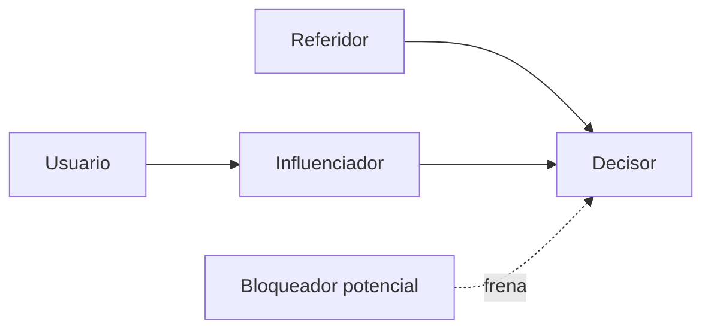

# Mapa de actores de compra

Organización: ___  Fecha: ___  ICP: ICP-__  Versión: borrador 1

Basado en la última venta ganada y la última perdida de este perfil (`OPO-nn`).

## 1. Actores

| ID | Rol en la compra (decisor, pagador, usuario, influenciador, bloqueador, referidor) | Cargo típico | Qué le importa | Qué teme | Cómo se le habla | Procedencia |
|---|---|---|---|---|---|---|
| ACT-01 | | | | | | Evidencia / Supuesto |

Un mismo cargo puede tener varios roles, y un rol puede estar en varias personas.

## 2. Relaciones (Mermaid con tabla equivalente)

Equivalente en tabla: quién influye en quién.

| Actor | Influye en | Efecto |
|---|---|---|
| ACT-__ | ACT-__ | Recomienda / opina / puede frenar |

## 3. Qué cambia en cómo vendemos

| Actor | Qué necesita ver o escuchar para avanzar | Quién del equipo lo atiende |
|---|---|---|
| ACT-__ | | |

## 4. Pendientes por validar

- ___
