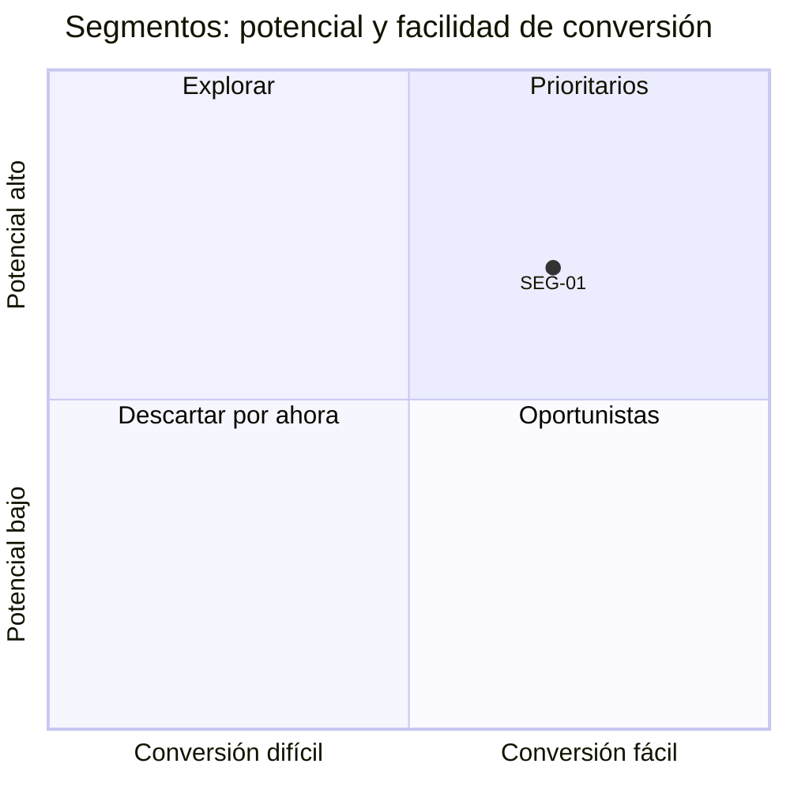

# Matriz de segmentos

Organización: ___  Fecha: ___  Versión: borrador 1
Fuente de los patrones: clientes actuales ganados (`HAL-nn`) y ventas perdidas (`HAL-nn`).

## 1. Segmentos candidatos

| ID | Segmento | Industria | Tamaño | Geografía | Necesidad principal | Capacidad de compra | Canal por el que se llega | Evidencia (`HAL-nn`) |
|---|---|---|---|---|---|---|---|---|
| SEG-01 | | | | | | | | |

## 2. Puntaje (1 a 5, más es mejor)

En **Competencia**, 5 = poca competencia o diferenciación clara.

| ID | Potencial | Acceso | Rentabilidad | Competencia | Facilidad de conversión | Total (máx. 25) | Procedencia del puntaje | Nota (obligatoria si hay 1 o 5) |
|---|---|---|---|---|---|---|---|---|
| SEG-01 | | | | | | | Propuesta de la IA / Acordado por el equipo | |

## 3. Decisión de foco

| ID | Decisión (prioritario, explorar después, descartado por ahora) | Motivo | Qué haría cambiar la decisión |
|---|---|---|---|
| SEG-01 | | | |

Decisión (`DEC-nn`): ___  Quién decide: ___  Fecha: ___

## 4. Mapa (Mermaid con tabla equivalente)

Equivalente en tabla: la sección 2 (potencial en el eje vertical, facilidad de conversión en el horizontal; coordenada = (puntaje − 1) / 4).

## 5. Supuestos y pendientes por validar

| ID | Supuesto | Cómo se verifica |
|---|---|---|
| SUP-__ | | Pendiente por validar |
