# Automatización con IA

Plugin de Distilled Innovation que te acompaña, con un facilitador de IA y paso a paso, a decidir **qué procesos conviene automatizar, cuáles asistir con IA y cuáles dejar como están**, y a diseñar el flujo de trabajo futuro con control humano.

## Qué es la metodología

Automatización con IA es una guía de referencia (no una camisa de fuerza) para pasar de "queremos usar IA" a un flujo de trabajo bien pensado, probado y listo para llevar a operación. Su idea central: **la función del facilitador no es convencerte de usar IA, es diseñar la mejor solución para el problema**, aunque la conclusión sea no automatizar, simplificar primero, usar reglas tradicionales, usar IA solo en algunos pasos, mantener el control humano o posponer hasta resolver problemas de datos o de proceso.

Se organiza en cuatro etapas: **A** descubrir y priorizar, **B** diseñar y validar, **C** implementar y transferir, **D** medir y mejorar. Este plugin cubre A y B; C y D continúan en **Implementación Empresarial**, que recibe la especificación `workflow-contract.yaml` que entrega `plan-piloto-y-especificacion`.

```mermaid
flowchart LR
  A1[descubrir-procesos] --> A2[definir-reto-de-automatizacion] --> A3[priorizar-flujos]
  A3 --> B1[mapear-proceso-actual] --> B2[disenar-proceso-futuro] --> B3[elegir-patron-y-autonomia]
  B3 --> B4[canvas-de-automatizacion]
  B4 --> B5[supuestos-y-riesgos] --> B6[prototipos-y-tarjetas-de-prueba] --> B7[plan-piloto-y-especificacion]
  B7 -.aprendizajes.-> B2
  B7 -.una tarea propia.-> X1[crear-skill-de-flujo]
```

| Orden | Skill | Etapa |
|---|---|---|
| 1 | `descubrir-procesos` | A |
| 2 | `definir-reto-de-automatizacion` | A |
| 3 | `priorizar-flujos` | A |
| 4 | `mapear-proceso-actual` | B |
| 5 | `disenar-proceso-futuro` | B |
| 6 | `elegir-patron-y-autonomia` | B |
| 7 | `canvas-de-automatizacion` | B |
| 8 | `supuestos-y-riesgos` | B |
| 9 | `prototipos-y-tarjetas-de-prueba` | B |
| 10 | `plan-piloto-y-especificacion` | B a C |
| 11 | `crear-skill-de-flujo` | Después del taller |

Las flechas de aprendizaje indican que lo que se descubre en el piloto puede reabrir el diseño del proceso futuro.

## Skills

Escribe la frase de arranque en tu asistente y la skill se activa sola.

| Skill | Para qué sirve | Frase de arranque | Estado |
|---|---|---|---|
| `facilitador-automatizacion-con-ia` | Punto de entrada: ubica tu situación (no sabes qué automatizar, tienes un caso, un prototipo o ya operas) y te manda a la skill correcta | "Quiero usar IA en mi empresa pero no sé en qué procesos" | Disponible |
| `descubrir-procesos` | Entrevista de proceso, fichas de señal e inventario de oportunidades | "Mi equipo se queja de que pierde tiempo, ayúdame a entender dónde" | Disponible |
| `definir-reto-de-automatizacion` | Scoping Canvas de 6 preguntas y recomendación: definir, refinar o dividir | "Quiero definir bien el reto antes de automatizar" | Disponible |
| `priorizar-flujos` | Inventario, mapa Valor × Factibilidad y cinco cubetas | "¿Qué procesos automatizo primero?" | Disponible |
| `mapear-proceso-actual` | Cómo se hace hoy: tabla, diagrama y responsables | "Quiero documentar cómo hacemos este proceso hoy" | Disponible |
| `disenar-proceso-futuro` | Eliminar, simplificar, asistir, automatizar o mantener humano | "Quiero rediseñar este proceso" | Disponible |
| `elegir-patron-y-autonomia` | Patrón de automatización y nivel de autonomía con guardrails | "¿Necesito un agente o me alcanza un flujo fijo?" | Disponible |
| `canvas-de-automatizacion` | Canvas de 12 bloques conversacional | "Arma el canvas de este flujo" | Disponible |
| `supuestos-y-riesgos` | Supuestos falsables y riesgos con mitigación | "¿Qué podría salir mal con esta automatización?" | Disponible |
| `prototipos-y-tarjetas-de-prueba` | Tarjetas de prueba y decisión sobre el prototipo | "¿Cómo pruebo esto sin gastar mucho?" | Disponible |
| `plan-piloto-y-especificacion` | Plan piloto y especificación portable (`workflow-contract.yaml`) | "Quiero un plan piloto para este flujo" | Disponible |
| `crear-skill-de-flujo` | Convierte una tarea repetida y simple en tu propia skill, con aprobaciones y prueba segura | "Quiero convertir esta tarea en una skill" | Disponible |

## Cómo se conecta con los otros plugins

- **Innovación Destilada** (antes): si el reto es difuso o hace falta entender a las personas que viven el proceso, usa `identificar-reto` e `investigar-y-empatizar`. Su reto formulado alimenta a `definir-reto-de-automatizacion`.
- **Implementación Empresarial** (después): recibe la especificación del flujo ya diseñado y lo lleva a una implementación gobernada, con rutas, decisiones y controles claros.

## Para quién es

Para líderes de operaciones, de áreas funcionales, equipos de transformación y consultores que quieren decidir con evidencia qué automatizar, sin comprometerse con una tecnología antes de entender el proceso. No necesitas conocimientos técnicos para las etapas A y B.

## Cómo trabaja el facilitador

- Una pregunta principal por turno.
- Cada dato queda marcado como Hecho, Supuesto, Recomendación o Pendiente por validar, con un ID estable.
- Todo diagrama viene con una tabla equivalente.
- En las etapas A y B no se elige tecnología ni proveedor.
- Puedes escribir en cualquier momento: "Muéstrame el avance", "¿Qué falta?" o "Finalizar".

Contenido bajo licencia CC BY 4.0 (atribución: Distilled Innovation).
