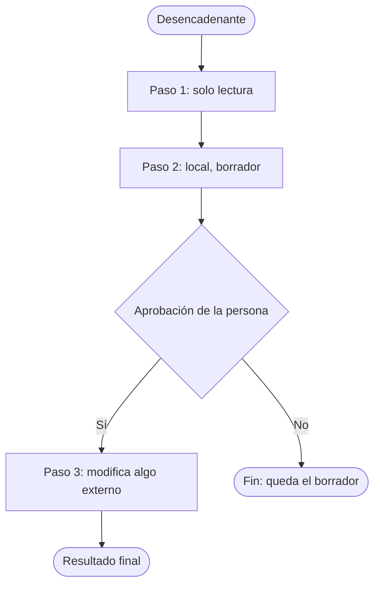

# Checklist de entrevista y diseño

Tarea: ___  Persona: ___  Fecha: ___

Pregunta solo lo que cambie materialmente el flujo. Una pregunta principal por turno; si la tarea es larga, en rondas cortas. Nunca pidas contraseñas, claves ni tokens.

## 1. Los once temas

| # | Tema | Pregunta guía | Qué anotar | Por qué importa |
|---|---|---|---|---|
| 1 | Resultado y desencadenantes | "Cuando termina bien, ¿qué tiene que existir y qué te hace empezar?" | Resultado, qué dispara la tarea, cada cuánto | Define cuándo se activa la skill |
| 2 | Entradas | "¿Con qué empiezas: qué archivo, hoja o mensaje?" | Qué hay al inicio y dónde está (en palabras, sin rutas reales) | Sin entradas claras, la skill no arranca |
| 3 | Pasos en orden | "Cuéntame la última vez, paso por paso" | Secuencia real, no la ideal | El orden es el corazón de la skill |
| 4 | Aplicaciones o servicios | "¿Qué programas, hojas o servicios usas en cada paso?" | Lo que la persona nombra, sin recomendar | Revela dependencias y permisos |
| 5 | Qué decide sola | "¿Qué puede hacer sin preguntarte?" | Decisiones de bajo riesgo y reversibles | Define la autonomía |
| 6 | Qué necesita aprobación | "¿Qué nunca debería hacer sin tu visto bueno?" | Todo lo que envía, publica, compra, elimina o registra | Son los puntos de aprobación |
| 7 | Resultado final | "¿Qué entrega al terminar y en qué formato?" | Entregable y dónde queda | Define el criterio de salida |
| 8 | Cómo verificarlo | "¿Cómo te das cuenta de que salió bien?" | Una comprobación simple y rápida | Alimenta la prueba segura |
| 9 | Fallos habituales | "¿Qué suele salir mal?" | Casos de borde y qué hacer | Se vuelven reglas de la skill |
| 10 | Dependencias | "¿Qué tiene que estar disponible para que funcione?" | Archivos, accesos, personas | Si falta algo, la skill se detiene |
| 11 | Privacidad y credenciales | "¿Hay datos de personas o accesos protegidos en alguno de los pasos?" | Datos sensibles y cómo se accede sin compartir claves | Nada sensible va en la skill |

## 2. Diseño que se devuelve para aprobación

### Proceso ordenado

| Paso | Qué hace | Clase | Aprobación | Si falla |
|---|---|---|---|---|
| 1 | | Solo lectura, local o modifica algo externo | Ninguna, o quién aprueba | |

Clases: **solo lectura** (mira, no cambia nada); **local** (crea o cambia un borrador o archivo propio); **modifica algo externo** (envía, publica, compra, elimina o registra fuera de la conversación).

### Diagrama

| Desde | Condición | Hacia |
|---|---|---|
| Desencadenante | | Paso 1 |
| Paso 1 | | Paso 2 |
| Paso 2 | | Aprobación de la persona |
| Aprobación | Sí | Paso 3 |
| Aprobación | No | Fin: queda el borrador |
| Paso 3 | | Resultado final |

### Contradicciones y riesgos

| Qué se vio | Por qué importa | Cómo se resuelve |
|---|---|---|
| | | |

### Dependencias, privacidad y credenciales

- Dependencias declaradas: ___
- Datos sensibles que toca: ___
- Cómo se accede sin compartir claves: la skill usa el acceso que la persona ya tiene configurado; si falta, se detiene y lo pide.

### Lo que falta

- Pendiente por validar: ___

### Aprobación del diseño

Aprobado por: ___ (persona)  Fecha: ___  Estado: Pendiente hasta que la persona lo diga explícitamente.
