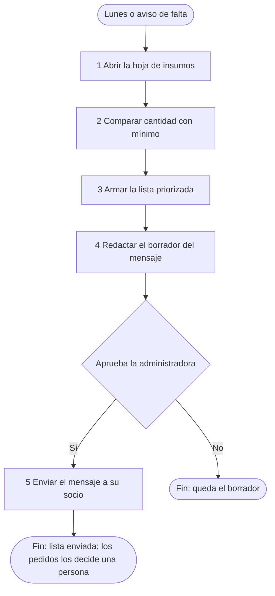

# Ejemplo: Crear una skill de flujo en una clínica dental ficticia

Empresa inventada: **Clínica Dental Sonrisa Norte** (clínica privada pequeña: 3 consultorios, 14 empleados). Todo lo siguiente es ficticio. Después del taller, la administradora quiere quedarse con algo propio: una tarea interna, repetida y simple, que hoy hace a mano cada lunes (la revisión semanal de los insumos de los consultorios). No es parte del flujo `FLU-01` ni toca a pacientes: es un buen caso para una skill personal.

## Turno 1

**Usuaria (la administradora):** Cada lunes reviso el stock de insumos y armo la lista de lo que falta. Quiero convertir eso en una skill.

**Facilitador:** Buena candidata: se repite, tiene pasos claros y el resultado es una lista. Para empezar: cuando termina bien, ¿qué tiene que existir y qué te hace empezar?

## Turno 2

**Usuaria:** Una lista de lo que está por debajo del mínimo, ordenada por lo más urgente, con un mensaje listo para mí misma. Empiezo los lunes a primera hora, o cuando alguien avisa que se acabó algo.

**Facilitador:** Anotado: resultado, lista priorizada y borrador de mensaje; desencadenantes, el lunes o un aviso. ¿Con qué empiezas: qué archivo u hoja?

## Turno 3

**Usuaria:** Una hoja con una fila por insumo: nombre, cantidad actual, mínimo, unidad y el proveedor habitual. La actualizan las asistentes cuando usan algo.

**Facilitador:** Gracias. Cuéntame la última vez, paso por paso, desde que abriste la hoja.

## Turno 4

**Usuaria:** Abrí la hoja, comparé cada insumo con su mínimo, miré cuáles estaban por debajo, ordené poniendo primero la anestesia y los guantes, y escribí un mensaje a mi socio con la lista. Después él decidió qué pedir.

**Facilitador:** Entiendo cinco pasos. ¿Qué puede hacer la skill sin preguntarte y qué nunca debería hacer sin tu visto bueno?

## Turno 5

**Usuaria:** Leer la hoja y hacer la lista, sí. Mandar el mensaje, solo si yo lo apruebo. Y pedir cosas a los proveedores, jamás: eso lo decidimos mi socio y yo. A veces el mínimo está vacío en algunos insumos.

**Facilitador:** Dos cosas anotadas: el envío requiere tu aprobación, y los mínimos vacíos son un riesgo. ¿Hay datos de personas o accesos protegidos en alguno de los pasos?

**Usuaria:** No, la hoja no tiene datos de pacientes. Solo necesito que el asistente pueda leerla.

## Turno 6: el diseño que se devuelve

**Facilitador:** Este es el proceso que entendí. Revísalo antes de que escriba nada.

| Paso | Qué hace | Clase | Aprobación | Si falla |
|---|---|---|---|---|
| 1 | Abrir la hoja de insumos | Solo lectura | Ninguna | Si no se puede leer, detenerse y avisar |
| 2 | Comparar la cantidad actual con el mínimo de cada insumo | Solo lectura | Ninguna | Si el mínimo está vacío, listarlo aparte como "sin mínimo" |
| 3 | Armar la lista de lo que está por debajo, con la anestesia y los guantes primero | Local (borrador) | La administradora la mira | Si no hay nada por debajo, decirlo |
| 4 | Redactar el borrador del mensaje con la lista | Local (borrador) | La administradora lo mira | |
| 5 | Enviar el mensaje a su socio | Modifica algo externo | **Sí, la administradora, antes de enviar** | Si no aprueba, queda el borrador |
| (fuera de la skill) | Decidir y hacer los pedidos a los proveedores | Lo hacen la administradora y su socio | | La skill **nunca** contacta proveedores |



| Desde | Condición | Hacia |
|---|---|---|
| Inicio | Lunes o aviso de que algo se acabó | Paso 1 |
| Paso 1 | | Paso 2 |
| Paso 2 | | Paso 3 |
| Paso 3 | | Paso 4 |
| Paso 4 | | Aprobación de la administradora |
| Aprobación | Sí | Paso 5 |
| Aprobación | No | Fin: queda el borrador |
| Paso 5 | | Fin: la lista llega a su socio |

Contradicciones y riesgos: (1) dijiste "arme la lista de lo que falta" y también que los pedidos los decide una persona: la skill solo prepara la lista y nunca pide nada. (2) Hay insumos sin mínimo: se listan aparte en vez de ignorarlos. (3) Dos asistentes actualizan la hoja: si una cantidad parece rara (negativa o muy grande), la skill la marca para revisar. Dependencias: poder leer la hoja de insumos. Privacidad: no hay datos de personas; el acceso es el que ya tiene tu asistente, y la skill no guarda ninguna clave. Pendiente por validar: el umbral de "urgente" para los otros insumos. ¿Este es el proceso que quieres que repita, o cambiamos algo?

**Usuaria:** Está bien así. Para "urgente" usemos solo anestesia y guantes por ahora. Aprobado.

## Entregable: la skill

El diseño quedó aprobado por la administradora. Este es el `SKILL.md` que se genera (carpeta `revision-semanal-de-insumos`):

````markdown
---
name: revision-semanal-de-insumos
description: Revisa la hoja de insumos de los consultorios, lista lo que está por debajo del mínimo (con la anestesia y los guantes primero) y prepara un borrador de mensaje para la administradora, que lo aprueba antes de enviarlo. Nunca hace pedidos a proveedores. Úsala cuando digas "revisa los insumos de esta semana", "qué nos falta en los consultorios", "arma la lista de insumos de los lunes" o "se acabó algo, ¿qué más está bajo?".
---
# Revisión semanal de insumos

Prepara cada lunes (o cuando alguien avisa de una falta) la lista de insumos por debajo del mínimo y un borrador de mensaje para la administradora. No pide nada a proveedores.

## Cuándo usarla / cuándo no

**Úsala** cuando haya que revisar el stock de insumos de los consultorios contra sus mínimos.

**No la uses** para hacer pedidos, comparar proveedores ni decidir cantidades a comprar: eso lo deciden la administradora y su socio.

## Antes de empezar

- Entrada: la hoja de insumos, con una fila por insumo (nombre, cantidad actual, mínimo, unidad y proveedor habitual).
- Dependencia: poder leer esa hoja. Si no se puede, detente y dilo; no inventes datos.
- Credenciales: usa el acceso que ya tiene el asistente. Nunca pidas ni guardes contraseñas, claves ni tokens.

## Proceso

1. **Abrir la hoja de insumos** (solo lectura).
2. **Comparar la cantidad actual con el mínimo** de cada insumo (solo lectura). Si el mínimo está vacío, anota el insumo aparte como "sin mínimo". Si una cantidad es negativa o parece muy grande, márcala para revisar.
3. **Armar la lista de lo que está por debajo del mínimo** (local, borrador). Pon primero la anestesia y los guantes; el resto, en el orden de la hoja.
4. **Redactar el borrador del mensaje** con la lista, los insumos "sin mínimo" y las cantidades por revisar (local, borrador). Muéstraselo a la administradora.
5. **Enviar el mensaje a su socio** (modifica algo externo). **Solo después de que la administradora apruebe** con un sí claro. Si no aprueba, deja el borrador.

## Puntos de aprobación

| Paso | Qué modifica | Quién aprueba | Si no aprueba |
|---|---|---|---|
| 5 | Envía un mensaje | La administradora | Queda el borrador; no se envía nada |

## Qué decide sola y qué no

- Decide sola: leer la hoja, comparar, ordenar y redactar el borrador.
- Nunca sin aprobación: enviar el mensaje.
- Nunca, bajo ninguna circunstancia: contactar proveedores o hacer pedidos.

## Si algo falla

| Falla habitual | Qué hacer |
|---|---|
| No se puede leer la hoja | Detenerse y avisar qué falta |
| Insumos sin mínimo | Listarlos aparte y pedir que alguien defina el mínimo |
| Cantidad negativa o muy grande | Marcarla para revisar; no la uses en la lista |
| Nada por debajo del mínimo | Decirlo y no redactar mensaje |

## Entregables

- La lista priorizada y el borrador del mensaje, en la conversación.

## Criterio de salida

La administradora comprueba tres insumos al azar contra la hoja y la lista coincide.
````

## Entregable: informe de la prueba segura

Para la prueba se usó una hoja de muestra con seis insumos inventados (incluyendo uno sin mínimo y uno con cantidad negativa), sin datos de personas.

| Campo | Resultado |
|---|---|
| Nombre de la skill | `revision-semanal-de-insumos` |
| Archivos usados | `SKILL.md` y una hoja de muestra con seis insumos ficticios |
| Dependencias | Poder leer la hoja de muestra (disponible) |
| Pasos ejecutados | 1 y 2 (solo lectura), 3 y 4 (local) |
| Pasos que se detuvieron en una aprobación | El 5: se mostró el borrador y no se envió |
| Resultado observado | Dos insumos por debajo del mínimo (la anestesia primero), uno "sin mínimo" y una cantidad negativa marcada para revisar; borrador del mensaje redactado |
| ¿Se envió, publicó, compró, eliminó o expuso algo? | No |
| Qué se ajusta | Se agregó la regla de la cantidad negativa en el paso 2 |

**Cómo guardarla:** la forma de cargar una skill propia depende del asistente de la administradora; se le indica que siga la guía de instalación de su plataforma, sin dar pasos específicos.

**Siguiente paso sugerido:** usarla el próximo lunes con la administradora verificando el resultado y anotar qué falló.

## Lo que se ve en este ejemplo

- La entrevista hizo una pregunta principal por turno y no preguntó lo que no cambiaba el flujo.
- El diseño separó lectura, borrador y envío, y dejó el pedido a proveedores fuera de la skill.
- Se señalaron contradicciones y riesgos (mínimos vacíos, cantidades raras) antes de construir.
- La skill se escribió solo después de la aprobación explícita.
- No hay credenciales ni datos de personas en la skill ni en la prueba, y el envío se detuvo en la aprobación.
