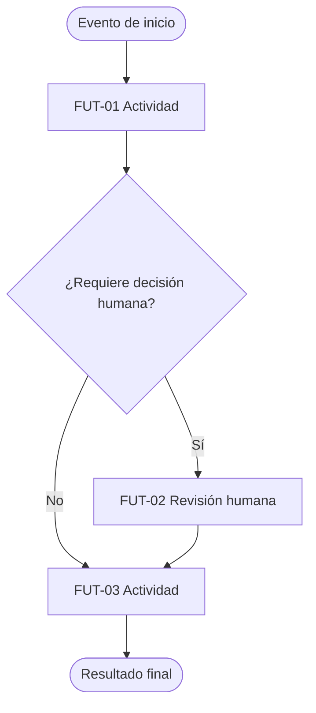

# Proceso futuro (To-Be)

Flujo: ___ (`FLU-__`)  Reto: `RET-__`  Dueño del proceso: ___  Fecha: ___  Facilitador: ___  Versión: borrador 1

Diseño **funcional**: qué debe lograr cada paso, quién decide y qué pasa en las excepciones. No nombres herramientas, productos, plataformas ni proveedores. Las capacidades de IA son hipótesis.

## 1. Principios de diseño

| ID | Principio | Procedencia |
|---|---|---|
| DEC-__ | | Decisión / Recomendación |

Restricciones conocidas (solo contexto, no decisiones de implementación): ___

## 2. Pasos del To-Be

| ID | Actividad | Reemplaza | Opción (eliminar / simplificar / asistir / automatizar / mantener humano) | Quién decide o aprueba | Capacidad | Excepción que maneja |
|---|---|---|---|---|---|---|
| FUT-01 | | PAS-__ | | | CAP-__ | EXC-__ |

Pasos del As-Is eliminados: ___ (con el porqué en `opciones-por-actividad.md`).

## 3. Capacidades funcionales (hipótesis)

| ID | Capacidad (verbo) | Qué entra | Qué sale | Qué pasa si falla o no está seguro | Paso |
|---|---|---|---|---|---|
| CAP-01 | Clasificar / extraer / resumir / validar / recomendar / redactar / registrar / notificar | | | | FUT-__ |

## 4. Decisiones humanas, excepciones y revisión

| Decisión o caso | Quién decide | Cuándo se revisa | Qué se escala y a quién |
|---|---|---|---|
| | | | |

## 5. Información e intercambios (en términos funcionales)

| Qué información se necesita | De dónde viene (rol, área o fuente en palabras funcionales) | Quién la recibe |
|---|---|---|
| | | |

## 6. Diagrama (Mermaid)



## 7. Tabla equivalente del diagrama

| Desde | Condición | Hacia |
|---|---|---|
| Evento de inicio | | FUT-01 |
| FUT-01 | | Decisión |
| Decisión | Sí | FUT-02 |
| Decisión | No | FUT-03 |
| FUT-02 | | FUT-03 |
| FUT-03 | | Resultado final |

## 8. Supuestos que hay que probar

| ID | Supuesto | Por qué importa | Prueba asociada |
|---|---|---|---|
| SUP-__ | | | Pendiente por validar |

## 9. Secciones funcionales para el canvas (bloques 3, 4 y 6)

- Bloque 3, Flujo futuro: ___
- Bloque 4, Capacidades de IA: ___ (herramientas pendientes hasta el MVP)
- Bloque 6, Responsables humanos y controles: ___
- Bloques 5 y 7 (patrón; sistemas, datos y herramientas): **pendientes**, se resuelven en `elegir-patron-y-autonomia` y en la etapa del MVP.

## 10. Resumen YAML

```yaml
proceso_futuro:
  flujo: FLU-00
  version: "borrador 1"
  pasos: []        # cada ítem: id, actividad, reemplaza, opcion, decide, capacidad
  capacidades: []  # cada ítem: id, verbo, entra, sale, si_falla
  decisiones_humanas: []
  excepciones: []
  supuestos: []
  validado_por: ""
```

## 11. Validación

- Validado por (dueño del proceso y quienes operan): ___  Fecha: ___  Correcciones: ___
- Dependencias visibles: ___
