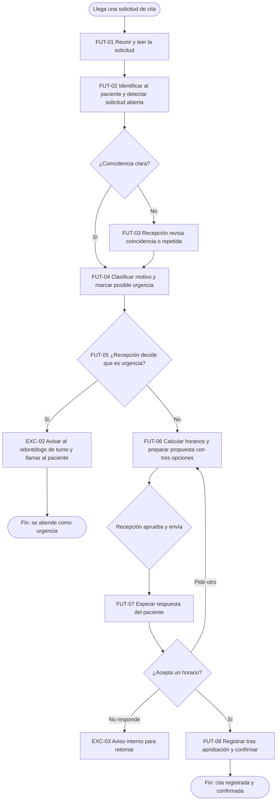

# Ejemplo: Diseñar el proceso futuro en una clínica dental ficticia

Empresa inventada: **Clínica Dental Sonrisa Norte** (clínica privada pequeña: 3 consultorios, 14 empleados). Todo lo siguiente es ficticio. Continúa el ejemplo de `mapear-proceso-actual`: el flujo `FLU-01` (agendar citas, `RET-01`) tiene ocho pasos `PAS-01` a `PAS-08`, línea base `HAL-01` (6 minutos de trabajo por solicitud, unas 40 al día, unas 88 horas por mes), errores `SUP-01` (unas 4 de cada 100, sin contar), duplicados `EXC-04` con causa supuesta `SUP-03`, y un vacío en el RACI: nadie responde por la clasificación de urgencias (`PAS-03`). Meta de `RET-01`: de 6 a 3 minutos por solicitud y de 4 a 1 cita con error por cada 100, sin empeorar la confirmación el mismo día. Ideas aparcadas: un solo lugar para todas las solicitudes, ver la agenda sin teclear, avisar si ya hay una solicitud abierta.

## Turno 1

**Usuaria (Valeria):** El mapa ya está validado por la jefa de recepción. Ahora quiero ver cómo debería funcionar.

**Facilitador:** Perfecto, y sin hablar todavía de herramientas. Para empezar: ¿qué debería ser distinto, para el paciente y para recepción, cuando esto funcione bien?

## Turno 2

**Usuaria:** Que el paciente reciba horarios en la primera respuesta, sin tantas idas y vueltas, y que recepción deje de teclear lo mismo dos veces y de revisar a mano si hay duplicados. Pero que nadie en recepción pierda el control de lo que se agenda.

**Facilitador:** Los convierto en tres principios: horarios en la primera respuesta, nada se teclea dos veces, y una persona de recepción sigue aprobando lo que se registra y se envía. ¿Los confirmas como decisión? (`DEC-03`).

**Usuaria:** Sí.

## Turno 3

**Facilitador:** Recorramos los pasos del mapa uno por uno. El primero: ¿este paso aporta valor al paciente o existe solo por cómo trabajan hoy? Hablo de "recibir la solicitud" por tres canales distintos.

**Usuaria:** El canal da igual al paciente, es la comodidad de cada uno. Para recepción sí es un lío tener tres lugares.

**Facilitador:** Entonces `PAS-01` se **simplifica**: todas las solicitudes llegan a una sola lista con el mismo formato. Sigamos con `PAS-03`, decidir si parece urgencia. ¿Quién debería decidirlo y qué le ayudaría a decidir mejor?

## Turno 4

**Usuaria:** Una odontóloga debería definir qué señales cuentan como urgencia, y recepción las aplica. Si recibe una alerta o una marca de que "parece urgencia", mejor, pero que decida la persona.

**Facilitador:** Esto cierra el vacío del RACI: la odontóloga coordinadora clínica define los criterios y responde por ellos, recepción los aplica (se incluye en `DEC-03`). El paso queda en **asistir**: una capacidad de clasificar marca la solicitud y la persona decide. El resto de los pasos los resumo en la tabla; revísenla.

## Entregable: opciones por actividad

| Paso del As-Is | ¿Aporta valor al paciente? | Opción | Por qué (dolor que resuelve) | Quién decide | Compromiso |
|---|---|---|---|---|---|
| `PAS-01` Recibir la solicitud | Sí, pero el canal no | Simplificar | Tres lugares donde mirar; se pierde la pista de qué ya llegó | Jefa de recepción | Cambio de hábitos: avisar a pacientes que escriben por dos canales |
| `PAS-02` Identificar al paciente y buscar la ficha | Sí | Automatizar (con revisión de casos dudosos) | Tecleo repetido; origen probable de duplicados (`SUP-03`) | Jefa de recepción | Datos de contacto incompletos (`FLU-02` los necesita): coincidencias dudosas van a una persona |
| `PAS-03` Decidir si parece urgencia | Sí | Asistir; la decisión se mantiene humana | Consecuencia clínica: un error no es reversible | Recepción; criterios y responsabilidad: odontóloga coordinadora clínica | Si la marca falla, se pierde tiempo; por eso decide la persona |
| `PAS-04` Revisar disponibilidad | Sí | Automatizar (reglas) | 1,5 minutos de revisión manual por solicitud | Jefa de recepción | Reglas de agenda por escrito (qué tipo de cita ocupa qué hueco) |
| `PAS-05` Proponer horarios | Sí | Asistir y simplificar | Idas y vueltas (`D2`); se ofrecen tres opciones en la primera respuesta | Recepción aprueba antes de enviar | Un mensaje mal armado llega al paciente: revisión previa |
| `PAS-06` Esperar la respuesta | Sí (es del paciente) | Simplificar | La espera no se elimina; se reduce con tres opciones y un aviso interno de solicitudes sin respuesta (`EXC-03`) | Recepción | Ninguno relevante |
| `PAS-07` Registrar la cita | Sí | Eliminar el tecleo; automatizar con aprobación | 1,5 minutos de tecleo y fuente de errores (`SUP-01`) | Recepción aprueba cada registro durante el piloto | Un registro equivocado llega a la agenda: aprobación previa |
| `PAS-08` Confirmar la cita | Sí | Automatizar (mensaje fijo, tras aprobar el registro) | Tarea repetitiva sin juicio | Jefa de recepción | La confirmación no puede salir antes del registro |

**Alternativas del To-Be completo:**

| Alternativa | Qué cambia | Costo | Riesgo | Cambio organizacional | ¿Cumple la meta? |
|---|---|---|---|---|---|
| A. Solo simplificar | Una lista única, formato común y reglas de agenda por escrito | Bajo (no hace falta construir nada nuevo) | Bajo | Medio: acordar un formato | No sé: probablemente no baja el tiempo de registro a la mitad |
| B. Simplificar y automatizar con reglas | A, más búsqueda de ficha, horarios libres y confirmación por reglas | Medio | Bajo a medio | Medio | Parcial: no resuelve el texto libre de los mensajes |
| C. B y asistencia de IA para leer mensajes | B, más entender el texto libre y marcar posibles urgencias | Medio a alto | Medio (errores de lectura y de urgencia) | Medio | Sí, como hipótesis a probar |

**Recomendación del facilitador:** C, porque los mensajes de texto libre (18 de las 40 solicitudes al día, `SUP-02`) no se pueden ordenar solo con reglas; con las decisiones y las aprobaciones humanas de arriba. Lo decide Valeria (`DEC-04`: se diseña con C y con una persona de recepción que aprueba el envío y el registro durante el piloto).

## Entregable: proceso futuro

| ID | Actividad | Reemplaza | Opción | Quién decide o aprueba | Capacidad | Excepción |
|---|---|---|---|---|---|---|
| `FUT-01` | Reunir la solicitud en la lista única y leer sus datos (nombre, motivo, preferencia de horario) | `PAS-01` | Simplificar; asistir | Recepción (llamadas: captura en el mismo formato) | `CAP-01` Extraer | `EXC-01` si falta un dato |
| `FUT-02` | Identificar al paciente y detectar si ya tiene una solicitud abierta | `PAS-02` | Automatizar | Recepción resuelve las dudas | `CAP-02` Validar | `EXC-01`, `EXC-04` |
| `FUT-03` | Revisar coincidencias dudosas o solicitudes repetidas | Nuevo (control) | Mantener humano | Recepción | | `EXC-04` |
| `FUT-04` | Clasificar el motivo y marcar si parece urgencia | `PAS-03` | Asistir | | `CAP-03` Clasificar | `EXC-02` |
| `FUT-05` | Decidir si es una urgencia | `PAS-03` | Mantener humano | Recepción; criterios de la odontóloga coordinadora clínica | | `EXC-02` |
| `FUT-06` | Calcular horarios libres que cumplen la preferencia y preparar la propuesta con tres opciones | `PAS-04`, `PAS-05` | Automatizar y asistir | Recepción aprueba y envía | `CAP-04` Recomendar horarios; `CAP-05` Redactar | |
| `FUT-07` | Esperar la respuesta, con aviso interno si no hay respuesta al final del día | `PAS-06` | Simplificar | Paciente; recepción retoma | `CAP-07` Notificar | `EXC-03` |
| `FUT-08` | Registrar la cita y confirmar al paciente | `PAS-07`, `PAS-08` | Automatizar tras aprobación | Recepción aprueba el registro | `CAP-06` Registrar; `CAP-07` Notificar | |

Se eliminan: el tecleo repetido de datos (`PAS-02` y `PAS-07`) y la revisión manual de duplicados al final del día.

| ID | Capacidad (hipótesis) | Entra | Sale | Si falla o no está seguro |
|---|---|---|---|---|
| `CAP-01` | Extraer | Mensaje, formulario o nota de la llamada | Nombre, motivo y preferencia de horario | Marca el dato como faltante y lo pasa a recepción |
| `CAP-02` | Validar | Datos del paciente | Ficha encontrada, no encontrada o dudosa; solicitud abierta o no | Dudosa pasa a `FUT-03` |
| `CAP-03` | Clasificar | Motivo de la consulta | Tipo de cita y marca de posible urgencia, con certeza | Si hay duda, se marca como posible urgencia |
| `CAP-04` | Recomendar | Tipo de cita, preferencia, agenda y reglas | Tres horarios libres | Sin horarios: recepción propone a mano |
| `CAP-05` | Redactar | Horarios y datos del paciente | Borrador de la propuesta | Recepción lo corrige antes de enviar |
| `CAP-06` | Registrar | Cita aprobada | Cita en la agenda | Error de registro: se avisa a recepción |
| `CAP-07` | Notificar | Cita registrada o solicitud sin respuesta | Confirmación al paciente; aviso interno a recepción | Falla de envío: aviso a recepción |

Información que se necesita (en términos funcionales): datos del paciente y su ficha, agenda de cada consultorio y profesional, reglas de qué tipo de cita ocupa qué hueco, y los criterios de urgencia definidos por la odontóloga coordinadora clínica.

| Desde | Condición | Hacia |
|---|---|---|
| Inicio | Llega una solicitud | `FUT-01` |
| `FUT-01` | | `FUT-02` |
| `FUT-02` | Coincidencia dudosa o solicitud repetida | `FUT-03`, luego `FUT-04` |
| `FUT-02` | Coincidencia clara | `FUT-04` |
| `FUT-04` | | `FUT-05` |
| `FUT-05` | Recepción decide que es urgencia | `EXC-02`, luego Fin (urgencia) |
| `FUT-05` | No es urgencia | `FUT-06` |
| `FUT-06` | Recepción aprueba y envía la propuesta | `FUT-07` |
| `FUT-07` | Pide otro horario | `FUT-06` |
| `FUT-07` | No responde | `EXC-03`, aviso interno |
| `FUT-07` | Acepta un horario | `FUT-08` |
| `FUT-08` | | Fin: cita registrada y confirmada |

Supuestos a probar: `SUP-04` (los mensajes y el formulario traen datos suficientes para leerlos sin volver a preguntar; Pendiente por validar: revisar 30 mensajes reales); `SUP-05` (buscar al paciente por documento y teléfono encuentra la ficha en la mayoría de casos; Pendiente por validar).

## Entregable: comparación As-Is contra To-Be

| Dimensión | As-Is (línea base y procedencia) | To-Be (meta o hipótesis) | Cómo se comprobará |
|---|---|---|---|
| Tiempo de trabajo por solicitud | 6 min (`HAL-01`, medido en 20 solicitudes) | Meta del reto: 3 min | Medir 20 solicitudes con el flujo nuevo |
| Espera del paciente | Minutos a horas por mensaje; promedio No sé | Hipótesis: baja porque recibe tres opciones en la primera respuesta | Medir el tiempo hasta la primera respuesta en 20 solicitudes |
| Errores y duplicados | Unas 4 de cada 100 (`SUP-01`, Dicho por participante, sin contar) | Meta del reto: 1 de cada 100 | Contar una semana de citas corregidas antes y durante el piloto |
| Experiencia del paciente | La confirmación llega el mismo día (Dicho por participante, en `RET-01`) | No debe empeorar; hipótesis: mejora si recibe horarios en la primera respuesta | Revisar el tiempo hasta la confirmación |
| Experiencia de recepción | Teclea cada solicitud dos veces y revisa duplicados al final del día | Hipótesis: dedica más tiempo a atender a quienes llegan | Preguntar a las dos recepcionistas tras el piloto |
| Controles | La jefa mira la agenda "a veces" | Recepción aprueba envío y registro; casos dudosos a revisión | Contar cuántos casos pasan a revisión |
| Esfuerzo de cambio | Ninguno | Medio: formato común, reglas de agenda por escrito, nuevo hábito de aprobar | Observar la primera semana |

Qué no mejora: la espera por la respuesta del paciente sigue existiendo; las solicitudes de urgencia siguen dependiendo de una persona; si los datos de contacto siguen incompletos, no mejora `FLU-02`. Dependencias: reglas de agenda por escrito, criterios de urgencia de la odontóloga coordinadora clínica.

Validado por la jefa de recepción y las dos recepcionistas (corrección: quisieron ver la propuesta de horarios antes de que salga, ya incluido en `FUT-06`).

**Siguiente paso sugerido:** `elegir-patron-y-autonomia`, con las capacidades `CAP-01` a `CAP-07` y las decisiones que siguen siendo humanas (`FUT-03`, `FUT-05` y las aprobaciones de `FUT-06` y `FUT-08`).

## Lo que se ve en este ejemplo

- No aparece ninguna herramienta ni proveedor: las capacidades se describen por verbo.
- Cada paso del As-Is tiene una opción y un porqué, y se eliminan pasos antes de pensar en IA.
- El vacío del RACI sobre urgencias se cierra con una decisión humana, no con una máquina.
- La comparación usa la línea base medida, la meta del reto y descripciones marcadas como hipótesis, sin inventar ahorros.
- Hay tres alternativas con su costo, riesgo y cambio, y una recomendación marcada como tal.
