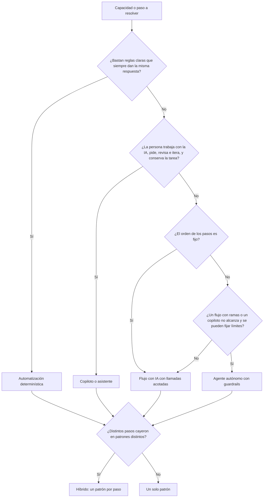

# Decisión de patrón

Flujo: ___ (`FLU-__`)  Fecha: ___  Facilitador: ___  Versión: borrador 1

Regla: lo más simple que funcione. No nombres productos, proveedores ni plataformas.

## 1. Árbol de decisión (Mermaid)

## 2. Tabla equivalente

| Pregunta | Si la respuesta es Sí | Si la respuesta es No |
|---|---|---|
| Q1. ¿Bastan reglas claras que siempre dan la misma respuesta? | Automatización determinística | Pasa a Q2 |
| Q2. ¿La persona trabaja con la IA (pide, revisa, itera) y conserva la tarea? | Copiloto o asistente | Pasa a Q3 |
| Q3. ¿El orden de los pasos es fijo? | Flujo con IA con llamadas acotadas | Pasa a Q4 |
| Q4. ¿Un flujo con ramas o un copiloto no alcanza y se pueden fijar límites? | Agente autónomo con guardrails | Flujo con IA |
| H. ¿Distintos pasos cayeron en patrones distintos? | Híbrido: un patrón por paso | Un solo patrón |

## 3. Recorrido por capacidad

| Capacidad | Q1 reglas | Q2 copiloto | Q3 orden fijo | Q4 agente | Patrón | Por qué (procedencia) |
|---|---|---|---|---|---|---|
| CAP-01 | | | | | | |

## 4. Verificación antes de recomendar un agente

| Alternativa más simple | ¿Resuelve el caso? | Por qué sí o no |
|---|---|---|
| Reglas o lógica tradicional | | |
| Flujo fijo con ramas | | |
| Llamadas estructuradas y acotadas a la IA | | |
| Copiloto con la persona decidiendo | | |

Si alguna resuelve el caso, no se recomienda un agente.

## 5. Patrón elegido (campo de justificación del canvas)

| Patrón | Marcado | Qué parte del flujo |
|---|---|---|
| Automatización determinística | [ ] | |
| Flujo con IA | [ ] | |
| Copiloto / Asistente | [ ] | |
| Agente autónomo | [ ] | |
| Híbrido | [ ] | |

Explicación / justificación (2 a 4 frases, etiquetadas como Recomendación): ___

Decisión: `DEC-__` (quién decidió: ___)

## 6. Pendiente hasta el MVP

| Tema | Por qué queda pendiente |
|---|---|
| Herramientas y conexiones | Se eligen en la especificación y la implementación, no aquí |
| Datos y fuentes concretas | |
