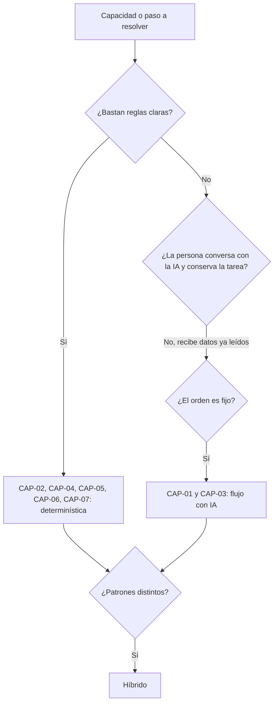

# Ejemplo: Elegir patrón y autonomía en una clínica dental ficticia

Empresa inventada: **Clínica Dental Sonrisa Norte** (clínica privada pequeña: 3 consultorios, 14 empleados). Todo lo siguiente es ficticio. Continúa el ejemplo de `disenar-proceso-futuro`: el flujo `FLU-01` (agendar citas, `RET-01`) tiene ocho pasos futuros `FUT-01` a `FUT-08` y siete capacidades: `CAP-01` Extraer, `CAP-02` Validar, `CAP-03` Clasificar, `CAP-04` Recomendar horarios, `CAP-05` Redactar, `CAP-06` Registrar y `CAP-07` Notificar. Decisiones humanas: `FUT-03` (coincidencias dudosas), `FUT-05` (urgencia) y las aprobaciones de `FUT-06` y `FUT-08` (`DEC-04`). Meta de `RET-01`: de 6 a 3 minutos por solicitud y de 4 a 1 cita con error por cada 100.

## Turno 1

**Usuaria (Valeria):** Mi socio insiste en que pongamos un agente que lo haga todo. ¿Qué opinas?

**Facilitador:** Veamos si hace falta, parte por parte. Para empezar: ¿qué partes del flujo siguen siempre la misma secuencia y cuáles dependen de lo que se encuentre en cada caso?

## Turno 2

**Usuaria:** La secuencia siempre es la misma: leer, buscar al paciente, ver si es urgencia, proponer horarios, registrar y confirmar. Lo que cambia es el contenido de cada mensaje, porque cada paciente escribe distinto.

**Facilitador:** Entonces el orden es fijo y la variación está en entender el texto libre. Recorramos las capacidades con el árbol; empiezo por `CAP-02`. ¿Se puede escribir como una regla que siempre dé la misma respuesta: buscar la ficha por documento y teléfono, y avisar si ya hay una solicitud abierta?

**Usuaria:** Sí, eso es buscar y comparar.

## Turno 3

**Facilitador:** Igual con `CAP-04` (horarios libres según las reglas de agenda), `CAP-05` (proponer los horarios con un mensaje fijo), `CAP-06` y `CAP-07`: son reglas y una plantilla, sin IA. Quedan **determinísticas**. Entender el mensaje de texto libre (`CAP-01`) y marcar posibles urgencias (`CAP-03`) no se pueden escribir como una regla fija. ¿La recepcionista necesita conversar con una IA para hacer esto, o recibe los datos ya leídos y los revisa?

**Usuaria:** Los recibe ya leídos y los revisa; no quiere conversar con nada.

**Facilitador:** Entonces no es un copiloto: es un **flujo con IA** (secuencia fija con dos llamadas acotadas). Y como las capacidades caen en patrones distintos, el flujo es **híbrido**. Antes de cerrar, verifico el agente: ¿un flujo fijo con ramas resuelve lo que decía tu socio?

**Usuaria:** Sí, el orden no cambia.

**Facilitador:** Entonces no hace falta un agente, y lo dejo escrito así (`DEC-05`, decide Valeria). Si cambia el proceso y el orden deja de ser fijo, se vuelve a evaluar.

## Turno 4

**Facilitador:** Ahora la autoridad. Si la IA se equivoca al leer un mensaje o al marcar una urgencia, ¿quién lo nota, cuánto cuesta y se puede deshacer?

**Usuaria:** Un dato mal leído lo nota recepción al revisarlo; una urgencia no detectada es lo grave, porque el paciente podría esperar horas con dolor fuerte o una infección. Una cita mal registrada se corrige, pero molesta al paciente.

**Facilitador:** Con eso propongo niveles. Para la urgencia el máximo es el nivel 1: la IA solo marca y decide la persona. Los datos leídos van en nivel 2: la persona los aprueba. Las reglas de buscar, calcular, proponer y avisar van en nivel 3, y el registro y el envío en nivel 2 durante el piloto (la recepcionista aprueba), con la posibilidad de subir a 3 más adelante si los errores bajan a la meta.

## Turno 5

**Facilitador:** Pasemos a los límites. ¿Qué sería lo peor que podría hacer este flujo si falla?

**Usuaria:** Mandarle a un paciente un mensaje con datos de otra persona, o no avisar una urgencia.

**Facilitador:** Asigno los límites del catálogo y registro dos riesgos. Última pregunta de control: ¿quién puede apagar la parte con IA y volver a trabajar como hoy?

**Usuaria:** La jefa de recepción, sin pedir permiso.

## Entregable: decisión de patrón

| Capacidad | Q1 reglas | Q2 copiloto | Q3 orden fijo | Q4 agente | Patrón | Por qué |
|---|---|---|---|---|---|---|
| `CAP-01` Extraer | No (texto libre) | No | Sí | No aplica | Flujo con IA | El mensaje es texto libre y se lee en un paso fijo (Dicho por participante) |
| `CAP-02` Validar | Sí | | | | Determinística | Buscar y comparar con reglas |
| `CAP-03` Clasificar | No (criterio flexible) | No | Sí | No aplica | Flujo con IA | Marca de posible urgencia; decide una persona |
| `CAP-04` Recomendar horarios | Sí | | | | Determinística | Reglas de agenda |
| `CAP-05` Redactar | Sí | | | | Determinística | Mensaje fijo con tres horarios; no hace falta IA |
| `CAP-06` Registrar | Sí | | | | Determinística | Una regla |
| `CAP-07` Notificar | Sí | | | | Determinística | Una regla |

| Desde | Condición | Hacia |
|---|---|---|
| Capacidad | ¿Bastan reglas? Sí | Determinística (`CAP-02`, `CAP-04`, `CAP-05`, `CAP-06`, `CAP-07`) |
| Capacidad | ¿Bastan reglas? No | Pregunta de copiloto |
| Copiloto | La persona recibe datos ya leídos (no conversa) | Pregunta del orden |
| Orden | El orden es fijo | Flujo con IA (`CAP-01`, `CAP-03`) |
| Determinística y flujo con IA | Patrones distintos | Híbrido |

**Verificación del agente:** reglas, no (texto libre); flujo con ramas, sí para todo el flujo; llamadas acotadas a la IA, sí para `CAP-01` y `CAP-03`; copiloto, no hace falta. No se recomienda un agente.

| Patrón | Marcado | Qué parte del flujo |
|---|---|---|
| Automatización determinística | [x] | `CAP-02`, `CAP-04`, `CAP-05`, `CAP-06`, `CAP-07` |
| Flujo con IA | [x] | `CAP-01`, `CAP-03` |
| Copiloto / Asistente | [ ] | |
| Agente autónomo | [ ] | |
| Híbrido | [x] | Reglas para casi todo el flujo y dos llamadas acotadas a la IA |

**Explicación / justificación (Recomendación):** el orden de los pasos es fijo y solo dos capacidades entienden texto libre, así que alcanza un flujo híbrido de reglas y dos llamadas acotadas a la IA; un agente no aporta, porque no hay caminos que decidir en cada caso. `DEC-05`. Pendiente hasta el MVP: qué herramientas y conexiones cumplen cada capacidad.

## Entregable: escalera de autoridad

| Capacidad | Paso | Nivel | Quién aprueba o revisa | Qué se registra |
|---|---|---|---|---|
| `CAP-03` Clasificar (marca de urgencia) | `FUT-04`, `FUT-05` | 1 Asesor | Recepción decide; criterios de la odontóloga coordinadora clínica | Marca, decisión y quién decidió |
| `CAP-01` Extraer | `FUT-01` | 2 Redactor | Recepción revisa los datos leídos | Datos leídos y correcciones |
| `CAP-02` Validar | `FUT-02`, `FUT-03` | 3 Ejecutor controlado | Recepción resuelve las dudas | Coincidencias dudosas |
| `CAP-04` y `CAP-05` Horarios y propuesta | `FUT-06` | 2 Redactor | Recepción aprueba y envía | Propuesta enviada |
| `CAP-06` y `CAP-07` Registrar y confirmar | `FUT-08` | 2 Redactor en el piloto | Recepción aprueba el registro | Cita registrada y confirmación enviada |
| `CAP-07` Aviso interno de solicitudes sin respuesta | `FUT-07` | 3 Ejecutor controlado | Jefa de recepción | Avisos emitidos |

Nivel del flujo en el piloto: 2 (el más alto que se concede a todo lo que toca al paciente o a la agenda), `DEC-05`. Condición para subir `FUT-08` al nivel 3: tasa de citas con error igual o menor que la meta de 1 de cada 100 durante un periodo que acordarán la jefa de recepción y Valeria (Pendiente por validar: definir cuántas semanas y la muestra); si se degrada, se baja de inmediato. Control humano: aprueba la recepcionista; las excepciones las revisa recepción en la misma jornada; puede detener la parte con IA y volver al modo manual la jefa de recepción; corrige un error de agenda recepción; la constancia de lo que hizo el sistema queda en el registro de acciones.

## Entregable: guardrails

| ID | Condición de riesgo | Dónde | Límite requerido | Responsable | Riesgo |
|---|---|---|---|---|---|
| `GRD-01` | Información personal o sensible (datos de pacientes y motivo de consulta) | `CAP-01`, `CAP-03` | Modelos aprobados, controles de acceso y registros de auditoría | Administradora | `RIE-03` |
| `GRD-02` | Extracción de baja certeza | `FUT-01`, `FUT-03` | Cola de revisión manual: lo que no se lee con certeza va a recepción | Jefa de recepción | `RIE-01` |
| `GRD-03` | Comunicación externa de alto valor (propuesta y confirmación al paciente) | `FUT-06`, `FUT-08` | Aprobación humana antes de enviar, mientras dure el piloto | Jefa de recepción | `RIE-01` |
| `GRD-04` | Cambios de alto impacto en reservas o cuentas (registrar en la agenda) | `FUT-08` | Autorización humana antes de registrar | Jefa de recepción | `RIE-01` |
| `GRD-05` | Respuesta sensible a políticas (urgencias) | `FUT-04`, `FUT-05` | Criterios aprobados por la odontóloga coordinadora clínica; ante la duda se marca como posible urgencia; decide una persona | Odontóloga coordinadora clínica | `RIE-02` |
| `GRD-06` | Texto externo que podría contener instrucciones ocultas | `CAP-01`, `CAP-03` | El mensaje del paciente se trata como dato, nunca como instrucciones | Administradora | `RIE-03` |
| `GRD-07` | Falla del componente de IA | Todo el flujo | Modo manual de respaldo, como hoy; la jefa de recepción puede apagarlo | Jefa de recepción | `RIE-01` |

No aplican: compromiso financiero (el flujo no cobra), acción irreversible (una cita se puede cancelar y reagendar), contenido web no confiable y ejecución autónoma en navegador (no se usa).

| ID | Riesgo | Impacto | Mitigación |
|---|---|---|---|
| `RIE-01` | Un registro o un mensaje equivocado llega al paciente o a la agenda (viene de `RET-01`) | Más citas duplicadas o a la hora equivocada | `GRD-02`, `GRD-03`, `GRD-04`, `GRD-07` |
| `RIE-02` | Una urgencia no se detecta | Paciente con dolor fuerte espera sin atención | `GRD-05`; la marca ante la duda; decide una persona |
| `RIE-03` | Datos de pacientes quedan expuestos a un componente no aprobado | Falta de confidencialidad de datos de salud | `GRD-01`, `GRD-06` |

**Siguiente paso sugerido:** `canvas-de-automatizacion`, con el patrón híbrido y su justificación, los niveles de autoridad, los guardrails y los riesgos `RIE-01` a `RIE-03`.

## Lo que se ve en este ejemplo

- Se descartó el agente con una verificación escrita: el orden de los pasos es fijo.
- Cinco de siete capacidades se resuelven con reglas; la IA entra solo donde hay texto libre.
- La capacidad con mayor riesgo (urgencias) queda en el nivel 1: la IA solo marca, decide una persona.
- El piloto se queda en el nivel 2 y la condición para subir a 3 se declara con una métrica, sin inventar el umbral.
- No aparece ningún producto, proveedor ni plataforma; lo técnico queda pendiente hasta el MVP.
