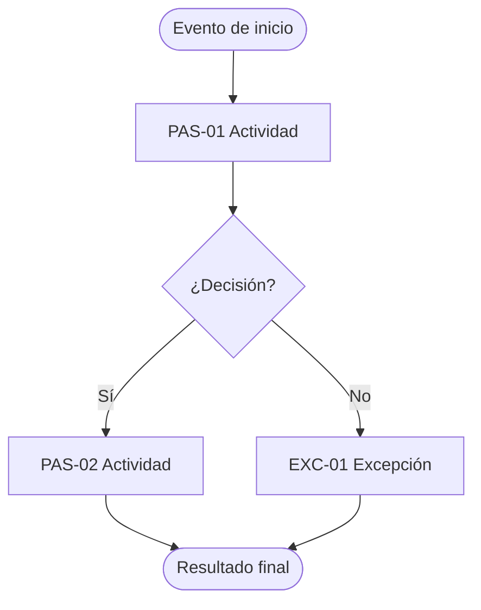

# Proceso actual (As-Is)

Flujo: ___ (`FLU-__`)  Reto: `RET-__`  Dueño del proceso: ___  Fecha: ___  Facilitador: ___  Versión: borrador 1

Describe cómo se hace **hoy**, no cómo debería hacerse. Lo que no se sabe va como "No sé" o Pendiente por validar.

## 1. Alcance

| Elemento | Respuesta | Procedencia |
|---|---|---|
| Qué inicia el proceso | | |
| Resultado final (cómo se sabe que terminó bien) | | |
| Variantes (canales, tipos de caso) | | |
| Queda fuera | | |
| Decisión de alcance | `DEC-__` (quién la confirmó) | Decisión |

## 2. Tabla de pasos

| ID | Actividad (verbo + objeto) | Quién | Dónde se hace | Entra | Sale | Tiempo de trabajo | Tipo (paso / decisión / espera / re-trabajo) | Procedencia |
|---|---|---|---|---|---|---|---|---|
| PAS-01 | | | | | | | | |

Tiempo total de trabajo (suma): ___ Línea base del flujo: ___ (`HAL-__`). Si la suma no coincide con la línea base, anota la diferencia como Pendiente por validar.

## 3. Diagrama (Mermaid)

## 4. Tabla equivalente del diagrama

| Desde | Condición | Hacia |
|---|---|---|
| Evento de inicio | | PAS-01 |
| PAS-01 | | Decisión D1 |
| D1 | Sí | PAS-02 |
| D1 | No | EXC-01 |
| PAS-02 | | Resultado final |

## 5. Decisiones

| ID | Decisión | Quién decide | Criterio | Consecuencia si se equivoca |
|---|---|---|---|---|
| D1 | | | | |

## 6. Dolores y fricciones

| ID | Dolor | Paso donde ocurre | Evidencia o procedencia |
|---|---|---|---|
| HAL-__ | | PAS-__ | |

## 7. Controles actuales

| Control | Quién lo hace | Cuándo | Qué detecta |
|---|---|---|---|
| | | | |

## 8. Contradicciones entre versiones

| Tema | Versión A (quién) | Versión B (quién) | Estado |
|---|---|---|---|
| | | | Sin resolver |

## 9. Ideas aparcadas (para `disenar-proceso-futuro`)

- ___

## 10. Vacíos y validación

- Pendientes por validar: ___
- Validado por (dueño del proceso): ___  Fecha: ___  Correcciones: ___
