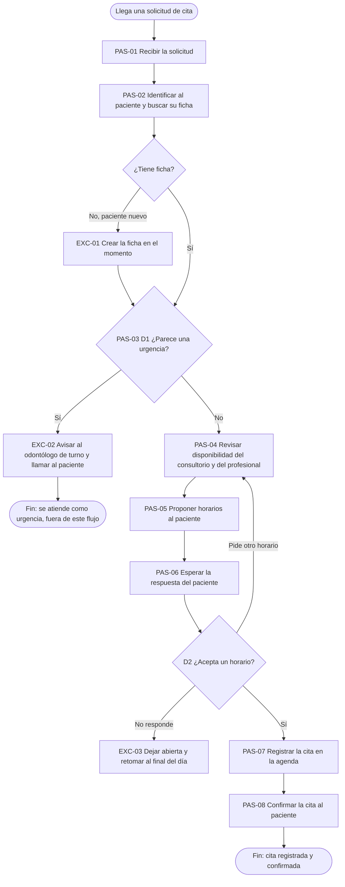

# Ejemplo: Mapear el proceso actual en una clínica dental ficticia

Empresa inventada: **Clínica Dental Sonrisa Norte** (clínica privada pequeña: 3 consultorios, 14 empleados). Todo lo siguiente es ficticio. Continúa el ejemplo de `priorizar-flujos`: `DEC-01` eligió como caso piloto candidato `FLU-01` (agendar citas, `RET-01`), con la línea base `HAL-01` (unos 6 minutos por solicitud, unas 40 solicitudes al día, unas 88 horas por mes, medido en 20 solicitudes) y el supuesto `SUP-01` (citas con error: unas 4 de cada 100, pendiente de contar una semana). Dueña del proceso: la jefa de recepción. Decide Valeria, la directora.

## Turno 1

**Usuaria (Valeria):** Ya elegimos agendar citas como piloto. ¿Cómo seguimos?

**Facilitador:** Antes de diseñar nada, documentemos cómo se hace hoy, con lo que ya sabemos como punto de partida (6 minutos por solicitud, `HAL-01`). Para delimitarlo: ¿qué hace que este proceso empiece y cómo saben en recepción que terminó bien?

## Turno 2

**Usuaria:** Empieza cuando llega una solicitud por llamada, mensaje o formulario de la página. Termina cuando la cita está en la agenda y el paciente tiene la confirmación. No incluimos reagendar ni cancelar, eso es el recordatorio.

**Facilitador:** Anotado el alcance: inicio, una solicitud por cualquiera de los tres canales; fin, cita registrada y confirmada; fuera, reagendar y cancelar (eso es `FLU-02`). ¿Lo confirmas como decisión? (`DEC-02`, la confirma Valeria).

**Usuaria:** Sí.

## Turno 3

**Facilitador:** Para reconstruirlo con algo real: ¿me cuentas la última solicitud que llegó, paso por paso, desde que entró hasta que quedó resuelta?

**Usuaria:** Ayer escribió un paciente pidiendo una limpieza la próxima semana por la tarde. Recepción leyó el mensaje, buscó su ficha, vio que era una limpieza, revisó la agenda de la higienista y del consultorio, le propuso dos horarios, esperó a que contestara (tardó dos horas), registró la cita y le mandó la confirmación.

**Facilitador:** Gracias, ya tengo ocho pasos. Para completarlos: ¿cuánto tarda recepción en cada uno, más o menos, cuando trabaja activamente?

## Turno 4

**Usuaria:** Leer, medio minuto. Buscar la ficha, un minuto. Entender el motivo, medio minuto. Revisar la agenda, un minuto y medio. Proponer horarios, medio minuto. Registrar, un minuto y medio. Confirmar, medio minuto. La espera depende: por llamada es en el momento y por mensaje puede ser horas.

**Facilitador:** La suma de trabajo da 6 minutos, igual que la línea base medida (`HAL-01`); el desglose por paso es Dicho por participante, no medido paso a paso (`HAL-02`). Ahora, ¿en cuáles pasos alguien tiene que decidir algo, esperar o volver a hacer algo?

## Turno 5

**Usuaria:** Hay una decisión importante: si el motivo parece una urgencia, no se agenda normal, se avisa al odontólogo y se llama al paciente. Otra: el paciente a veces no acepta los horarios y se vuelve a revisar la agenda. Y algunos nunca contestan.

**Facilitador:** Lo marco como decisión `D1` (¿parece urgencia?) y `D2` (¿acepta un horario?), con `EXC-02` y `EXC-03`. ¿Qué otros casos se salen del camino normal y cada cuánto pasan?

## Turno 6

**Usuaria:** Pacientes nuevos que no tienen ficha, y las citas duplicadas: el paciente escribe y después llama, y cada recepcionista lo registra por su lado. Cuántas veces, no sé; lo de los errores ya lo dije, unas 4 de cada 100 según recepción.

**Facilitador:** Los dejo como `EXC-01` y `EXC-04`, frecuencia No sé, y los duplicados enlazados a `SUP-01` (sin contar todavía). Sobre el volumen, ¿cuántas solicitudes llegan por cada canal?

**Usuaria:** Unas 16 por llamada, 18 por mensaje y 6 por el formulario.

**Facilitador:** Anotado como Dicho por participante (`SUP-02`, suma 40, coincide con `HAL-01`). Ahora los responsables: ¿quién responde por el resultado de este proceso, aunque no lo ejecute?

## Turno 7

**Usuaria:** La jefa de recepción responde por todo el proceso. Lo ejecutan las dos recepcionistas. Si algo es clínico, se pregunta al odontólogo de turno. Un cambio en el proceso lo decido yo.

**Facilitador:** Armo el RACI. Un vacío: no está definido quién responde si una urgencia se clasifica mal. ¿Quién debería responder, la jefa de recepción o el odontólogo de turno?

**Usuaria:** No lo habíamos pensado. Lo hablamos con ellos.

**Facilitador:** Lo dejo como vacío declarado (Pendiente por validar). Por último, ¿qué controles hay hoy y qué contó cada recepcionista distinto?

**Usuaria:** Nadie revisa el registro de otra persona; la jefa mira la agenda al final del día, a veces. Una recepcionista busca primero la ficha y la otra primero revisa si hay horario.

**Facilitador:** Ambas versiones quedan en contradicciones, sin elegir. Validemos con la jefa de recepción antes de cerrar.

## Entregable: proceso actual

Flujo `FLU-01` Agendar citas, `RET-01`, dueña: jefa de recepción. Versión: borrador 1 (pendiente de validar con ella).

| ID | Actividad | Quién | Dónde | Entra | Sale | Trabajo | Tipo | Procedencia |
|---|---|---|---|---|---|---|---|---|
| `PAS-01` | Recibir la solicitud | Recepcionista | Llamada, mensaje o formulario | Solicitud del paciente | Solicitud anotada | 0,5 min | Paso | Dicho por participante |
| `PAS-02` | Identificar al paciente y buscar su ficha | Recepcionista | Fichas de pacientes | Nombre y datos | Ficha encontrada o `EXC-01` | 1 min | Paso | Dicho por participante |
| `PAS-03` | Entender el motivo y decidir si parece urgencia (`D1`) | Recepcionista; consulta al odontólogo de turno si duda | Conversación con el paciente | Motivo de la consulta | Tipo de cita, o `EXC-02` | 0,5 min | Decisión | Dicho por participante |
| `PAS-04` | Revisar disponibilidad del consultorio y del profesional | Recepcionista | Agenda de la clínica | Tipo de cita, preferencia de horario | Horarios posibles | 1,5 min | Paso | Dicho por participante |
| `PAS-05` | Proponer horarios al paciente | Recepcionista | Mismo canal de la solicitud | Horarios posibles | Propuesta enviada | 0,5 min | Paso | Dicho por participante |
| `PAS-06` | Esperar la respuesta del paciente (`D2`) | Paciente | Mismo canal | Propuesta | Horario aceptado, otra petición o silencio | 0 min | Espera | Dicho por participante |
| `PAS-07` | Registrar la cita en la agenda | Recepcionista | Agenda de la clínica | Horario aceptado | Cita registrada | 1,5 min | Paso | Dicho por participante |
| `PAS-08` | Confirmar la cita al paciente | Recepcionista | Mismo canal | Cita registrada | Confirmación enviada | 0,5 min | Paso | Dicho por participante |

Tiempo total de trabajo: 6 minutos, igual a la línea base `HAL-01` (medida en 20 solicitudes); el desglose por paso es `HAL-02` (Dicho por participante, sin medir por paso). Espera de `PAS-06`: en el momento por llamada; de minutos a horas por mensaje (No sé el promedio).



| Desde | Condición | Hacia |
|---|---|---|
| Inicio | Llega una solicitud | `PAS-01` |
| `PAS-01` | | `PAS-02` |
| `PAS-02` | Ficha encontrada | `PAS-03` |
| `PAS-02` | Paciente nuevo sin ficha | `EXC-01`, luego `PAS-03` |
| `PAS-03` (`D1`) | Parece una urgencia | `EXC-02`, luego Fin (se atiende como urgencia) |
| `PAS-03` (`D1`) | No parece urgencia | `PAS-04` |
| `PAS-04` | | `PAS-05` |
| `PAS-05` | | `PAS-06` |
| `PAS-06` (`D2`) | Pide otro horario | `PAS-04` |
| `PAS-06` (`D2`) | No responde | `EXC-03`, retomar al final del día |
| `PAS-06` (`D2`) | Acepta un horario | `PAS-07` |
| `PAS-07` | | `PAS-08` |
| `PAS-08` | | Fin: cita registrada y confirmada |

Volumen (`SUP-02`, Dicho por participante): unas 40 solicitudes al día, 16 por llamada, 18 por mensaje y 6 por el formulario.

| ID | Excepción | Dónde | Cómo se maneja hoy | Cada cuánto | Quién | Procedencia |
|---|---|---|---|---|---|---|
| `EXC-01` | Paciente nuevo sin ficha | `PAS-02` | Se crea la ficha en el momento | No sé | Recepcionista | Dicho por participante |
| `EXC-02` | Motivo que parece urgencia | `PAS-03` | Se avisa al odontólogo de turno y se llama al paciente | No sé | Odontólogo de turno | Dicho por participante |
| `EXC-03` | El paciente no responde la propuesta | `PAS-06` | Queda abierta; se retoma al final del día | No sé | Recepcionista | Dicho por participante |
| `EXC-04` | Cita duplicada (el paciente escribe y luego llama) | `PAS-07` | Se detecta al revisar la agenda o cuando llega el paciente | Unas 4 de cada 100 citas con error (`SUP-01`, sin contar) | Jefa de recepción | Dicho por participante |

Dolores: duplicados y datos equivocados (`PAS-07`, `EXC-04`); tecleo de lo que ya llegó escrito (`PAS-02` y `PAS-07`); esperas largas por mensaje (`PAS-06`). Causa de los duplicados: **Supuesto** `SUP-03` (el mismo paciente usa dos canales y cada recepcionista registra por su lado), pendiente de revisar las citas duplicadas de una semana. Controles actuales: la jefa de recepción mira la agenda al final del día, "a veces"; nadie revisa el registro de otra persona. Contradicción: en qué orden se hacen `PAS-02` y `PAS-04` (una recepcionista busca primero la ficha; la otra, primero el horario); sin resolver.

### RACI

| Paso | Actividad | R | A | C | I |
|---|---|---|---|---|---|
| `PAS-01` | Recibir la solicitud | Recepcionista | Jefa de recepción | | |
| `PAS-02` | Identificar al paciente | Recepcionista | Jefa de recepción | | |
| `PAS-03` | Decidir si parece urgencia | Recepcionista | **Vacío** (Pendiente por validar) | Odontólogo de turno | Jefa de recepción |
| `PAS-04` | Revisar disponibilidad | Recepcionista | Jefa de recepción | Higienista y odontólogo (agenda propia) | |
| `PAS-05` | Proponer horarios | Recepcionista | Jefa de recepción | | Paciente |
| `PAS-07` | Registrar la cita | Recepcionista | Jefa de recepción | | Higienista y odontólogo, paciente |
| `PAS-08` | Confirmar la cita | Recepcionista | Jefa de recepción | | Paciente |

Derechos de decisión: la agenda y las citas, la jefa de recepción; lo clínico, el odontólogo de turno; cambiar el proceso, Valeria. Escalamiento: dudas de agenda a la jefa de recepción; dudas clínicas al odontólogo de turno. Segregación: quien registra la cita es quien la confirma y nadie la revisa de forma independiente (hallazgo). Ideas aparcadas (para el diseño del proceso futuro): un solo lugar para todas las solicitudes; ver la agenda sin teclear; avisar si el paciente ya tiene una solicitud abierta.

```yaml
proceso:
  id: FLU-01
  nombre: Agendar citas
  reto: RET-01
  dueno: Jefa de recepción
  version: "borrador 1"
  validado_por: ""
alcance:
  inicio: Llega una solicitud por llamada, mensaje o formulario
  fin: Cita registrada y confirmada
  fuera_de_alcance: [reagendar, cancelar]
  decision: DEC-02
pasos:
  - {id: PAS-01, actividad: Recibir la solicitud, tipo: paso, quien: Recepcionista, tiempo_trabajo_min: 0.5}
  - {id: PAS-02, actividad: Identificar al paciente y buscar su ficha, tipo: paso, quien: Recepcionista, tiempo_trabajo_min: 1}
  - {id: PAS-03, actividad: Entender el motivo y decidir si parece urgencia, tipo: decision, quien: Recepcionista, tiempo_trabajo_min: 0.5}
  - {id: PAS-04, actividad: Revisar disponibilidad del consultorio y del profesional, tipo: paso, quien: Recepcionista, tiempo_trabajo_min: 1.5}
  - {id: PAS-05, actividad: Proponer horarios al paciente, tipo: paso, quien: Recepcionista, tiempo_trabajo_min: 0.5}
  - {id: PAS-06, actividad: Esperar la respuesta del paciente, tipo: espera, quien: Paciente, tiempo_trabajo_min: 0}
  - {id: PAS-07, actividad: Registrar la cita en la agenda, tipo: paso, quien: Recepcionista, tiempo_trabajo_min: 1.5}
  - {id: PAS-08, actividad: Confirmar la cita al paciente, tipo: paso, quien: Recepcionista, tiempo_trabajo_min: 0.5}
raci:
  - {paso: PAS-03, R: [Recepcionista], A: vacio, C: [Odontólogo de turno], I: [Jefa de recepción]}
tiempos_y_volumenes:
  tiempo_trabajo_total_min: 6
desconocidos:
  - {id: SUP-01, que_falta: contar una semana de citas con error, como_medirlo: registrar cada cita corregida}
  - {id: SUP-03, que_falta: causa de los duplicados, como_medirlo: revisar las citas duplicadas de una semana}
```

(En el entregable real el YAML lleva todos los pasos, decisiones, excepciones y el RACI completo, siguiendo `assets/proceso-actual.yaml`; aquí se abrevia por espacio.)

**Validación:** la jefa de recepción revisa el mapa; mientras tanto, versión borrador 1. Pendientes por validar: contar los errores (`SUP-01`), la causa de los duplicados (`SUP-03`), la frecuencia de `EXC-01` a `EXC-03` y quién responde por la clasificación de urgencias.

**Siguiente paso sugerido:** `disenar-proceso-futuro`, con `FLU-01`, los dolores, las ideas aparcadas y el vacío del RACI.

## Lo que se ve en este ejemplo

- El mapa reutiliza `FLU-01`, `RET-01`, `HAL-01` y `SUP-01` sin volver a preguntarlos.
- Los 6 minutos de la línea base cuadran con la suma de los pasos; el desglose se marca como Dicho por participante.
- Dos recepcionistas cuentan el orden distinto y el mapa lo deja como contradicción sin resolver.
- El RACI tiene un vacío declarado (quién responde por la clasificación de urgencias) en vez de completarse por suposición.
- Las soluciones que surgieron quedaron como ideas aparcadas, fuera del mapa.
