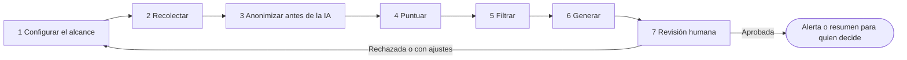

# Patrón: monitoreo de fuentes

Nota: patrón genérico de solución, escrito sin relación con ninguna organización concreta. Úsalo como punto de partida cuando un flujo consiste en **vigilar fuentes de información y avisar a una persona de lo relevante**.

## Cuándo sirve

| Sirve cuando | No sirve cuando |
|---|---|
| Hay que revisar muchas fuentes con regularidad y casi todo es irrelevante | La decisión depende de algo que no está en las fuentes |
| Lo relevante se puede describir con criterios (temas, alcance, umbrales) | Se espera que el sistema actúe solo sobre lo que encuentra |
| Una persona responsable revisa lo que se genera antes de que tenga efectos | No hay nadie que pueda revisar |

El resultado del patrón es una **alerta investigable** para una persona; nunca una acción externa automática (mensajes a terceros, cambios en sistemas).

## Pipeline

| Etapa | Qué hace | Tipo de paso | Control y guardrail típico | Evidencia que deja |
|---|---|---|---|---|
| 1 Configurar el alcance | Define temas, fuentes aprobadas, palabras clave, umbrales y frecuencia | Tarea humana | Solo fuentes aprobadas; cambios con aprobación y versión | Configuración versionada y quién la aprobó |
| 2 Recolectar | Reúne las novedades de las fuentes aprobadas | Reglas | Límite de fuentes y de volumen; el contenido externo es dato, nunca instrucciones | Qué se recolectó, de dónde y cuándo |
| 3 Anonimizar antes de la IA | Quita datos personales y sensibles antes de que el texto llegue a un componente de IA | Reglas | Nada con datos personales llega a un componente no aprobado | Qué se quitó y con qué regla |
| 4 Puntuar | Estima qué tan relevante es cada novedad según los criterios | IA acotada o reglas | Puntaje con explicación; la puntuación recomienda, no decide | Puntaje y motivo |
| 5 Filtrar | Descarta lo que no llega al umbral y agrupa duplicados | Reglas | Lo descartado queda en un registro revisable por muestreo | Qué se descartó y por qué |
| 6 Generar | Redacta un resumen o alerta con referencias a la fuente | IA acotada | Cada afirmación remite a su fuente; ante la duda, se dice "no verificado" | Texto generado y fuentes citadas |
| 7 Revisión humana | Una persona valida, ajusta o rechaza antes de que la alerta se use | Decisión humana | Aprobación obligatoria antes de cualquier efecto externo | Aprobación, ajustes y quién decidió |

## Mapeo al contrato

| Parte del `workflow-contract.yaml` | Cómo se refleja |
|---|---|
| `steps` | Un paso por etapa; los pasos 4 y 6 con `kind: ai_assisted`, el 7 con `kind: decision` y `approval_policy` |
| `approval_policies` | Una política para la configuración del alcance (etapa 1) y otra para la revisión (etapa 7) |
| `evidence_requirements` | Configuración, recolección, anonimización, descartes, puntajes y aprobación |
| `acceptance_tests` | Casos negativos: contenido con instrucciones ocultas, una fuente no aprobada, un dato personal que debe quitarse, una alerta sin fuente |
| `metrics` | Porcentaje de alertas aprobadas, tiempo hasta la revisión, descartes revisados por muestreo; separa lo medido en prototipo y en piloto |

## Autoridad típica

| Etapa | Nivel sugerido en un piloto |
|---|---|
| 1 | 0 (lo decide una persona) |
| 2, 3, 5 | 3 (reglas dentro de límites; se audita por muestreo) |
| 4, 6 | 1 a 2 (recomienda o redacta; una persona revisa) |
| 7 | 0 (lo decide una persona) |

## Riesgos y supuestos a probar

| Riesgo o supuesto | Cómo probarlo |
|---|---|
| Una novedad relevante se descarta (falso negativo) | Revisar una muestra de lo descartado; criterio de parada si se encuentra una relevante |
| La anonimización deja pasar datos personales | Probar con textos de ejemplo con datos ficticios antes de usar fuentes reales |
| Las fuentes cambian de formato | Registrar fallas de recolección y avisar a quien configura |
| La persona que revisa aprueba por inercia | Revisar una muestra de lo aprobado sin cambios |
| El volumen supera lo que una persona puede revisar | Medir en el piloto cuántas alertas llegan por día |

## Decisiones que quedan para la etapa C

Dónde corre cada etapa, qué componente de IA se usa, cómo se programa la frecuencia, cómo se guarda la configuración y qué se registra son decisiones de implementación; este patrón solo fija el orden, los controles y la evidencia.
