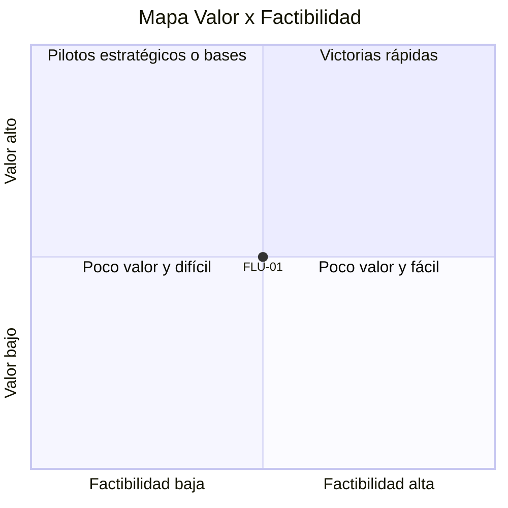

# Mapa Valor × Factibilidad y cubetas

Equipo: ___  Fecha: ___

## 1. Cálculo

- Valor = puntaje de Valor de negocio (eje vertical).
- Factibilidad = promedio de Idoneidad, Preparación y Riesgo y control (eje horizontal).
- Coordenadas del diagrama: x = (factibilidad − 1) / 4, y = (valor − 1) / 4.

| ID | Flujo | Valor | Factibilidad | x | y |
|---|---|---|---|---|---|
| FLU-01 | | | | | |

## 2. Mapa (Mermaid)

## 3. Tabla equivalente

| Cuadrante | Valor | Factibilidad | Flujos |
|---|---|---|---|
| Victorias rápidas (alto valor, alta factibilidad) | ≥ 3 | ≥ 3 | |
| Pilotos estratégicos o bases (alto valor, baja factibilidad) | ≥ 3 | < 3 | |
| Poco valor y difícil | < 3 | < 3 | |
| Poco valor y fácil | < 3 | ≥ 3 | |

El mapa da una posición provisional; la cubeta final sale del orden de decisión (juicio humano, riesgo y bases faltantes pueden moverla).

## 4. Cubetas

Orden de decisión (detente en el primer "sí"): 1) ¿valor ≤ 2, trabajo fundamentalmente humano o riesgo y control = 1 sin control? No automatizar. 2) ¿juicio humano esencial, o riesgo y control ≤ 2 con valor ≥ 3? Asistir no automatizar. 3) ¿preparación ≤ 2? Requiere bases. 4) ¿valor, factibilidad y riesgo y control ≥ 3? Victorias rápidas. 5) ¿valor ≥ 3 y factibilidad < 3 por falta de evidencia o capacidades? Pilotos estratégicos.

| Cubeta | Definición | Flujos | Por qué | Qué sigue |
|---|---|---|---|---|
| Victorias rápidas | Alto valor, alta preparación, riesgo manejable | | | |
| Pilotos estratégicos | Alto valor, puede requerir validación o capacidades nuevas | | | |
| Requiere bases | Prometedor, pero faltan datos, proceso o integración | | | |
| Asistir no automatizar | La IA apoya a las personas; el juicio humano sigue siendo esencial | | | |
| No automatizar | Poco valor, alto riesgo o trabajo fundamentalmente humano | | | |

## 5. Decisión

- Caso piloto candidato: ___ (`DEC-__`, decidió: ___)
- Línea base inicial: ___ (frecuencia, tiempo, errores; procedencia: ___)
- Pendientes por validar: ___
