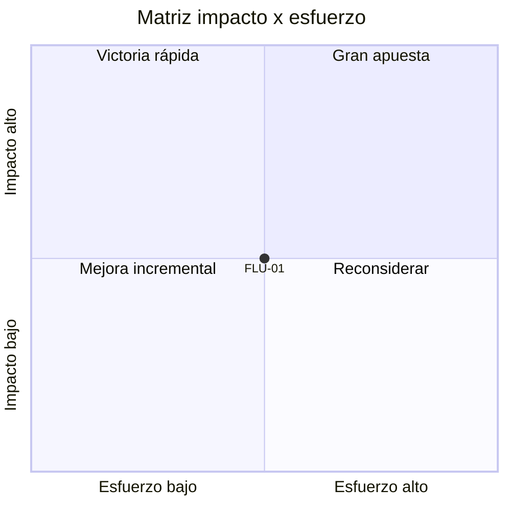

# Matriz ponderada impacto / esfuerzo (variante)

Equipo: ___  Fecha: ___  Facilitador: ___

Úsala cuando el equipo prefiera pensar en impacto contra esfuerzo. Se puntúa por consenso con escala 1 / 3 / 5. Solo se priorizan flujos con reto definido.

## 1. Criterios y pesos

| Dimensión | Criterio | Peso | 1 | 3 | 5 |
|---|---|---|---|---|---|
| Impacto | I1. Resultado de cara al reto | 0,6 | Logra menos de lo esperado | Logra lo esperado | Logra lo esperado y agrega valor |
| Impacto | I2. Objetivos y metas estratégicas | 0,4 | No aporta al propósito | Aporte indirecto | Aporte directo |
| Esfuerzo | E1. Tiempo | 0,4 | Rango corto (define el equipo, p. ej. hasta 1 mes) | Rango medio (p. ej. 1 a 3 meses) | Rango largo (p. ej. más de 3 meses) |
| Esfuerzo | E2. Recursos técnicos y financieros | 0,6 | Ninguno adicional | Solo uno de los dos | Ambos (herramientas y dinero) |

Acuerda los rangos de E1 antes de puntuar y anótalos aquí: ___

## 2. Puntaje

| ID | Flujo | Reto | I1 | I2 | E1 | E2 | Impacto | Esfuerzo | Índice | Cuadrante | Procedencia | Nota (obligatoria si hay 1 o 5) |
|---|---|---|---|---|---|---|---|---|---|---|---|---|
| FLU-01 | | RET-__ | | | | | | | | | Propuesta de la IA / Acordado por el equipo | |

Impacto = 0,6 × I1 + 0,4 × I2. Esfuerzo = 0,4 × E1 + 0,6 × E2. Índice = Impacto / Esfuerzo. Umbral = 3, y se aplica a **Impacto** y **Esfuerzo** (≥ 3 es alto; < 3 es bajo). El Índice no tiene umbral: solo ordena la lista (más alto = más rendimiento).

## 3. Cuadrantes

| Cuadrante | Impacto | Esfuerzo | Qué hacer |
|---|---|---|---|
| Victoria rápida | Alto | Bajo | Prioridad máxima; ejecutar pronto |
| Mejora incremental | Bajo | Bajo | Se hace si sobra capacidad |
| Gran apuesta | Alto | Alto | Exige planeación, recursos y decisión explícita |
| Reconsiderar | Bajo | Alto | Replantear, dividir o descartar por ahora |

## 4. Mapa (Mermaid)

Coordenadas: x = (esfuerzo − 1) / 4, y = (impacto − 1) / 4.

## 5. Decisión

- Foco: ___ (`DEC-__`)
- En espera o descartado, con motivo: ___
