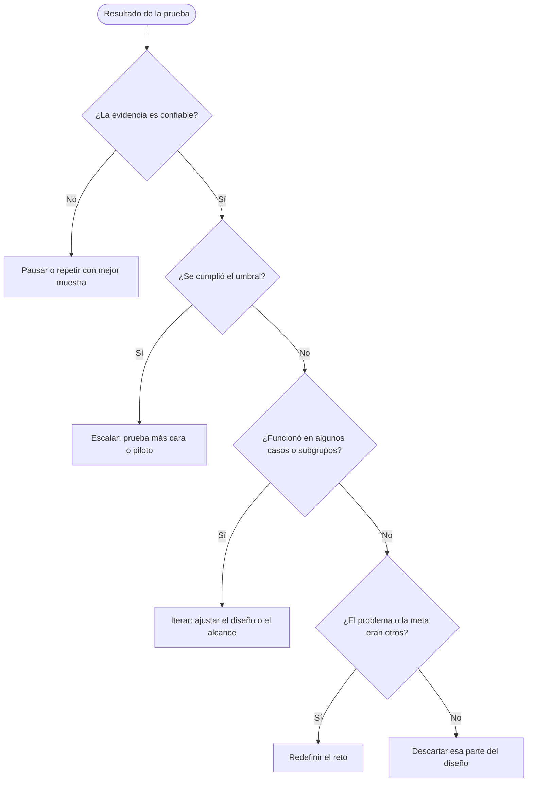

# Tarjeta de prueba

ID: `PRU-__`  Flujo: ___ (`FLU-__`)  Fecha: ___  Responsable de la prueba: ___

Una tarjeta por supuesto (o por dos, si los prueba el mismo experimento). El umbral de "Acertamos si" se escribe **antes** de probar.

## 1. Las cuatro frases

| Frase | Respuesta |
|---|---|
| **Creemos que** (el supuesto, con su ID) | `SUP-__`: ___ |
| **Para verificarlo, haremos** (acción concreta, quién, con qué datos) | ___ |
| **Y mediremos** (la métrica, cómo se cuenta) | ___ |
| **Acertamos si** (el umbral, fijado de antemano) | ___ |

## 2. Campos de la tarjeta

| Campo | Respuesta |
|---|---|
| Nivel crítico (de la criticidad del supuesto: Crítico 16 a 25, Alto 10 a 15, Medio menos de 10) | ___ (criticidad ___) |
| Costo (Bajo, Medio o Alto; horas y personas) | ___ |
| Tipo de prueba (`tipos-de-prueba.md`) | ___ |
| Fidelidad del prototipo (la más baja que sirva) | ___ |
| Evidencia que se recolectará (lo que la gente **hace** o lo que **dice**) | ___ |
| Confiabilidad esperada de los datos (Alta, Media o Baja, y por qué: tamaño de la muestra, datos reales o ficticios, quién los revisa) | ___ |
| Límites de seguridad (datos anonimizados; nada se envía, se publica, se registra en un sistema real ni se expone) | ___ |
| Dependencias (qué debe existir antes) | ___ |
| Fecha y duración | ___ |

## 3. Coincidencia con el concepto

| Pregunta | Respuesta |
|---|---|
| ¿Qué parte del concepto representa el prototipo? | ___ |
| ¿Qué parte no representa (y por tanto esta prueba no puede decir nada de ella)? | ___ |
| ¿Quién simula al sistema, si alguien lo hace, y lo sabe la persona que prueba? | ___ |
| ¿Qué resultado podría deberse al prototipo y no al concepto? | ___ |

## 4. Resultado (se completa después)

| Campo | Respuesta |
|---|---|
| Fecha de la prueba | ___ |
| Lo observado (números o ejemplos) | ___ |
| ¿Acertamos? | Verdadero, falso o inconcluso |
| Confiabilidad real de los datos | Alta, Media o Baja, y por qué |
| Qué nos sorprendió | ___ |
| **Decisión** | Iterar, escalar, pausar, descartar o redefinir el reto (`DEC-__`, decide: ___) |

## 5. Árbol de decisión

| Desde | Condición | Decisión |
|---|---|---|
| Resultado | La evidencia no es confiable (muestra pequeña, datos dudosos, falta un criterio) | Pausar o repetir con mejor muestra |
| Resultado | Evidencia confiable y se cumplió el umbral | Escalar: una prueba más cara o el piloto |
| Resultado | Evidencia confiable, no se cumplió, pero funcionó en algunos casos o subgrupos | Iterar: ajustar el diseño o el alcance |
| Resultado | No se cumplió y no funcionó en ningún subgrupo, pero el problema o la meta eran otros | Redefinir el reto |
| Resultado | No se cumplió y no hay variante útil | Descartar esa parte del diseño (se mantiene humana o se simplifica) |
