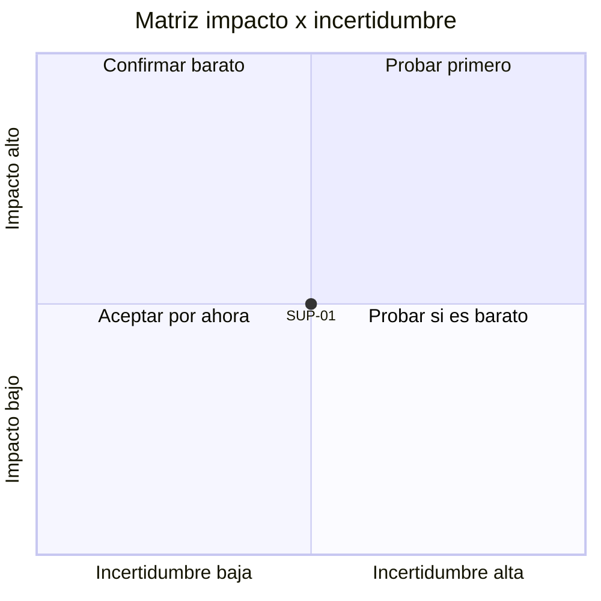

# Matriz de impacto × incertidumbre

Flujo: ___ (`FLU-__`)  Fecha: ___

## 1. Coordenadas

Eje horizontal: incertidumbre (1 a 5). Eje vertical: impacto si es falso (1 a 5). Coordenadas del diagrama: x = (incertidumbre − 0,6) / 5, y = (impacto − 0,6) / 5. Así 1 a 3 queda en la mitad baja y 4 a 5 en la alta, sin caer sobre la línea. Si dos supuestos coinciden en el mismo punto, sepáralos unos 0,04 sin cruzar la línea, para que se lean.

| ID | Supuesto (corto) | Impacto | Incertidumbre | x | y |
|---|---|---|---|---|---|
| SUP-01 | | | | | |

## 2. Matriz (Mermaid)

## 3. Tabla equivalente

| Cuadrante | Impacto | Incertidumbre | Qué hacer | Supuestos |
|---|---|---|---|---|
| Probar primero (impacto alto, incertidumbre alta) | 4 a 5 | 4 a 5 | Tarjeta de prueba antes de construir | |
| Confirmar barato (impacto alto, incertidumbre media o baja) | 4 a 5 | 1 a 3 | Una prueba barata o un control; revisar si cambia el contexto | |
| Aceptar por ahora (impacto bajo, incertidumbre baja) | 1 a 3 | 1 a 3 | Registrarlo y seguir | |
| Probar si es barato (impacto bajo, incertidumbre alta) | 1 a 3 | 4 a 5 | Solo si cuesta poco | |

Los límites son anclas para conversar: una nota de 3 en impacto con incertidumbre 4 puede merecer prueba si es barata. Un impacto alto nunca se deja sin al menos una prueba barata o un control. El orden final lo decide una persona.

## 4. Lectura

- Más arriesgados (criticidad alta): ___
- Dependencias que cambian el orden: ___
- Qué se decidió no probar todavía y por qué: ___
