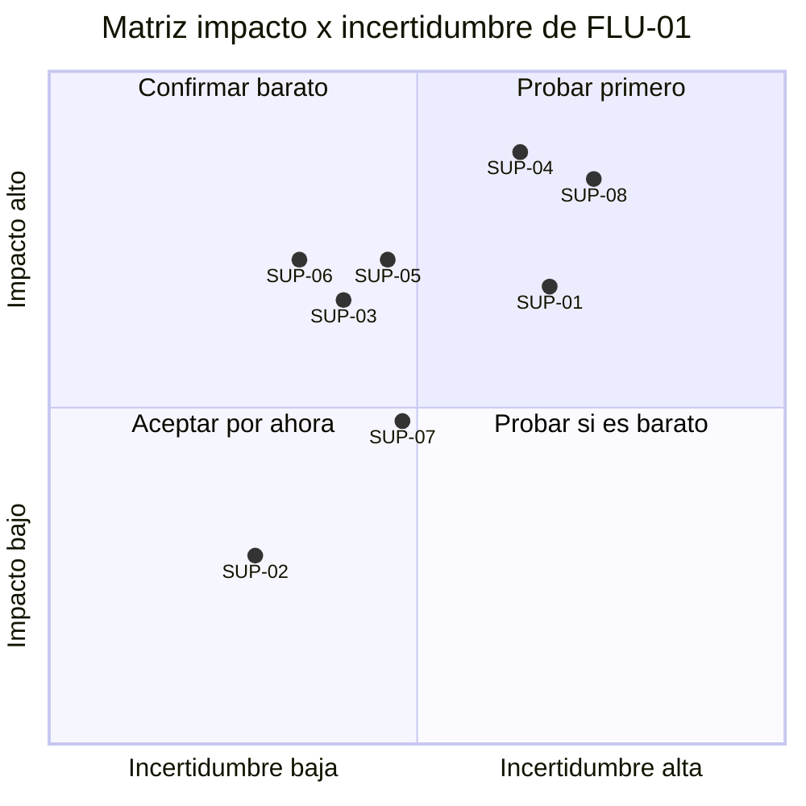

# Ejemplo: Supuestos y riesgos en una clínica dental ficticia

Empresa inventada: **Clínica Dental Sonrisa Norte** (clínica privada pequeña: 3 consultorios, 14 empleados). Todo lo siguiente es ficticio. Continúa el ejemplo de `canvas-de-automatizacion`: el flujo `FLU-01` (agendar citas, `RET-01`) tiene un canvas en Borrador 1 (piloto provisional de dos semanas, mensajes y formulario), un patrón híbrido (`DEC-05`), niveles de autoridad, guardrails `GRD-01` a `GRD-07` y riesgos `RIE-01` a `RIE-03`. Supuestos ya con ID: `SUP-01` (citas con error), `SUP-02` (volumen por canal), `SUP-03` (causa de duplicados), `SUP-04` (datos suficientes en los mensajes) y `SUP-05` (búsqueda de la ficha). Meta de `RET-01`: de 6 a 3 minutos por solicitud y de 4 a 1 cita con error por cada 100.

## Turno 1

**Usuaria (Valeria):** El canvas está listo para que lo revise con mi socio. ¿Qué podría salir mal antes de que armemos el piloto?

**Facilitador:** Con lo que ya hay puedo reunir cinco supuestos con ID y tres riesgos; lo que falta es redactarlos de forma que se puedan desmentir y ver cuáles pesan más. Para empezar: ¿qué es lo que más temes que no sea cierto de lo que dice el canvas?

## Turno 2

**Usuaria:** Que los mensajes no traigan los datos que necesitamos, y que se nos pase una urgencia.

**Facilitador:** Los escribo así. `SUP-04`: "Creemos que en al menos 24 de 30 mensajes reales (80 %) se pueden leer los datos necesarios sin volver a preguntar; lo sabremos revisando 30 mensajes anonimizados; es falso si son menos". El 80 % lo propongo yo como Supuesto: ¿lo confirmas o prefieres otro umbral? Y para la urgencia (`SUP-08`, nuevo): "Creemos que la marca de posible urgencia detecta todos los mensajes que la odontóloga coordinadora clínica considera urgentes; falso si deja pasar uno solo en una muestra de 40". ¿Un mensaje urgente sin marcar es inaceptable para la clínica?

**Usuaria:** Sí, ese umbral es cero. Lo del 80 % está bien.

## Turno 3

**Facilitador:** Del lado del equipo: ¿cómo creen que reaccionará recepción a aprobar cada propuesta y registro en vez de escribirlos?

**Usuaria:** Pidieron ver la propuesta antes de que salga, así que creo que sí. Pero si tarda más que hoy lo van a dejar, eso me lo dijo la jefa de recepción.

**Facilitador:** Lo escribo como `SUP-06` (adopción): "Creemos que recepción aprueba cada propuesta y registro en menos de 3 minutos por solicitud y sin reescribir; falso si el promedio supera los 3 minutos o reescriben más de 2 de cada 10". El 3 sale de la meta del reto; la evidencia es Dicho por participante. Con `SUP-07` (los pacientes aceptan uno de tres horarios en la primera respuesta; falso si más de 4 de cada 10 piden otro) tengo los ocho. Para calificarlos necesito saber qué se rompe si fallan; empiezo por la urgencia: si `SUP-08` resulta falsa, ¿qué pasa?

**Usuaria:** Un paciente con dolor fuerte espera horas. Es lo peor que puede pasar.

## Turno 4

**Facilitador:** Califico con la escala de 1 a 5 y justifico cada nota; revísalas, porque tú conoces el negocio. Lo que no se ha contado queda con incertidumbre alta. Ahora los riesgos que impidan probar: ¿se pueden usar mensajes reales de pacientes para las pruebas?

**Usuaria:** No sin quitar nombres, documentos y teléfonos. Eso lo autoriza la administradora.

**Facilitador:** Lo registro como `RIE-06`, que impide probar, con la administradora como responsable. Entrego los tres documentos.

## Entregable: registro de supuestos

Flujo `FLU-01` Agendar citas. Canvas Borrador 1, 2026-10-25. Quién conoce los datos: jefa de recepción.

| ID | Afirmación falsable | Tipo | Evidencia actual (procedencia) | Impacto | Incert. | Crit. | Evidencia mínima | Responsable |
|---|---|---|---|---|---|---|---|---|
| `SUP-01` | Creemos que hoy hay unas 4 citas con error por cada 100; lo sabremos contando las citas corregidas durante una semana; es falso si da menos de 2 o más de 8 por cada 100 | Valor | Dicho por participante, sin contar | 4 | 4 | 16 | Conteo de una semana | Jefa de recepción |
| `SUP-02` | Creemos que llegan unas 40 solicitudes al día (16 por llamada, 18 por mensaje, 6 por formulario); es falso si un día contado da menos de 32 o más de 48 | Valor | Dicho por participante; coincide con `HAL-01` (medido en 20 solicitudes) | 2 | 2 | 4 | Conteo de un día por canal | Recepción |
| `SUP-03` | Creemos que los duplicados nacen de que el mismo paciente usa dos canales y cada recepcionista registra por su lado; es falso si menos de la mitad de los duplicados de una semana ocurren entre canales distintos | Factibilidad (causa) | Dicho por participante con dos casos recordados | 4 | 3 | 12 | Revisar los duplicados de una semana | Jefa de recepción |
| `SUP-04` | Creemos que en al menos 24 de 30 mensajes reales se leen los datos necesarios sin volver a preguntar; es falso si son menos | Datos | Supuesto del diseño; nadie lo ha revisado | 5 | 4 | 20 | 30 mensajes anonimizados contra la lista de datos necesarios | Recepción |
| `SUP-05` | Creemos que buscar por documento y teléfono encuentra la ficha correcta; es falso si en 20 pacientes de prueba la encuentra en menos de 18 | Datos | Dicho por participante: hoy se piden esos datos | 4 | 3 | 12 | 20 búsquedas de prueba con datos anonimizados | Recepción |
| `SUP-06` | Creemos que recepción aprueba cada propuesta y registro en menos de 3 minutos por solicitud y sin reescribir; es falso si el promedio supera los 3 minutos o reescriben más de 2 de cada 10 | Adopción | Dicho por participante: pidieron ver la propuesta; "si tarda más lo dejan" | 4 | 3 | 12 | 20 solicitudes con una recepcionista | Jefa de recepción |
| `SUP-07` | Creemos que los pacientes aceptan uno de tres horarios en la primera respuesta; es falso si más de 4 de cada 10 piden otro | Deseabilidad | Sin evidencia | 3 | 3 | 9 | Primeras 20 propuestas del piloto | Recepción |
| `SUP-08` | Creemos que la marca de posible urgencia detecta todos los mensajes que la odontóloga coordinadora clínica considera urgentes; es falso si deja pasar uno en una muestra de 40 | Seguridad (clínica) | Sin evidencia; los criterios aún no están escritos | 5 | 4 | 20 | 40 mensajes anonimizados revisados por ella | Odontóloga coordinadora clínica |

Justificación de las notas: `SUP-04` y `SUP-08` tienen impacto 5 porque de ellos dependen la lectura de datos y la seguridad de los pacientes; `SUP-01` y `SUP-03` tienen impacto 4 porque sostienen la meta principal (errores). Incertidumbre 4 en lo no contado, 3 en lo dicho con ejemplos, 2 donde el dato se midió en otro contexto. Las notas las revisa Valeria.

Cobertura por tipo: deseabilidad (`SUP-07`), valor (`SUP-01`, `SUP-02`), factibilidad (`SUP-03`), datos (`SUP-04`, `SUP-05`), seguridad (`SUP-08`), adopción (`SUP-06`). **Viabilidad económica: sin supuestos** (Pendiente por validar: se cubre con la clasificación de costo y esfuerzo del plan piloto; el retorno sigue en "No sé").

Los más arriesgados (juicio humano sobre la criticidad):

| Orden | ID | Por qué va primero | Siguiente paso |
|---|---|---|---|
| 1 | `SUP-04` | Criticidad 20; si falla, `CAP-01` no puede leer los mensajes | Tarjeta de prueba |
| 2 | `SUP-08` | Criticidad 20; seguridad de pacientes (`RIE-02`); depende de que existan los criterios escritos | Tarjeta de prueba, tras los criterios |
| 3 | `SUP-01` | Criticidad 16; sin una línea base contada no se puede mostrar la meta | Tarjeta de prueba |
| 4 | `SUP-03` | Criticidad 12; define las reglas de `CAP-02` (dependencia) | Tarjeta de prueba con `SUP-01` |
| 5 | `SUP-05` | Criticidad 12; bloquea `FUT-02` y cuesta una hora probarlo | Tarjeta de prueba |

`SUP-06` (criticidad 12) queda sexto por nota, pero se prueba junto con `SUP-05`, porque la misma prueba sirve a los dos.

## Entregable: matriz de impacto × incertidumbre

Coordenadas (x = (incertidumbre − 0,6) / 5, y = (impacto − 0,6) / 5; los puntos que coinciden se separaron un poco para que se lean):

| ID | Supuesto (corto) | Impacto | Incertidumbre | x | y |
|---|---|---|---|---|---|
| `SUP-01` | Citas con error | 4 | 4 | 0,68 | 0,68 |
| `SUP-02` | Volumen al día | 2 | 2 | 0,28 | 0,28 |
| `SUP-03` | Causa de duplicados | 4 | 3 | 0,40 | 0,66 |
| `SUP-04` | Datos suficientes | 5 | 4 | 0,64 | 0,88 |
| `SUP-05` | Búsqueda de la ficha | 4 | 3 | 0,46 | 0,72 |
| `SUP-06` | Aprobación sin reescribir | 4 | 3 | 0,34 | 0,72 |
| `SUP-07` | Aceptan un horario | 3 | 3 | 0,48 | 0,48 |
| `SUP-08` | Marca de urgencia | 5 | 4 | 0,74 | 0,84 |

| Cuadrante | Supuestos | Qué hacer |
|---|---|---|
| Probar primero (impacto 4 a 5, incertidumbre 4 a 5) | `SUP-01`, `SUP-04`, `SUP-08` | Tarjeta de prueba antes de construir |
| Confirmar barato (impacto 4 a 5, incertidumbre 1 a 3) | `SUP-03`, `SUP-05`, `SUP-06` | Prueba barata; `SUP-03` y `SUP-05` por dependencia |
| Aceptar por ahora | `SUP-02`, `SUP-07` | Registrar; `SUP-07` se observa en las primeras 20 propuestas del piloto |
| Probar si es barato | Ninguno | |

Lectura: tres supuestos piden prueba antes de construir; `SUP-08` espera a que existan los criterios de urgencia. Se decidió no probar todavía `SUP-02` ni `SUP-07`.

## Entregable: registro de riesgos

| ID | Riesgo | Impacto | Prob. (Supuesto) | Mitigación | Guardrail | Responsable | Supuesto |
|---|---|---|---|---|---|---|---|
| `RIE-01` | Un registro o un mensaje equivocado llega al paciente o a la agenda | Citas duplicadas o a la hora equivocada | Media | Aprobación humana, cola de revisión, modo manual | `GRD-02`, `GRD-03`, `GRD-04`, `GRD-07` | Jefa de recepción | `SUP-01`, `SUP-03` |
| `RIE-02` | Una urgencia no se detecta | Paciente con dolor fuerte espera sin atención | No sé | Ante la duda se marca; decide una persona; criterios escritos | `GRD-05` | Odontóloga coordinadora clínica | `SUP-08` |
| `RIE-03` | Datos de pacientes expuestos a un componente no aprobado | Falta de confidencialidad de datos de salud | Baja | Modelos aprobados, acceso controlado; el mensaje se trata como dato | `GRD-01`, `GRD-06` | Administradora | |
| `RIE-04` | Recepción aprueba por inercia, sin mirar | Los errores pasan aunque haya aprobación | Media | Revisar una muestra semanal de lo aprobado sin cambios; vigilar el porcentaje | `GRD-03` | Jefa de recepción | `SUP-06` |
| `RIE-05` | Las reglas de agenda quedan desactualizadas en diciembre y enero | Horarios propuestos que no existen | Alta (Dicho por participante: cambian cada año) | Reglas con fecha de revisión antes de cada temporada | `GRD-04` | Jefa de recepción | |

Riesgo que impide probar:

| ID | Riesgo | Qué impide | Mitigación | Responsable |
|---|---|---|---|---|
| `RIE-06` | No se pueden usar mensajes reales con nombres, documentos y teléfonos | Probar `SUP-04`, `SUP-05` y `SUP-08` con datos reales | Anonimizar antes de probar; la administradora autoriza el conjunto | Administradora |

Autonomía y riesgo:

| Capacidad | Nivel actual | Riesgo si falla | Guardrail | Supuestos validados antes de subir | Quién decide subir |
|---|---|---|---|---|---|
| `CAP-03` Clasificar (urgencia) | 1 | `RIE-02` | `GRD-05` | `SUP-08` (y una muestra mayor); queda en 1 salvo decisión de la odontóloga | Odontóloga coordinadora clínica |
| `CAP-01` Extraer | 2 | `RIE-01`, `RIE-03` | `GRD-01`, `GRD-02` | `SUP-04`, `SUP-05` | Jefa de recepción |
| `CAP-06` y `CAP-07` (registro y confirmación) | 2 | `RIE-01`, `RIE-04` | `GRD-03`, `GRD-04` | `SUP-01` (línea base contada y meta alcanzada), `SUP-06` | Valeria |
| `CAP-02` Validar | 3 | `RIE-01` | `GRD-02` | `SUP-03`, `SUP-05` | Jefa de recepción |

**Pendientes por validar:** umbral de `SUP-02` (nadie lo ha fijado); probabilidad de `RIE-02` (No sé); criterios de urgencia (los escribe la odontóloga coordinadora clínica).

**Siguiente paso sugerido:** `prototipos-y-tarjetas-de-prueba`, con `SUP-04`, `SUP-08`, `SUP-01`, `SUP-03`, `SUP-05` y `SUP-06`.

## Lo que se ve en este ejemplo

- Cada supuesto trae una señal y un umbral; los umbrales propuestos por el facilitador se marcaron como Supuesto y los confirmó la usuaria.
- Se reutilizaron `SUP-01` a `SUP-05` y se sumaron `SUP-06` a `SUP-08` sin cambiar ningún ID anterior.
- Un tipo quedó sin supuestos (viabilidad económica) y se declaró como vacío en vez de inventar uno.
- La criticidad se ajustó con juicio humano por dependencia (`SUP-03`, `SUP-05`).
- Hay un riesgo que impide probar (`RIE-06`) y cada capacidad con nivel mayor que 1 dice qué debe validarse antes de subirla.
