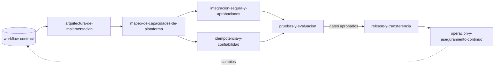

# Implementación Empresarial

Plugin de Distilled Innovation que acompaña al **equipo de TI o de implementación del cliente y a los consultores** a llevar un flujo de trabajo ya diseñado a una **implementación gobernada** en la plataforma que el cliente elija: con arquitectura trazable, decisiones registradas, controles de seguridad, aprobaciones humanas y pruebas.

## Qué es la metodología

Implementación Empresarial continúa a **Automatización con IA** (etapas C y D: implementar y transferir, medir y mejorar). Recibe la especificación portable del flujo, el `workflow-contract.yaml` que entrega `plan-piloto-y-especificacion`, y la convierte en una solución operable sin reescribir el diseño.

Tres ideas la guían:

- **El contrato es la fuente de verdad.** Actores, pasos, estados, aprobaciones y evidencias no se reinterpretan en silencio; si algo debe cambiar, el cambio vuelve a su dueño como decisión.
- **Toda configuración del cliente es una decisión.** Plataforma, plazos, umbrales, retención, roles aprobadores: cada uno con dueño, fecha y aprobación, en un registro único.
- **No hay conversión automática entre plataformas.** Lo que se construye en una plataforma no se traslada solo a otra; cada requisito se mapea contra el perfil elegido, cada mapeo es una decisión revisable y alguien con autoridad la aprueba.

## Requisito previo

Un `workflow-contract` del flujo (de `plan-piloto-y-especificacion`, plugin Automatización con IA), idealmente con un piloto cerrado y la puerta de entrada a la etapa C evaluada. Si no lo tienes, el facilitador te remite allí.

## Etapas

| Orden | Skill | Recibe | Produce |
|---|---|---|---|
| 0 | `facilitador-implementacion-empresarial` | `workflow-contract` | Ruta, registro de decisiones y estado |
| 1 | `arquitectura-de-implementacion` | Contrato | Arquitectura lógica trazable, límites de componentes, plan de implementación |
| 2 | `mapeo-de-capacidades-de-plataforma` | Arquitectura y plataforma elegida | `capability-map.yaml` con opciones, decisión, brecha, dueño y aprobación |
| 3 | `integracion-segura-y-aprobaciones` | Arquitectura y mapa | Modelo de amenazas, mínimo privilegio, secretos, matriz de aprobación y auditoría |
| 3 | `idempotencia-y-confiabilidad` | Arquitectura y mapa | Claves idempotentes, reintentos, compensaciones y recuperación |
| 4 | `pruebas-y-evaluacion` | Controles y criterios | Plan de evaluación funcional, de seguridad, de resiliencia y de calidad de IA |
| 5 | `release-y-transferencia` | Pruebas aprobadas | Checklist de salida, runbook y transferencia |
| 6 | `operacion-y-aseguramiento-continuo` | Solución en operación | Observabilidad, KPIs, control de cambios y recertificación |

Los cambios en operación vuelven al contrato.

## Skills

Escribe la frase de arranque en tu asistente y la skill se activa sola.

| Skill | Para qué sirve | Frase de arranque | Estado |
|---|---|---|---|
| `facilitador-implementacion-empresarial` | Comprueba el contrato, elige la ruta y abre el registro de decisiones | "Ya tenemos el flujo diseñado, ¿cómo lo llevamos a producción?" | Disponible |
| `arquitectura-de-implementacion` | Arquitectura lógica trazable al contrato, sin plataforma por defecto, con orquestador determinístico | "¿Qué componentes necesita este workflow-contract?" | Disponible |
| `mapeo-de-capacidades-de-plataforma` | Mapa requisito → opciones → decisión → brecha → dueño → aprobación, con perfiles Microsoft, AWS, Google y autoalojado | "Mapea el contrato contra nuestra plataforma" | Disponible |
| `integracion-segura-y-aprobaciones` | Amenazas, mínimo privilegio, secretos, datos hacia el modelo, matriz de aprobación y auditoría | "¿Quién tiene que aprobar qué antes de que el sistema actúe?" | Disponible |
| `idempotencia-y-confiabilidad` | Claves idempotentes, reintentos, compensaciones, cola de errores y recuperación | "¿Qué pasa si este paso se ejecuta dos veces?" | Disponible |
| `pruebas-y-evaluacion` | `evaluation-plan.yaml` con cuatro categorías, casos positivos y negativos, métricas de calidad de IA y criterios de aceptación | "¿Cómo probamos esto antes de salir?" | Disponible |
| `release-y-transferencia` | Preparación de release (nunca "listo" sin dueños, aprobación y rollback), runbook y transferencia de propiedad | "¿Qué necesitamos para salir a producción?" | Disponible |
| `operacion-y-aseguramiento-continuo` | Observabilidad, alertas, KPIs de valor (piloto frente a producción), costo por caso, control de cambios y recertificación | "¿Cómo sabemos que sigue funcionando bien?" | Disponible |

## Para quién es

Para equipos de TI, de implementación y de arquitectura del cliente, y para consultores. Usa términos técnicos, siempre con una línea que los explique. Las personas de negocio participan aprobando decisiones, no configurando.

## Cómo trabaja el facilitador

- Una pregunta principal por turno.
- Cada dato queda marcado como Hecho, Supuesto, Recomendación o Pendiente por validar, con un ID estable.
- Todo diagrama viene con una tabla equivalente.
- No elige plataforma por defecto, no promete equivalencias entre proveedores y marca "(verificar)" todo dato de plataforma no confirmado; los perfiles llevan su fecha de verificación.
- Sin credenciales, direcciones reales ni datos personales en ningún artefacto.
- Puedes escribir en cualquier momento: "Muéstrame el avance", "¿Qué falta?" o "Finalizar".

## Cómo se conecta con los otros plugins

- **Automatización con IA** (antes): diseña el flujo y entrega el `workflow-contract.yaml`. Implementación Empresarial usa el mismo esquema `workflow-contract.schema.json`.
- **Automatización con IA** (después): las mejoras de operación que cambian el diseño (variantes nuevas, pasos, autonomía) vuelven a `disenar-proceso-futuro` y recorren la cadena hasta el contrato.

Contenido bajo licencia CC BY 4.0 (atribución: Distilled Innovation).
