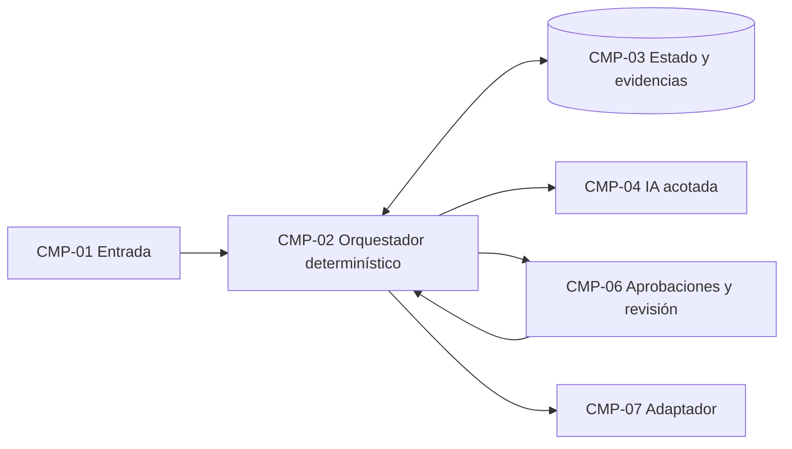

# Plan de implementación

Flujo: ___ (`FLU-__`)  Contrato: `workflow-contract.yaml` (madurez: ___, fecha: ___)
Versión del plan: ___  Fecha: ___  Aprueba (rol): ___  Estado: Borrador / Aprobado

> Arquitectura lógica: describe responsabilidades y límites, no productos. La plataforma se elige después, como decisión del cliente (`DEC-__`). No hay conversión automática entre plataformas.

## 1. Alcance

| Elemento | Respuesta | Procedencia |
|---|---|---|
| Qué entra (pasos, variantes, canales) | | |
| Qué no entra | | |
| Sistemas existentes que se leen | | |
| Sistemas existentes que se modifican | | |
| Restricciones del cliente (datos, horarios, volumen) | | |

## 2. Componentes lógicos

| ID | Componente | Responsabilidad | No puede | Datos que maneja (sensibilidad) | Dueño (rol) |
|---|---|---|---|---|---|
| `CMP-01` | | | | | |

Componentes de referencia (usa los que el contrato pida): entrada, orquestador determinístico, almacén de estado y evidencias, componente de IA acotado, reglas, bandeja de aprobaciones y cola de revisión, adaptador por sistema existente, mensajería de salida, auditoría y observabilidad, control de modo manual.

## 3. Diagrama

| Origen | Destino | Qué cruza | Sensibilidad | Condición |
|---|---|---|---|---|
| | | | | |

## 4. Orquestación

| Pregunta | Respuesta |
|---|---|
| Quién guarda el estado del caso | Orquestador determinístico + almacén de estado |
| Esperas largas (pasos `wait`) y su tiempo máximo | |
| Reintentos por paso (del contrato) | |
| Dónde ocurren las aprobaciones y qué pasa si nadie responde | |
| Qué pasa si el sistema se reinicia en medio de un caso | |
| Rol de la orquestación generativa (si existe) | Solo conversación; no maneja estado, aprobaciones ni efectos externos |

## 5. Trazabilidad contrato → componentes

Resumen; el detalle va en `trazabilidad-contrato-componentes.md`.

| Elemento del contrato | Componentes | Brecha |
|---|---|---|
| `FUT-__` | | |

## 6. Decisiones de arquitectura

Se agregan al registro de decisiones del facilitador.

| ID | Decisión | Alternativas | Dueño | Fecha | Aprobación |
|---|---|---|---|---|---|
| `DEC-__` | | | | | Pendiente |

## 7. Riesgos técnicos

| ID | Riesgo → impacto | Mitigación | Componente | Dueño |
|---|---|---|---|---|
| `RIE-__` | | | | |

## 8. Orden de construcción

| Orden | Qué se construye | Depende de | Cómo se comprueba |
|---|---|---|---|
| 1 | | | |

## 9. Requisitos para el mapeo de capacidades

Lo que `mapeo-de-capacidades-de-plataforma` tiene que cubrir (`REQ-nn`).

| ID | Requisito | Categoría | Viene de |
|---|---|---|---|
| `REQ-01` | | orquestación / estado / identidad / secretos / aprobaciones / observabilidad / idempotencia / modelo de IA / conocimiento / integración / protección de datos / prueba de aceptación | |

## 10. Pendientes

| Pendiente | Quién decide | Para cuándo | Bloquea |
|---|---|---|---|
| | | | |
