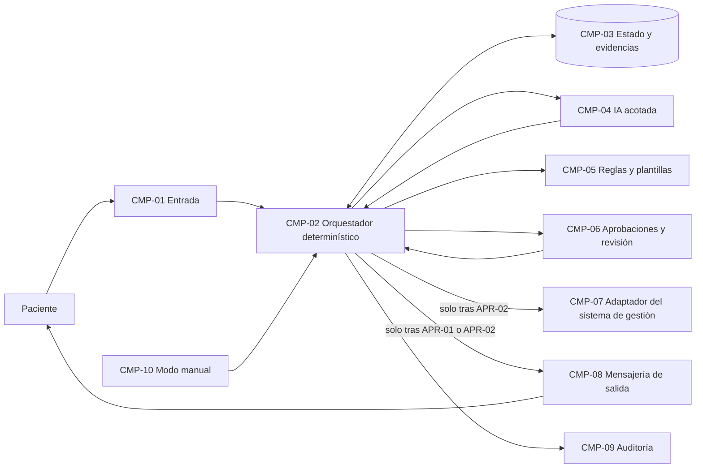

# Ejemplo: Arquitectura de implementación en una clínica dental ficticia

Empresa inventada: **Clínica Dental Sonrisa Norte** (clínica privada pequeña: 3 consultorios, 14 empleados). Todo lo siguiente es ficticio. Continúa el ejemplo de `facilitador-implementacion-empresarial`: el contrato de `FLU-01` (agendar citas) pasó la revisión con tres valores pendientes (`DEC-11` plazo de espera, `DEC-12` retención, `DEC-13` rol aprobador); la puerta pasa con condiciones (`DEC-08`); ruta completa con la plataforma por decidir (`DEC-09`); alcance: variante A por mensaje y formulario (`DEC-10`). Habla el líder técnico del proveedor de TI externo; aprueba Valeria (directora).

## Turno 1

**Líder técnico:** Ya tenemos el contrato revisado. Queremos la arquitectura.

**Facilitador:** El contrato trae ocho pasos: dos con IA (`FUT-01` leer la solicitud, `FUT-04` marcar posible urgencia), dos con efecto externo (`FUT-06` propuesta al paciente, `FUT-08` registro y confirmación) y una espera (`FUT-07`). ¿Qué sistemas actuales tocan esos dos pasos que envían o registran, y quién es dueño de cada uno?

## Turno 2

**Líder técnico:** La agenda y las fichas están en el sistema de gestión de la clínica, que contratan a un proveedor de software; lo administra la jefa de recepción. Los mensajes salen hoy desde el teléfono de recepción. El formulario es de la página web.

**Facilitador:** Entonces habrá un adaptador para el sistema de gestión (lee fichas, escribe citas) y una mensajería de salida nueva, porque un teléfono personal no deja evidencia ni se puede controlar desde el flujo. Lo anoto como decisión pendiente de Valeria. La espera de `FUT-07` puede durar horas: ¿qué tiene que pasar si el sistema se reinicia mientras un caso espera la respuesta del paciente?

## Turno 3

**Líder técnico:** Que siga donde estaba, obviamente. ¿No podríamos poner un agente que maneje todo, que lea, proponga y registre?

**Facilitador:** Un agente que decide en el momento qué herramienta usar (orquestación generativa) no es un motor durable: no garantiza el orden, ni que la aprobación de recepción ocurra antes de registrar, ni que retome el caso tras un reinicio. Por eso el estado, las esperas, los reintentos y las aprobaciones van en un **orquestador determinístico**, y la IA queda como una llamada acotada en `FUT-01` y `FUT-04`, sin permisos para escribir. Además, el patrón aprobado en el diseño es híbrido (`DEC-05`), no un agente. ¿Quién aprueba las decisiones de arquitectura, Valeria o la jefa de recepción?

## Turno 4

**Líder técnico:** Valeria, con la jefa de recepción revisando lo que toca a recepción. Finalizar.

**Facilitador:** Entrego el plan de implementación y la trazabilidad.

## Entregable: plan de implementación

Flujo: Agendar citas (`FLU-01`). Contrato: `workflow-contract.yaml` (madurez `pilot`, 2026-11-03). Versión del plan: borrador 1 (2026-12-09). Aprueba: Valeria. Estado: Borrador.

> Arquitectura lógica: no nombra productos. La plataforma se elige en el mapeo de capacidades, como decisión de la clínica (`DEC-09`). No hay conversión automática entre plataformas.

### 1. Alcance

| Elemento | Respuesta | Procedencia |
|---|---|---|
| Qué entra | Variante A por mensaje y formulario; pasos `FUT-01` a `FUT-08` | Decisión (`DEC-10`) |
| Qué no entra | Llamadas; variantes B, C y D (van a la cola de revisión); reagendar y cancelar (`FLU-02`) | Decisión (`DEC-10`) |
| Sistemas que se leen | Sistema de gestión de la clínica: fichas y agenda | Dicho por participante |
| Sistemas que se modifican | Sistema de gestión: citas. Mensajes al paciente | Dicho por participante |
| Restricciones | Datos de salud (`GRD-01`); autorización de datos reales pendiente (`DEC-08`) | Evidencia (contrato) |

### 2. Componentes lógicos

| ID | Componente | Responsabilidad | No puede | Datos (sensibilidad) | Dueño |
|---|---|---|---|---|---|
| `CMP-01` | Entrada | Recibe solicitudes y respuestas por mensaje y formulario; crea el caso con `request_id` o lo asocia a uno abierto | Interpretar el contenido | Texto de la solicitud (`sensitive`) | Proveedor de TI |
| `CMP-02` | Orquestador determinístico | Ejecuta `FUT-01` a `FUT-08` en orden, guarda el estado, maneja la espera de `FUT-07`, los reintentos y las aprobaciones | Leer texto libre, decidir urgencias | Referencias al caso | Proveedor de TI |
| `CMP-03` | Estado y evidencias | Guarda el estado (`ST-01` a `ST-11`) y `EVD-01` a `EVD-06` | Ejecutar lógica | `sensitive` | Administradora (datos) |
| `CMP-04` | IA acotada | `FUT-01`: extrae datos; `FUT-04`: marca posible urgencia. Salida estructurada | Escribir en sistemas, enviar, aprobar, llamar herramientas | Texto minimizado (`sensitive`) | Proveedor de TI |
| `CMP-05` | Reglas de agenda y plantillas | `FUT-02` (búsqueda y solicitud abierta), `FUT-06` (tres horarios y plantilla) | Decidir fuera de las reglas escritas | `personal`, `internal` | Jefa de recepción (reglas) |
| `CMP-06` | Bandeja de aprobaciones y cola de revisión | `APR-01` a `APR-04`, `FUT-03`, `FUT-05`, casos en `ST-09` y `ST-11`; aviso interno de `FUT-07` | Ejecutar el efecto: devuelve la decisión a `CMP-02` | `sensitive` | Jefa de recepción |
| `CMP-07` | Adaptador del sistema de gestión | Leer fichas y horarios; crear citas | Borrar o modificar citas existentes; leer historias clínicas | `personal`, `sensitive` | Proveedor de TI |
| `CMP-08` | Mensajería de salida | Enviar la propuesta y la confirmación con plantilla aprobada | Enviar sin aprobación; redactar libremente | `personal` | Jefa de recepción |
| `CMP-09` | Auditoría y observabilidad | Quién aprobó qué y cuándo; métricas del contrato; alertas | Guardar el texto completo de los mensajes | `internal` | Administradora |
| `CMP-10` | Control de modo manual | Apagar `CMP-04` y enviar todo a la cola de revisión (`GRD-07`) | Encenderse sin la jefa de recepción | — | Jefa de recepción |

### 3. Diagrama

| Origen | Destino | Qué cruza | Sensibilidad | Condición |
|---|---|---|---|---|
| Paciente | `CMP-01` | Solicitud o respuesta | `sensitive` | — |
| `CMP-01` | `CMP-02` | Caso nuevo o respuesta asociada | `sensitive` | — |
| `CMP-02` | `CMP-04` | Texto minimizado de la solicitud | `sensitive` | Solo si el modo manual está apagado |
| `CMP-04` | `CMP-02` | Datos extraídos o marca, en campos con tipo | `sensitive` | El orquestador valida la forma |
| `CMP-02` | `CMP-06` | Lo que hay que aprobar o revisar | `sensitive` | `APR-01` a `APR-04`, `FUT-03`, `FUT-05` |
| `CMP-02` | `CMP-07` | Lectura de ficha y horarios; creación de cita | `personal` | Crear cita solo tras `APR-02` |
| `CMP-02` | `CMP-08` | Propuesta o confirmación con plantilla | `personal` | Solo tras `APR-01` (propuesta) o `APR-02` (confirmación) |
| `CMP-02` | `CMP-09` | Quién, qué, cuándo, versión | `internal` | Siempre |
| `CMP-10` | `CMP-02` | Encendido o apagado de la parte con IA | — | Jefa de recepción |

### 4. Orquestación

| Pregunta | Respuesta |
|---|---|
| Quién guarda el estado | `CMP-02` con `CMP-03` (`DEC-14`) |
| Esperas largas | `FUT-07`: plazo `DEC-11` (Pendiente); aprobaciones pendientes: aviso a la jefa a una hora por definir (`DEC-16`, Pendiente) |
| Reintentos | Los del contrato: `FUT-01` y `FUT-06` un intento; `FUT-08` ninguno (va a revisión) |
| Si nadie aprueba | Lo que dice `on_timeout` de cada política: el caso espera y se avisa a la jefa |
| Reinicio en medio de un caso | Se retoma desde el último estado guardado en `CMP-03` |
| Orquestación generativa | No se usa: las solicitudes entran como eventos, no como conversación (`DEC-14`) |

### 5. Trazabilidad (resumen)

Detalle completo en la tabla de trazabilidad (abajo). Sin elementos del contrato sin componente. Una pregunta abierta: `CMP-08` es nuevo porque hoy se usa un teléfono personal (`DEC-17`).

### 6. Decisiones de arquitectura

| ID | Decisión | Alternativas | Dueño | Fecha | Aprobación |
|---|---|---|---|---|---|
| `DEC-14` | Un orquestador determinístico es dueño del estado, el orden, las esperas, los reintentos y las aprobaciones; no se usa orquestación generativa | Un agente que decide qué herramienta usar | Valeria | 2026-12-09 | Pendiente |
| `DEC-15` | La IA es una llamada acotada en `FUT-01` y `FUT-04`, con salida estructurada y sin herramientas que escriban | IA con acceso a la agenda | Valeria | 2026-12-09 | Pendiente |
| `DEC-16` | Hora del aviso "al final del día" de `APR-01` y `APR-02` | 17:00; 18:00; al cierre de recepción | Jefa de recepción | Para 2026-12-11 | Pendiente |
| `DEC-17` | Los mensajes al paciente salen de una mensajería institucional (`CMP-08`), no del teléfono de recepción | Seguir con el teléfono de recepción | Valeria | Para 2026-12-11 | Pendiente |

### 7. Riesgos técnicos

| ID | Riesgo → impacto | Mitigación | Componente | Dueño |
|---|---|---|---|---|
| `RIE-07` | El sistema de gestión no permite evitar citas duplicadas al reintentar → cita doble (`RIE-01`) | Requisito de idempotencia `REQ-08` para el mapeo; `FUT-08` sin reintento automático | `CMP-07` | Proveedor de TI |
| `RIE-08` | La respuesta del paciente llega después del plazo y no se asocia al caso → solicitud perdida | Asociar por paciente y solicitud abierta (`FUT-02`, `EXC-04`); casos sin asociar a revisión | `CMP-01`, `CMP-02` | Proveedor de TI |

### 8. Orden de construcción

| Orden | Qué se construye | Depende de | Cómo se comprueba |
|---|---|---|---|
| 1 | `CMP-02`, `CMP-03`, `CMP-06`, `CMP-10` con pasos simulados | Plataforma (`DEC-09`) | Un caso recorre los estados y se retoma tras un reinicio |
| 2 | `CMP-05` y `CMP-07` en solo lectura | Acceso de lectura aprobado | `FUT-02` encuentra fichas de prueba |
| 3 | `CMP-04` con datos anonimizados | Modelo permitido y autorización de datos | `AT-02`, `AT-03`, `AT-05` |
| 4 | `CMP-07` escritura y `CMP-08` | `REQ-08`, `DEC-17` | `AT-01`, `AT-04`, `AT-06` |
| 5 | `CMP-09` | Retención (`DEC-12`) | Cada aprobación queda con quién y cuándo |

### 9. Requisitos para el mapeo de capacidades

| ID | Requisito | Categoría | Viene de |
|---|---|---|---|
| `REQ-01` | Orquestación durable: orden fijo, estado persistente, reanudación | orquestación | `FUT-01` a `FUT-08`, `CMP-02` |
| `REQ-02` | Esperas con tiempo máximo (respuesta del paciente y aprobaciones pendientes) | orquestación | `FUT-07`, `on_timeout`, `DEC-11`, `DEC-16` |
| `REQ-03` | Estado del caso y cola de revisión | estado | `ST-01` a `ST-11`, `CMP-03` |
| `REQ-04` | Llamada acotada a un modelo permitido, con salida estructurada | modelo de IA | `FUT-01`, `FUT-04`, `CMP-04` |
| `REQ-05` | Bandeja de aprobación con identidad del aprobador | aprobaciones | `APR-01` a `APR-04`, `CMP-06` |
| `REQ-06` | Identidad y permisos por rol y por componente | identidad | Actores, `CMP-07` |
| `REQ-07` | Secretos de conexión fuera de los artefactos | secretos | `CMP-07`, `CMP-08` |
| `REQ-08` | Registro de cita sin duplicados | idempotencia | `FUT-08`, `AT-06`, `RIE-07` |
| `REQ-09` | Envío de propuesta sin duplicados | idempotencia | `FUT-06` |
| `REQ-10` | Evidencia y auditoría con retención | observabilidad | `EVD-01` a `EVD-06`, `DEC-12` |
| `REQ-11` | Modo manual | orquestación | `GRD-07`, `CMP-10` |
| `REQ-12` | Minimización de datos antes del modelo | protección de datos | `GRD-01`, `RIE-03` |
| `REQ-13` | Adaptador del sistema de gestión (leer fichas, crear citas) | integración | `FUT-02`, `FUT-08`, `CMP-07` |
| `REQ-14` | Pruebas de aceptación ejecutables | prueba de aceptación | `AT-01` a `AT-06` |

### 10. Pendientes

| Pendiente | Quién decide | Para cuándo | Bloquea |
|---|---|---|---|
| `DEC-11`, `DEC-13`, `DEC-16`, `DEC-17` | Jefa de recepción y Valeria | 2026-12-11 | Construcción de `FUT-07` y `CMP-08` |
| `DEC-12` retención | Administradora | 2026-12-18 | `CMP-09` |
| Autorización de datos reales | Administradora | Por definir con la administradora | Orden 3 en adelante con datos reales |

## Entregable: trazabilidad contrato → componentes (pasos)

| Paso | Tipo | Efecto externo | Ejecuta | Apoyo | Aprobación | Idempotencia | Evidencia | Éxito / falla |
|---|---|---|---|---|---|---|---|---|
| `FUT-01` | ai_assisted | No | `CMP-04` | `CMP-02`, `CMP-06` | `APR-04` | Clave natural `request_id` | `EVD-01` | `ST-02` / `ST-09` |
| `FUT-02` | deterministic | No | `CMP-05` | `CMP-07` (lectura) | No aplica | No aplica | `EVD-02` | `ST-03` o `ST-11` / `ST-09` |
| `FUT-03` | human_task | No | `CMP-06` | — | No aplica | No aplica | `EVD-02` | `ST-03` / `ST-09` |
| `FUT-04` | ai_assisted | No | `CMP-04` | `CMP-02` | No aplica | No aplica | `EVD-03` | `ST-04` / `ST-09` |
| `FUT-05` | decision | No | `CMP-06` | — | `APR-03` | No aplica | `EVD-03` | `ST-05` o `ST-10` / `ST-09` |
| `FUT-06` | deterministic | Sí | `CMP-05`, `CMP-08` | `CMP-06` | `APR-01` | Clave `request_id` + `proposal_version` | `EVD-04` | `ST-06` / `ST-09` |
| `FUT-07` | wait | No | `CMP-02` | `CMP-01`, `CMP-06` | No aplica | Clave natural `request_id` + `notice_date` | `EVD-06` | `ST-07` / `ST-09` |
| `FUT-08` | deterministic | Sí | `CMP-07`, `CMP-08` | `CMP-06` | `APR-02` | Clave `patient_id` + `slot_id` (`REQ-08`) | `EVD-05` | `ST-08` / `ST-09` |

| Guardrail | Componente que lo hace cumplir |
|---|---|
| `GRD-01` datos sensibles | `CMP-02` (minimiza antes de `CMP-04`), `CMP-03`, `CMP-09` |
| `GRD-02` baja certeza a revisión | `CMP-02`, `CMP-06` |
| `GRD-03` y `GRD-04` aprobación antes de enviar y registrar | `CMP-06`, `CMP-02` |
| `GRD-05` urgencias | `CMP-04` (marca ante la duda), `CMP-06` (decide una persona) |
| `GRD-06` mensaje como dato | `CMP-04` (instrucciones fijas), `CMP-02` (valida la salida) |
| `GRD-07` modo manual | `CMP-10` |

Pruebas de aceptación: `AT-01` recorre `CMP-01` a `CMP-09`; `AT-02` y `AT-03`, `CMP-04` y `CMP-06`; `AT-04`, `CMP-05`; `AT-05`, `CMP-02`; `AT-06`, `CMP-07`.

**Siguiente paso sugerido:** `mapeo-de-capacidades-de-plataforma`, con los catorce requisitos `REQ-01` a `REQ-14`, en cuanto la clínica elija plataforma; en paralelo, `integracion-segura-y-aprobaciones` sobre los flujos de datos de la sección 3.

## Lo que se ve en este ejemplo

- La arquitectura no nombra ningún producto: la plataforma sigue pendiente (`DEC-09`).
- La propuesta de "un agente que maneje todo" se respondió con la razón concreta (la orquestación generativa no es un motor durable) y con la decisión de patrón del diseño (`DEC-05`).
- Cada componente tiene una columna "No puede"; la IA no escribe ni aprueba.
- Ninguna flecha llega a `CMP-07` o `CMP-08` sin su aprobación.
- Los valores que aparecieron (hora del aviso, mensajería institucional) entraron al registro como decisiones pendientes con dueño.
- La trazabilidad cubre pasos, aprobaciones, evidencias, guardrails y pruebas, y deja catorce requisitos para el mapeo.
