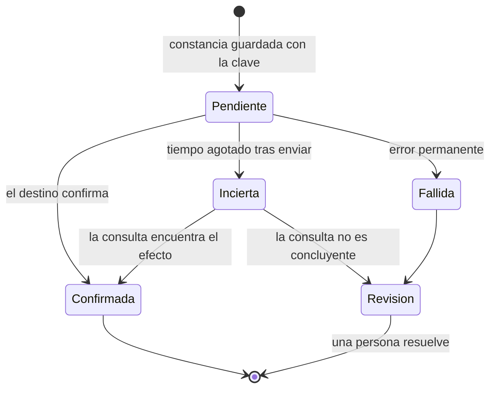

# Registro de idempotencia y confiabilidad

Flujo: ___ (`FLU-__`)  Contrato (fecha): ___  Plan de implementación (versión): ___  Mapa de capacidades: ___
Fecha: ___  Elabora (rol): ___  Aprueba (rol): ___  Estado: Borrador / Aprobado

> Idempotencia: repetir una operación produce el mismo resultado que hacerla una vez. Este registro dice, para cada operación repetible, cómo se reconoce una repetición, qué pasa cuando algo falla y cómo se recupera. Sin secretos, direcciones reales ni datos de casos reales: las claves se describen por sus campos.

## 1. Operaciones repetibles

| ID | Operación | Paso del contrato | Efecto externo | Clave (campos) | Alcance (qué es "la misma operación") | Constancia: dónde y cuándo | Retención de la clave (decisión) | Qué garantiza el destino |
|---|---|---|---|---|---|---|---|---|
| `IDM-__` | | `FUT-__` | Sí / No | | | Antes del efecto, en `CMP-__` | `DEC-__` | Acepta clave / Permite consultar / Nada (brecha) |

## 2. Duplicados técnicos y de negocio

| Situación | Tipo | Cómo se reconoce | Qué hace el flujo | Regla del contrato |
|---|---|---|---|---|
| | Técnico (misma entrega repetida) / De negocio (la persona pide dos veces) | | Absorber y registrar / Cola de revisión | `EXC-__`, `AT-__` |

## 3. Errores y reintentos

| Operación | Error | Clase | Reintento (intentos, espera) | Al agotarse | Reintento por defecto de la plataforma (verificar) y ajuste |
|---|---|---|---|---|---|
| `IDM-__` | | Transitorio / Permanente / Incierto | Según `retry_policy` del contrato | Cola de revisión / Cola de errores | |

Regla: un error **incierto** (tiempo agotado después de enviar) nunca se reintenta a ciegas; primero se consulta el destino o el caso pasa a revisión.

## 4. Ciclo de una operación con efecto externo

| Estado de la constancia | Cómo se llega | Qué sigue |
|---|---|---|
| Pendiente | Se guardó la clave antes del efecto | Ejecutar el efecto |
| Confirmada | El destino confirmó | Continuar el flujo |
| Fallida | Error permanente | Cola de revisión o de errores |
| Incierta | Tiempo agotado después de enviar | Consultar el destino; si no es concluyente, revisión |
| Revisión | Falla o incertidumbre sin resolver | Una persona decide; queda registrado |

## 5. Compensaciones

| Efecto | ¿Se puede deshacer? | Compensación o acción correctiva | Quién la propone | Quién la aprueba | Permiso necesario | Evidencia |
|---|---|---|---|---|---|---|
| | Sí / No | | | (según la matriz de aprobación) | | `EVD-__` |

## 6. Colas

| Cola | Tipo | Qué entra | Dueño | Revisión (cada cuánto) | Antigüedad máxima y alerta | Cómo se reprocesa |
|---|---|---|---|---|---|---|
| Cola de revisión | Negocio | Casos que decide una persona | | | | La persona decide en la bandeja |
| Cola de errores | Técnica | Entradas o efectos con falla técnica | | | | Con la misma clave, nunca con una nueva |

## 7. Recuperación y conciliación

| Situación | Qué pasa | Quién actúa | Objetivo de tiempo (decisión) |
|---|---|---|---|
| Reinicio del orquestador a mitad de un caso | Retoma desde el último estado guardado | | `DEC-__` |
| Sistema de destino caído | | | |
| Conciliación periódica (constancias contra destino) | | | |
| Último recurso | Modo manual | | |

## 8. Pruebas de resiliencia

| Prueba | Operación | Tipo | Qué se hace | Resultado esperado |
|---|---|---|---|---|
| | `IDM-__` | Positiva / Negativa | | |

## 9. Decisiones, riesgos y cambios al contrato

| ID | Decisión, riesgo o cambio | Alternativas | Dueño | Fecha | Aprobación |
|---|---|---|---|---|---|
| `DEC-__` | | | | | Pendiente |

## 10. Pendientes

| Pendiente | Quién decide | Para cuándo | Bloquea |
|---|---|---|---|
| | | | |
