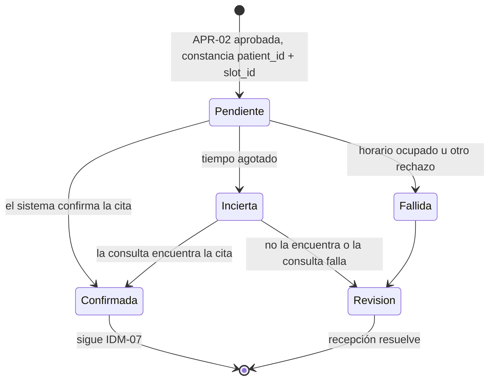

# Ejemplo: Idempotencia y confiabilidad en una clínica dental ficticia

Empresa inventada: **Clínica Dental Sonrisa Norte** (clínica privada pequeña: 3 consultorios, 14 empleados). Todo lo siguiente es ficticio. Continúa el ejemplo de `integracion-segura-y-aprobaciones`: `FLU-01` (agendar citas) tiene arquitectura lógica (`CMP-01` a `CMP-10`), plataforma Microsoft elegida por la clínica (`DEC-18`), un mapa `MAP-FLU-01-MS` con seis requisitos pendientes, entre ellos `REQ-08` (cita sin duplicados, opción decidida en `DEC-19`), `REQ-09` (propuesta sin duplicados) y `REQ-13` (adaptador del sistema de gestión, pendiente hasta confirmar la interfaz), y una revisión de seguridad con controles `CTL-01` a `CTL-10` y la matriz de aprobación de operación (`DEC-22`). El contrato fija: `FUT-01` y `FUT-06`, un intento; `FUT-08`, ningún reintento automático. Las decisiones llegaron hasta `DEC-24` y los riesgos hasta `RIE-08`. Participan el líder técnico del proveedor de TI y, desde el turno 3, la jefa de recepción, dueña del contrato.

## Turno 1

**Líder técnico:** Ya pasamos la revisión de seguridad. Valeria quiere que le garanticemos que nunca se va a duplicar una cita.

**Facilitador:** El contrato tiene dos pasos con efecto externo, `FUT-06` (propuesta al paciente) y `FUT-08` (registro y confirmación), y el sistema de gestión no acepta una clave de operación (`DEC-19`), así que lo que podemos garantizar depende de una sola cosa: cuando el conector intenta crear una cita y se agota el tiempo de espera, ¿el sistema de gestión permite consultar por paciente y horario si la cita quedó creada?

## Turno 2

**Líder técnico:** El proveedor del sistema nos confirmó por escrito que se pueden consultar citas por paciente y fecha; todavía no lo probamos. Y supongo que el conector, si falla, reintenta solo, ¿no?

**Facilitador:** Esa es justamente la trampa. Muchas plataformas reintentan solas algunas acciones con valores por defecto (en el perfil Microsoft, la política de reintentos de cada acción, verificar en la documentación vigente). Un reintento automático dentro del paso que crea la cita podría duplicarla sin que el orquestador lo vea, y el contrato dice que `FUT-08` no se reintenta solo. Así que la configuración se hace explícita, acción por acción, y queda como riesgo (`RIE-09`) hasta probarla. Con la consulta por paciente y fecha, un tiempo agotado deja de ser una apuesta: se consulta antes de decidir. Una pregunta de valor del contrato: los reintentos de cada paso los fija su dueña. ¿Hablamos con la jefa de recepción sobre qué hacer cuando el modelo no responde?

## Turno 3

**Jefa de recepción:** Aquí estoy. Si el modelo no responde, que lo intente un par de veces antes de mandarme el caso; pero la cita, jamás dos veces.

**Facilitador:** Queda como cambio al contrato (`DEC-26`): `FUT-01` y `FUT-04`, que no tienen efecto externo, hasta tres intentos solo ante errores transitorios, con espera creciente; ante una respuesta con formato roto, sin reintento y a tu cola. `FUT-06` y `FUT-08` no cambian. Ahora los duplicados de negocio: si un paciente escribe por mensaje y además llena el formulario, son dos solicitudes distintas para el sistema. ¿Prefieres que la segunda vaya a tu cola de revisión, como dice el contrato, o que se una sola a la primera?

## Turno 4

**Jefa de recepción:** A la cola, como está. A veces es la mamá pidiendo para el hijo, y eso no lo puede adivinar el sistema.

**Líder técnico:** ¿Y si se cae todo un martes en la mañana? Propongo que si no volvemos en cuatro horas hábiles, la jefa pase a modo manual. Valeria tendrá que decidirlo. Finalizar.

**Facilitador:** Entrego el registro.

## Entregable: registro de idempotencia y confiabilidad

Flujo: Agendar citas (`FLU-01`). Contrato: 2026-11-03 (con el cambio `DEC-26`). Plan: borrador 1. Mapa: `MAP-FLU-01-MS`. Fecha: 2026-12-18. Elabora: líder técnico del proveedor de TI. Aprueba: Valeria; los cambios al contrato, la jefa de recepción. Estado: Borrador.

> Lo que este registro **no** dice: "la plataforma garantiza que no se duplican citas". El sistema de gestión no acepta clave de operación; la idempotencia de `FUT-08` es parcial (constancia previa + consulta) y la brecha queda escrita con su mitigación.

### 1. Operaciones repetibles

| ID | Operación | Paso | Efecto externo | Clave (campos) | Alcance | Constancia | Retención de la clave | Qué garantiza el destino |
|---|---|---|---|---|---|---|---|---|
| `IDM-01` | Crear el caso al recibir una solicitud | Entrada de `FUT-01` (`CMP-01`) | No | `request_id` = canal + identificador del envío en el canal | Por canal | Tabla de casos (`REQ-03`), con clave única (verificar) | `DEC-25`, Pendiente | Interno: la tabla rechaza una clave repetida (verificar) |
| `IDM-02` | Llamar al modelo para leer la solicitud o marcar urgencia | `FUT-01`, `FUT-04` | No | `request_id` + paso + versión de instrucciones | Por caso | Resultado guardado en la tabla de casos | Igual que el caso | Sin efecto externo: repetir es seguro |
| `IDM-03` | Registrar la decisión de una aprobación | `APR-01` a `APR-04` | No | `request_id` + política + versión de lo aprobado | Por caso y política | Tabla de evidencias (`REQ-10`) | `DEC-12` | Interno: vale la primera respuesta |
| `IDM-04` | Enviar la propuesta al paciente | `FUT-06` | **Sí** | `request_id` + `proposal_version` (contrato) | Por caso y versión | Constancia de envío antes de llamar a la mensajería (`REQ-09`) | `DEC-25`, Pendiente | Mensajería sin elegir (`DEC-17`): no se sabe si acepta clave ni si informa la entrega (verificar) |
| `IDM-05` | Avisar internamente que no hubo respuesta | `FUT-07` | No (aviso interno) | `request_id` + `notice_date` (contrato) | Por caso y día | Tabla de casos | Igual que el caso | Interno |
| `IDM-06` | Crear la cita en el sistema de gestión | `FUT-08` | **Sí** | `patient_id` + `slot_id` (contrato) | Por paciente y horario | Constancia previa en la tabla de operaciones (`DEC-19`) | `DEC-25`, Pendiente | No acepta clave; permite consultar por paciente y fecha (Dicho por participante, por probar en `REQ-13`) |
| `IDM-07` | Enviar la confirmación al paciente | `FUT-08` (sub-operación) | **Sí** | `patient_id` + `slot_id` + "confirmación" | Por paciente y horario | Constancia de envío | `DEC-25`, Pendiente | Igual que `IDM-04` |
| `IDM-08` | Asociar la respuesta del paciente al caso | `FUT-07` (`CMP-01`) | No | `request_id` del caso abierto + identificador del mensaje de respuesta | Por caso | Tabla de casos | Igual que el caso | Interno (`RIE-08`) |

La confirmación (`IDM-07`) va con su propia constancia, separada del registro (`IDM-06`): si falla el mensaje, no se vuelve a intentar crear la cita.

### 2. Duplicados técnicos y de negocio

| Situación | Tipo | Cómo se reconoce | Qué hace el flujo | Regla |
|---|---|---|---|---|
| El paciente envía el formulario dos veces (doble clic) | Técnico | Misma clave de `IDM-01` | Se absorbe: un solo caso; queda registrado | `IDM-01` |
| El canal entrega dos veces el mismo mensaje | Técnico | Misma clave de `IDM-01` | Se absorbe | `IDM-01` |
| El paciente escribe por mensaje y además llena el formulario | De negocio | Claves distintas; `FUT-02` detecta una solicitud abierta | Cola de revisión (`ST-09`); decide recepción | `EXC-04`, `AT-04` (Decisión de la jefa de recepción) |
| El paciente responde dos veces "acepto el martes" | Técnico | Caso ya en `ST-07` | La segunda respuesta se adjunta como nota; no cambia el horario | `IDM-08` |
| La recepcionista aprueba dos veces la misma propuesta | Técnico | Misma clave de `IDM-03` | Vale la primera; la segunda se registra y se ignora | `IDM-03` |

### 3. Errores y reintentos

| Operación | Error | Clase | Reintento | Al agotarse | Reintento por defecto de la plataforma |
|---|---|---|---|---|---|
| `IDM-01` | La tabla de casos no responde | Transitorio | Lo reintenta la entrada hasta 3 veces con espera creciente | Cola de errores | Revisar el disparador del canal (verificar si el canal reenvía) |
| `IDM-02` | El modelo no responde o rechaza por límite de solicitudes | Transitorio | Hasta 3 intentos, espera de 1, 2 y 4 minutos (`DEC-26`) | Cola de revisión | Configurar explícito en la acción (verificar el valor por defecto) |
| `IDM-02` | Salida que no respeta los campos (`CTL-04`) | Permanente | Ninguno | Cola de revisión | — |
| `IDM-04` | La mensajería rechaza el contacto | Permanente | Ninguno | Cola de revisión | Configurar en "sin reintento" (verificar) |
| `IDM-04` | Tiempo agotado después de enviar | **Incierto** | **Ninguno a ciegas**: consultar el estado del envío con la clave, si la mensajería lo permite (verificar) | Si no es concluyente, revisión: recepción confirma con el paciente antes de reenviar | Igual |
| `IDM-06` | Dato rechazado por el sistema (horario ya ocupado) | Permanente | Ninguno | Revisión: recepción propone de nuevo (`proposal_version` + 1) | Configurar en "sin reintento" (verificar) — `RIE-09` |
| `IDM-06` | Tiempo agotado al crear la cita | **Incierto** | **Ninguno**: consultar por paciente y fecha | Encontrada: constancia "confirmada". No encontrada o consulta fallida: revisión | Igual |
| `IDM-07` | La confirmación no sale | Transitorio o incierto | Ninguno automático | Revisión: "cita registrada sin confirmación"; recepción reenvía con la misma clave | Igual |

### 4. Ciclo de la constancia de `IDM-06`

| Estado | Cómo se llega | Qué sigue |
|---|---|---|
| Pendiente | `APR-02` aprobada; constancia guardada antes de llamar al sistema | Crear la cita |
| Confirmada | El sistema confirma, o la consulta la encuentra | Confirmación al paciente (`IDM-07`) |
| Fallida | Rechazo permanente (horario ocupado) | Cola de revisión (`ST-09`) |
| Incierta | Tiempo agotado | Consulta por paciente y fecha |
| Revisión | No se pudo saber si se creó | Recepción revisa la agenda y decide; nunca se repite a ciegas |

### 5. Compensaciones

| Efecto | ¿Se puede deshacer? | Compensación o acción correctiva | Propone | Aprueba | Permiso | Evidencia |
|---|---|---|---|---|---|---|
| Cita duplicada (la detecta la conciliación) | Sí, a mano | Anular la cita sobrante en el sistema de gestión | Proveedor de TI (la conciliación) | Jefa de recepción, que la anula con su propio usuario | El conector no puede borrar ni modificar citas (`CTL-06`): la compensación es humana | `EVD-05` y registro de compensaciones |
| Dos confirmaciones al paciente | No | Mensaje de aclaración con una plantilla nueva | Jefa de recepción | Valeria, porque la plantilla la propone la jefa (matriz de `DEC-22`) | Mensajería con plantilla aprobada | `EVD-05` |
| Propuesta enviada dos veces | No | Ninguna por defecto; recepción decide si aclara | Recepción | Jefa de recepción | — | `EVD-04` |
| Cita creada con un horario que el paciente no aceptó | Sí, a mano | Anular y volver a proponer | Recepción | Jefa de recepción | Usuario propio de recepción | `EVD-05` |

### 6. Colas

| Cola | Tipo | Qué entra | Dueño | Revisión | Antigüedad máxima y alerta | Reprocesamiento |
|---|---|---|---|---|---|---|
| Cola de revisión (`ST-09`, `CMP-06`) | Negocio | Casos fuera del piloto, dudas, rechazos, resultados inciertos | Jefa de recepción | Continua en horario de recepción | 4 horas hábiles; alerta a la jefa (`DEC-27`, Pendiente) | La persona decide en la bandeja |
| Cola de errores | Técnica | Entradas que no crearon caso, fallas técnicas de `IDM-01` | Proveedor de TI | Cada día hábil, a primera hora | 2 horas hábiles; alerta al proveedor. Si un elemento cumple un día, se crea un caso en la cola de revisión para que recepción contacte al paciente | Con la misma clave de `IDM-01`; nunca con una nueva |

### 7. Recuperación y conciliación

| Situación | Qué pasa | Quién actúa | Objetivo |
|---|---|---|---|
| Reinicio del flujo a mitad de un caso | Retoma desde el último estado en la tabla de casos; las constancias "pendiente" se consultan antes de repetir | Automático; lo verifica el proveedor de TI | Sin pérdida de casos (`REQ-01`) |
| Sistema de gestión caído | `FUT-02` y `FUT-08` fallan como transitorios o inciertos; los casos esperan en revisión | Proveedor de TI; la jefa informa a recepción | `DEC-28`, Pendiente |
| Conciliación diaria | Al cierre de recepción, comparar constancias de `IDM-06` con las citas del día en el sistema de gestión: constancia sin cita, cita sin constancia, cita doble | Proveedor de TI la ejecuta; la jefa de recepción resuelve las diferencias | Diferencias resueltas antes de la apertura siguiente (`DEC-27`, Pendiente) |
| Último recurso | Modo manual (`CMP-10`, `GRD-07`) | Jefa de recepción | Si el servicio no vuelve en 4 horas hábiles (`DEC-28`, propuesta del líder técnico) |

### 8. Pruebas de resiliencia

| Prueba | Operación | Tipo | Qué se hace | Resultado esperado |
|---|---|---|---|---|
| `RES-01` | `IDM-01` | Negativa | Enviar dos veces el mismo formulario | Un solo caso |
| `RES-02` | `FUT-02` | Negativa | Mismo paciente por mensaje y por formulario | El segundo caso va a la cola de revisión (`AT-04`) |
| `RES-03` | `IDM-02` | Positiva | El modelo falla dos veces y responde a la tercera | El caso sigue sin intervención (`DEC-26`) |
| `RES-04` | `IDM-04` | Negativa | Tiempo agotado simulado después de enviar la propuesta | No se reenvía; consulta o revisión |
| `RES-05` | `IDM-06` | Negativa | Repetir `FUT-08` con la misma clave | Una sola cita (`AT-06`) |
| `RES-06` | `IDM-06` | Negativa | Tiempo agotado simulado al crear la cita | Consulta; si la cita existe, no se crea otra; si no se sabe, revisión |
| `RES-07` | `IDM-06` | Negativa | Revisar la configuración de reintentos de la acción que crea la cita | Sin reintentos automáticos (`RIE-09`) |
| `RES-08` | `IDM-05` | Negativa | Detener y reanudar el flujo durante la espera de `FUT-07` | El caso sigue; el aviso del día no se duplica |
| `RES-09` | `IDM-01` | Negativa | Reprocesar un elemento desde la cola de errores | Misma clave; ningún caso duplicado |
| `RES-10` | Conciliación | Positiva | Crear a mano una cita sin constancia en el sistema de prueba | La conciliación la detecta y la envía a revisión |
| `RES-11` | `IDM-03` | Negativa | Dos respuestas a la misma aprobación | Una sola decisión registrada |

### 9. Decisiones, riesgos y cambios al contrato

| ID | Decisión, riesgo o cambio | Alternativas | Dueño | Fecha | Aprobación |
|---|---|---|---|---|---|
| `DEC-25` | Retención de las claves: casos y envíos, 90 días después del cierre; citas, hasta 30 días después de la fecha de la cita (propuesta del proveedor de TI) | Lo mismo que las evidencias (`DEC-12`) | Administradora | Para 2026-12-23 | Pendiente |
| `DEC-26` | Cambio al contrato: `FUT-01` y `FUT-04` hasta 3 intentos solo ante errores transitorios, espera de 1, 2 y 4 minutos; `FUT-06` y `FUT-08` sin cambio | Mantener un intento; reintentar también `FUT-06` | Jefa de recepción (dueña del contrato) | 2026-12-18 | Aprobada por la jefa de recepción; Valeria informada |
| `DEC-27` | Conciliación diaria al cierre de recepción y antigüedad máxima de la cola de revisión: 4 horas hábiles | Conciliación semanal | Jefa de recepción | Para 2026-12-23 | Pendiente |
| `DEC-28` | Objetivo de recuperación: 4 horas hábiles; después, modo manual | 1 día hábil | Valeria | Para 2026-12-23 | Pendiente |
| `RIE-09` | Los reintentos por defecto de una acción repiten un efecto sin que el orquestador lo vea → cita o mensaje duplicado | Configurar cada acción con efecto de forma explícita y probarlo (`RES-07`) | Proveedor de TI | 2026-12-18 | Registrado |
| `RIE-10` | Envío de propuesta de resultado incierto → el paciente recibe dos propuestas o ninguna | Consulta del estado si la mensajería lo permite; si no, revisión antes de reenviar | Proveedor de TI | 2026-12-18 | Registrado |

### 10. Pendientes

| Pendiente | Quién decide | Para cuándo | Bloquea |
|---|---|---|---|
| Probar la consulta por paciente y fecha en el sistema de gestión de prueba (`REQ-13`, `REQ-08`) | Proveedor de TI | Antes de construir `FUT-08` | `IDM-06` |
| Elegir la mensajería (`DEC-17`) y verificar si acepta clave o informa la entrega | Valeria; el proveedor de TI verifica | Por definir con Valeria | `IDM-04`, `IDM-07` |
| `DEC-25`, `DEC-27`, `DEC-28` | Administradora, jefa de recepción, Valeria | 2026-12-23 | Salida a producción |
| Actualizar el `workflow-contract.yaml` con `DEC-26` (`retry_policy` de `FUT-01` y `FUT-04`) | Jefa de recepción | Antes de las pruebas | Pruebas de `IDM-02` |

**Siguiente paso sugerido:** `pruebas-y-evaluacion`, para convertir `RES-01` a `RES-11`, los controles `CTL-01` a `CTL-10` y las pruebas `AT-01` a `AT-06` en un plan de evaluación con criterios de aceptación aprobados.

## Lo que se ve en este ejemplo

- La pregunta del primer turno fue la que decide cuánto se puede garantizar: si el destino permite consultar.
- "Nunca se duplica una cita" no se prometió: la idempotencia de `FUT-08` es parcial y la brecha quedó escrita.
- Los reintentos por defecto de la plataforma se trataron como riesgo, marcados "(verificar)", y con una prueba propia.
- El cambio de reintentos de `FUT-01` y `FUT-04` lo aprobó la dueña del contrato; los pasos con efecto externo no cambiaron.
- El duplicado de negocio (mensaje y formulario del mismo paciente) siguió la regla del contrato, no la clave técnica.
- Como el conector no puede borrar, la compensación de una cita duplicada es humana y pasa por la matriz de aprobación.
- Cada cola tiene dueño y alerta, y la de errores nunca deja a un paciente sin atender: al día se convierte en caso de revisión.
