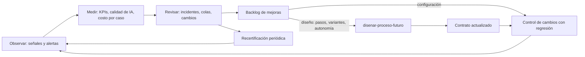

# Herramientas para la operación y el aseguramiento continuo

Nota de fuente: la observabilidad, las alertas, la revisión periódica, el control de cambios y la recertificación provienen del diseño de implementación empresarial de Distilled Innovation. La etapa D de su oferta (medir y mejorar: KPIs, calidad de resultados, costos, fallos, excepciones, adopción, retroalimentación, mejora de reglas e instrucciones, expansión controlada; tablero de resultados, informe de evaluación, backlog de mejoras y plan de escalamiento), sus criterios de calidad operativa (costos por caso, estado observable, disponibilidad, gestión de cambios, trazabilidad de versiones, propiedad de incidentes), la diferencia entre métricas de prototipo y resultados de producción, y el servicio complementario de operación y optimización con alcance y niveles de servicio definidos provienen también de esa oferta.

## 1. El ciclo de aseguramiento

| Desde | Hacia | Cuándo |
|---|---|---|
| Observar | Medir | Continuo; revisión semanal o mensual |
| Medir | Revisar | En cada revisión periódica |
| Revisar | Backlog de mejoras | Cada incidente alto, cada patrón en la cola, cada KPI fuera de meta |
| Backlog | Control de cambios | Mejoras de configuración (reglas, plantillas, instrucciones, umbrales) |
| Backlog | `disenar-proceso-futuro` | Mejoras de diseño (variantes nuevas, pasos, aprobaciones, autonomía) |
| `disenar-proceso-futuro` | Contrato actualizado | Tras recorrer la cadena de Automatización con IA |
| Contrato actualizado | Control de cambios | Implementación y pruebas de lo que cambió |
| Revisar | Recertificación | En la fecha programada o tras un cambio mayor |

## 2. Piloto, producción y servicio gestionado

| Criterio verificable | Piloto | Producción | Servicio gestionado |
|---|---|---|---|
| Alcance | Acotado (una variante, un equipo, pocas semanas) | El del release aprobado | El de producción |
| Aprobación de entrada | Plan piloto aprobado | Aprobación de salida registrada, puerta de pruebas aprobada | Acuerdo firmado |
| Dueños | Equipo del piloto | Dueño y suplente para todo, del cliente | Los del cliente, más el tercero en lo que dice el acuerdo |
| Rollback | Volver al proceso manual | Niveles ensayados, con disparadores | Igual; el tercero lo ejecuta según el acuerdo |
| Medición | Muestra pequeña, cifras indicativas | KPIs con línea base y meta, medidos en producción | Informe periódico acordado |
| Compromiso de servicio | Ninguno | El del cliente con sus usuarios | Horario, tiempos de respuesta por severidad, disponibilidad acordada |
| Mejoras | Parte del diseño | Backlog del cliente | Las incluidas en el acuerdo; el resto, con aprobación aparte |
| Recertificación | No aplica | Programada, a cargo del cliente | A cargo del tercero, aprobada por el cliente |

Sin un acuerdo escrito que cubra estas filas, no hay servicio gestionado: hay soporte técnico (si se acordó) y dueños del cliente.

## 3. Catálogo de señales

| Señal | Para qué sirve | Umbral típico de alerta |
|---|---|---|
| Casos por estado | Ver atascos | Muchos casos en un estado intermedio |
| Antigüedad en la cola de revisión | Que ninguna persona espere de más | Más que el máximo decidido |
| Antigüedad en la cola de errores | Que ninguna falla técnica quede olvidada | Más que el máximo decidido |
| Errores por clase | Distinguir caídas pasajeras de fallas de diseño | Aumento brusco de permanentes o inciertos |
| Fallas del modelo | Detectar un servicio degradado | Varias fallas seguidas |
| Tasa de escalamiento | Ver si la IA dejó de rendir o cambió la entrada | El doble de la medida en pruebas |
| Diferencias de conciliación | Detectar duplicados o efectos perdidos | Cualquiera |
| Uso del modo manual | Saber cuándo y por qué se apagó | Cualquiera (se registra) |

## 4. KPIs de valor

- Cada KPI tiene **línea base** (con su procedencia: medida o dicha), **resultado del piloto** (rotulado, con su muestra), **meta** y **resultado de producción** (con muestra y fecha).
- Si la muestra es pequeña, dilo y no declares la meta cumplida: "muy pronto para saber" es un resultado válido.
- Suma **adopción** (qué parte de los casos entra por el flujo) y **calidad de IA en producción**: correcciones que hacen las personas al aprobar, casos perdidos en una muestra revisada, falsas alarmas.
- Separa lo que mejoró por el flujo de lo que cambió por otras causas (temporada, personal): anótalo como Supuesto cuando no se pueda separar.

## 5. Costo por caso

1. Reúne los costos del período: consumo de plataforma, modelo, mensajería, horas de personas, soporte.
2. Atribuye al flujo lo que se puede separar (por servicio, por etiqueta); reparte lo que no, con un criterio escrito (por ejemplo, proporción de ejecuciones) marcado como Supuesto.
3. Divide por los casos del período y compáralo con el costo del proceso anterior (horas por caso de la línea base).
4. Declara lo que no incluye (licencias que el cliente ya pagaba, por ejemplo) y por qué.
5. Nunca uses precios de lista de una plataforma sin verificarlos: usa la factura del cliente.

## 6. Control de cambios: pruebas que se repiten

| Tipo de cambio | Aprobación habitual | Regresión mínima |
|---|---|---|
| Reglas o plantillas | Dueño del proceso (si propone él, la autoridad superior) | Casos funcionales de los pasos afectados; datos cruzados entre personas |
| Instrucciones o modelo | Autoridad del cliente y responsable de datos | Calidad de IA completa; instrucciones ocultas; datos hacia el modelo |
| Definición del flujo | Autoridad del cliente | Funcional completo; resiliencia de los pasos tocados |
| Permisos o conexiones | Autoridad del cliente | Seguridad de permisos y secretos |
| Versión de la plataforma o de un conector | Autoridad del cliente o dueño del proceso, después de la regresión que corre el soporte técnico (quien propone no aprueba solo) | Resiliencia y efectos externos; volver a verificar lo marcado "(verificar)" |
| Cambio de diseño | Dueño del contrato | Cadena completa desde `disenar-proceso-futuro` |

## 7. Recertificación

| Revisión | Pregunta |
|---|---|
| Calidad de IA | ¿Las métricas del plan de evaluación siguen cumpliendo con las versiones vigentes y con entradas recientes? |
| Seguridad | ¿Los permisos siguen siendo mínimos? ¿Se rotaron los secretos? ¿La auditoría registra lo necesario? |
| Datos | ¿La retención se cumple? ¿Los datos que llegan al modelo son los decididos? |
| Plataforma | ¿Cambió algo del perfil? (volver a verificar con fecha) |
| Contrato | ¿Describe lo que de verdad ocurre? |
| Valor | ¿Los KPIs justifican seguir? |
| Soporte | ¿El acuerdo se cumplió y sigue vigente? |

## 8. A dónde va cada mejora

| Mejora | Va a |
|---|---|
| Ajustar una regla, una plantilla o un umbral | Control de cambios |
| Ajustar instrucciones del modelo | Control de cambios, con la regresión de calidad de IA |
| Atender una variante nueva o un caso que hoy va a revisión | `disenar-proceso-futuro`, luego la cadena hasta el contrato |
| Dar más autonomía (menos aprobaciones) | `elegir-patron-y-autonomia` y `supuestos-y-riesgos` (Automatización con IA), con evidencia de operación |
| Un flujo nuevo relacionado | `priorizar-flujos` o `definir-reto-de-automatizacion` (Automatización con IA) |

## 9. Lista de salida

| Comprobación | Sí / No |
|---|---|
| Límite piloto, producción y servicio gestionado escrito con criterios | |
| Señales y alertas con dueño, acción y prueba | |
| KPIs con línea base, piloto, meta y producción, cada uno con procedencia y muestra | |
| Costo por caso con qué incluye y qué se repartió | |
| Bitácora con aprobación y regresión de cada cambio | |
| Incidentes con causa, dueño y mejora | |
| Recertificación programada con alcance y responsable | |
| Backlog que separa diseño (vuelve a `disenar-proceso-futuro`) de configuración | |
