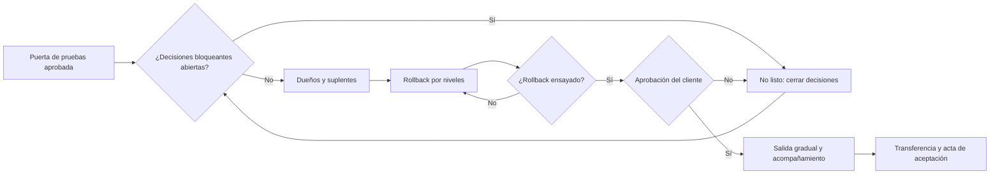

# Herramientas para el release y la transferencia

Nota de fuente: la checklist de salida, la prohibición de liberar sin propietarios, aprobación y rollback, el runbook y la transferencia de propiedad provienen del diseño de implementación empresarial de Distilled Innovation; los entregables de despliegue (solución desplegada, configuración, pruebas, controles, runbook, documentación, transferencia de conocimiento y acta de aceptación) y la diferencia entre prototipo y producción provienen de su oferta empresarial (etapa C, Implementar y transferir). Los niveles de rollback, la salida gradual y el acompañamiento reforzado son prácticas usadas ampliamente en operación de sistemas.

## 1. Camino a la salida

| Paso | Condición para avanzar | Si no se cumple |
|---|---|---|
| Puerta de pruebas | Aprobada, con criterios cumplidos o dispensados | Volver a `pruebas-y-evaluacion` |
| Decisiones bloqueantes | Ninguna abierta | No listo: cerrar con su dueño |
| Dueños | Todo componente, cola, alerta y tarea con dueño y suplente | No listo |
| Rollback | Niveles, disparadores, quién decide, casos en curso | No listo |
| Ensayo | Registrado con fecha, tiempo y quién | No listo |
| Aprobación | La da la autoridad del cliente, registrada | No listo |
| Salida | Ventana, gradualidad y acompañamiento | — |
| Transferencia | Checklist completa y acta firmada | La operación no queda transferida |

## 2. Niveles de rollback

| Nivel | Qué hace | Cuándo conviene | Cuidado |
|---|---|---|---|
| 1. Modo manual | Apaga la parte con IA; los casos van a revisión | Errores de calidad de la IA, instrucciones ocultas, dudas sobre datos | Debe poder hacerlo una persona del cliente, sin permiso previo |
| 2. Versión anterior | Restaura reglas, plantillas o instrucciones previas | Un cambio reciente empeoró el resultado | Requiere tener guardada la versión anterior y saber cómo restaurarla en la plataforma (verificar en el perfil elegido) |
| 3. Proceso anterior | Desactiva el flujo; las personas trabajan como antes | Efectos equivocados hacia afuera, plataforma caída por más del objetivo de recuperación | Definir qué pasa con los casos en curso y cómo se vuelve a activar |

**Disparadores verificables** (ejemplos): un efecto duplicado confirmado; un mensaje con datos de otra persona; más de N casos en la cola de errores; la tasa de escalamiento duplica la del plan de evaluación; el servicio caído más tiempo que el objetivo de recuperación. "Si algo va mal" no es un disparador.

## 3. Salida gradual

| Forma | Ejemplo | Criterio para ampliar |
|---|---|---|
| Por canal | Primero el formulario, después los mensajes | Una semana sin incidentes altos y métricas dentro del plan |
| Por horario | Solo en la mañana, con más personas disponibles | Idem |
| Por volumen | Una parte de los casos; el resto, como antes | Idem |
| Por grupo de personas | Un equipo primero | Idem |

## 4. Acompañamiento reforzado (hipercuidado)

Período corto después de la salida (por ejemplo, dos semanas) con revisión diaria de colas, alertas e incidentes, y una persona de soporte disponible en el horario de operación. Se cierra con un criterio escrito (por ejemplo, diez días hábiles sin incidentes altos y colas dentro de su antigüedad máxima), no por calendario.

## 5. Quién es dueño de qué después de la transferencia

| Ámbito | Dueño habitual | Nunca |
|---|---|---|
| Proceso, reglas y plantillas | Dueño del proceso del cliente | El proveedor que construyó, sin aprobación del cliente |
| Datos, retención, auditoría | Responsable de datos del cliente | — |
| Aprobaciones del día a día | Personas del cliente con su identidad | Cuentas compartidas |
| Operación técnica y soporte | Equipo de TI del cliente, o un tercero con acuerdo escrito | "El que lo hizo", sin acuerdo |
| Decisiones de cambio | Según la matriz de aprobación | Quien propone el cambio, solo |

## 6. Señales de que no está listo

- "Lo probamos, pero con otra versión de las instrucciones."
- "El rollback es apagarlo", sin decir quién, cuándo ni qué pasa con los casos en curso.
- "La revisión legal llega la semana que viene."
- "El soporte lo damos nosotros, como siempre", sin acuerdo.
- "Lo aprueba el equipo técnico."

## 7. Lista de salida

| Comprobación | Sí / No |
|---|---|
| Puerta de pruebas aprobada; ninguna decisión bloqueante abierta | |
| Lo que se libera coincide con lo probado | |
| Dueños y suplentes para todo | |
| Rollback por niveles, con disparadores y quién decide, ensayado | |
| Salida con ventana, gradualidad y acompañamiento | |
| Aprobación de salida del cliente registrada | |
| Runbook y checklist de transferencia entregados; acta firmada | |
| Contrato con madurez `production` | |
