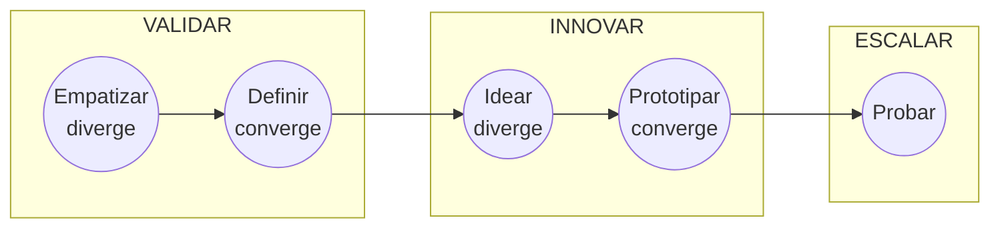

# Innovación Destilada

Plugin de Distilled Innovation que te acompaña, con un facilitador de IA y paso a paso, a pasar de "tengo una idea o un problema" a una solución probada en el mercado.

## Qué es la metodología

Innovación Destilada es una metodología de referencia (no una camisa de fuerza) inspirada en Design Thinking, Lean Startup y Value Proposition Design. Se organiza en tres fases (Validar, Innovar, Escalar) y cinco etapas que alternan entre abrir opciones (divergir) y elegir (converger). Su idea central: antes de buscar soluciones, detenerse a preguntar "¿realmente este es el problema?".

| Fase | Etapa | Movimiento |
|---|---|---|
| Validar | Empatizar | Diverge |
| Validar | Definir | Converge |
| Innovar | Idear | Diverge |
| Innovar | Prototipar | Converge |
| Escalar | Probar | Itera |

## Skills

Escribe la frase de arranque en tu asistente y la skill se activa sola.

| Skill | Para qué sirve | Frase de arranque | Estado |
|---|---|---|---|
| `facilitador-innovacion-destilada` | Punto de entrada: diagnostica tu etapa, guarda el estado del proyecto y te manda a la skill correcta | "Tengo una idea y no sé por dónde empezar" | Disponible |
| `alinear-equipo` | Propósito común, valores, MEGA, perfiles y acuerdo de trabajo | "Quiero alinear a mi equipo antes de arrancar un proyecto de innovación" | Disponible |
| `identificar-reto` | Convierte un problema u oportunidad en un reto "¿Cómo podemos...?" priorizado | "Tengo un problema, ayúdame a plantearlo como reto" | Disponible |
| `investigar-y-empatizar` | Entrevistas, observación y perfil de usuario | "Quiero entender a mis clientes" | Disponible |
| `sintetizar-y-redefinir-reto` | Hallazgos, necesidades y tensiones; reto redefinido | "Tengo muchas notas de entrevistas, ¿qué hallamos?" | Disponible |
| `facilitar-ideacion` | Agenda y técnicas de ideación | "Prepárame una sesión de ideas" | Disponible |
| `construir-concepto-fuerte` | Agrupa ideas y arma un concepto fuerte | "Tenemos muchas ideas, ¿cuál sigue?" | Disponible |
| `disenar-prototipo` | Mapa de valor, prototipos rápidos y pitch | "Quiero hacer tangible mi concepto" | Disponible |
| `validar-supuestos-y-mvp` | Supuestos riesgosos, MVP y tarjeta de prueba | "¿Cómo pruebo esto sin gastar mucho?" | Próximamente |
| `probar-y-aprender` | Tablero de validación y métricas | "Ya hicimos pruebas, ¿seguimos o cambiamos?" | Próximamente |
| `modelo-de-negocio-y-escalamiento` | Los 9 bloques y el encaje con el mercado | "Quiero armar el modelo de negocio" | Próximamente |
| `innovacion-abierta-y-ecosistema` | Patrones y prácticas de innovación abierta | "¿Con quién podemos innovar?" | Próximamente |

## Cómo se conecta con los otros plugins

Los retos validados que salen de Innovación Destilada alimentan:

- **Automatización con IA**: cuando el reto se resuelve rediseñando un flujo de trabajo (usa `identificar-reto` como entrada).
- **Aceleración Comercial**: cuando la solución validada necesita ofertas, mensajes y acciones para crecer.

## Cómo trabaja el facilitador

- Una pregunta principal por turno.
- Cada dato queda marcado como Hecho, Supuesto, Recomendación o Pendiente por validar, con un ID estable.
- Todo diagrama viene con una tabla equivalente.
- Puedes escribir en cualquier momento: "Muéstrame el avance", "¿Qué falta?" o "Finalizar".

Contenido bajo licencia CC BY 4.0 (atribución: Distilled Innovation).
