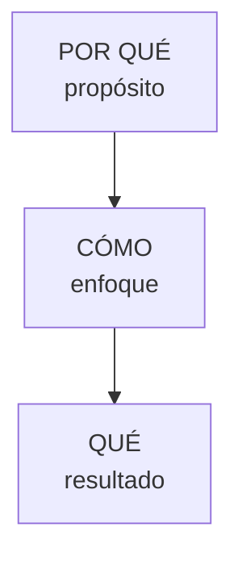

# Círculo Dorado del proyecto

Proyecto: ___  Fecha: ___  Modo: individual / equipo  (si es individual, validar con el equipo)

| Anillo | Pregunta | Respuesta | Procedencia | Etiqueta |
|---|---|---|---|---|
| Por qué | ¿Por qué estamos atacando este reto? ¿Qué creemos? | | | |
| Cómo | ¿Cómo pensamos lograrlo? ¿Qué nos distingue al trabajar? | | | |
| Qué | ¿Qué queremos lograr y para quién? | | | |

## Prueba de coherencia

- ¿Se puede leer de adentro hacia afuera (Por qué, Cómo, Qué) sin contradicciones? Sí / No
- ¿Alguien nuevo en el equipo entendería el Por qué sin explicación extra? Sí / No

## Vacíos (Pendiente por validar)

- ___
