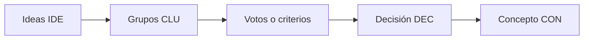

# Agrupación y votación de ideas

Proyecto: ___  Fecha: ___  Versión: borrador 1
Reto (`RET-nn`): ¿Cómo podemos ___?  Modo: equipo (votación) / individual (criterios)

## 1. Grupos

| ID | Nombre del grupo (frase completa) | Ideas (`IDE-nn`) | Ideas unidas | Observación |
|---|---|---|---|---|
| CLU-01 | | | | |
| CLU-02 | | | | |

## 2. Votación (modo equipo)

Votos por persona: ___  Personas que votaron: ___

| Grupo | Votos | Posición |
|---|---|---|
| CLU-01 | | |

## 3. Criterios (modo individual o desempate)

Escala: 1 (bajo), 2 (medio), 3 (alto). Una calificación de la IA es **Inferencia de la IA** hasta que la persona la confirma.

| Grupo | Conecta con la evidencia | Visible | Implementable | Diferente | Ambiciosa | Total |
|---|---|---|---|---|---|---|
| CLU-01 | | | | | | |

## 4. Decisión

Grupos que se fortalecen: ___  (`DEC-nn`, decidido por ___)
Grupos guardados para después: ___

## 5. Ruta de la selección

| Paso | Registro |
|---|---|
| Ideas | `IDE-nn` |
| Grupos | `CLU-nn` |
| Votos o criterios | Tablas 2 o 3 |
| Decisión | `DEC-nn` |
| Concepto | `CON-nn` |

## 6. Riesgos y pendientes por validar

| ID | Riesgo | Impacto | Mitigación |
|---|---|---|---|
| RIE-01 | | | |

- Pendiente por validar: ___
