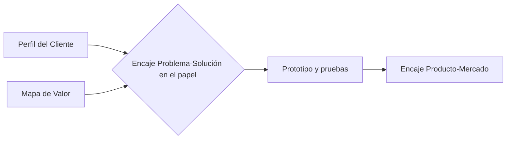

# Encaje Problema-Solución (en el papel)

Proyecto: ___  Fecha: ___  Versión: borrador 1
Concepto (`CON-nn`): ___

Se revisa que los productos y servicios, los aliviadores y los creadores de beneficios estén alineados con las tareas, los dolores y los beneficios más importantes del Perfil del Cliente. Esto es una **hipótesis en el papel**; el encaje con el mercado se busca después con pruebas.

## 1. Checklist Mapa de Valor ↔ Perfil del Cliente

Estado: Cubierto, Parcial o Sin cubrir.

| Orden | Perfil del Cliente (tarea, dolor o beneficio) | Elemento del Mapa de Valor | Estado | Evidencia |
|---|---|---|---|---|
| 1ra tarea | | `PRS-nn` | | `HAL-nn` |
| 1er dolor | | `ALI-nn` | | `TEN-nn` |
| 2do dolor | | `ALI-nn` | | |
| 1er beneficio | | `CRB-nn` | | `NEC-nn` |

Lectura inversa: ¿hay elementos del Mapa de Valor que no responden a nada importante del perfil?

| Elemento del Mapa de Valor | ¿Responde a algo importante? | Qué hacer |
|---|---|---|
| `PRS-nn` / `ALI-nn` / `CRB-nn` | Sí / No | Mantener / quitar / revisar |

## 2. Resultado

- Cubiertos: ___ de ___ ítems importantes.
- Encaje en el papel: Alto / Medio / Bajo.
- Decisión (`DEC-nn`): ajustar el concepto / dejar fuera de alcance / seguir al prototipo. Decide la persona.

## 3. Lista de calidad

- [ ] El 1er dolor y la 1ra tarea están cubiertos
- [ ] Cada aliviador apunta a un dolor real del perfil
- [ ] Cada creador de beneficio apunta a un beneficio esperado
- [ ] Nada importante del Mapa de Valor queda sin respaldo en el perfil
- [ ] Todo lo que no tiene evidencia está marcado como Supuesto

## 4. Ruta hacia el mercado

| Paso | Qué se logra |
|---|---|
| Perfil del Cliente y Mapa de Valor | Insumos |
| Encaje Problema-Solución | La solución es la más indicada en el papel |
| Prototipo y pruebas | Evidencia real |
| Encaje Producto-Mercado | Validación con el mercado (etapa posterior) |

## 5. Riesgos y pendientes por validar

| ID | Riesgo | Impacto | Mitigación |
|---|---|---|---|
| RIE-01 | | | |

- Pendiente por validar: ___
