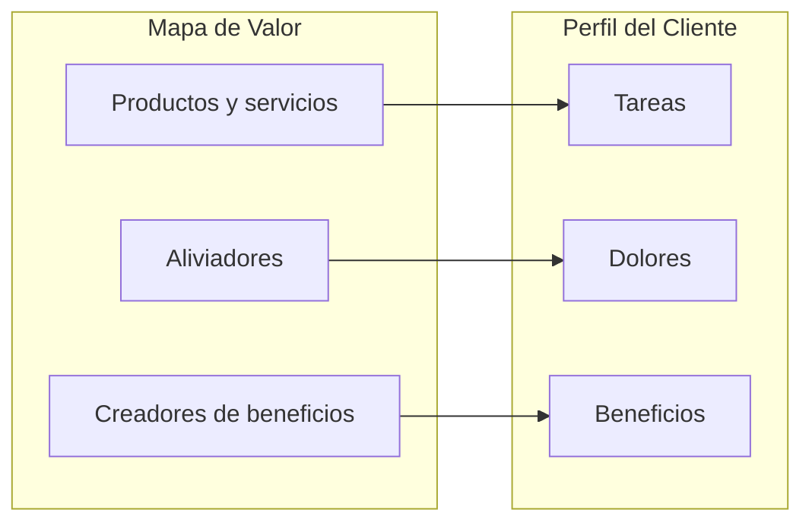

# Mapa de Valor

Proyecto: ___  Fecha: ___  Versión: borrador 1
Concepto (`CON-nn`): ___  Perfil del Cliente de referencia: ___

El Mapa de Valor es el lado izquierdo del Canvas de Propuesta de Valor: describe cómo estaría estructurada la propuesta y qué valor se entrega al segmento. Cada elemento apunta a algo del Perfil del Cliente.

## 1. Productos y servicios

| ID | Producto o servicio | Tarea del cliente que ayuda a cumplir | Procedencia |
|---|---|---|---|
| PRS-01 | | 1ra tarea | |

## 2. Aliviadores (cómo se alivian los dolores)

| ID | Aliviador | Dolor que alivia | Evidencia (`HAL-nn`, `TEN-nn`) | Procedencia |
|---|---|---|---|---|
| ALI-01 | | 1er dolor | | |

## 3. Creadores de beneficios (cómo se crean los beneficios)

| ID | Creador de beneficio | Beneficio que crea | Evidencia (`HAL-nn`, `NEC-nn`) | Procedencia |
|---|---|---|---|---|
| CRB-01 | | 1er beneficio | | |

## 4. Diagrama

| Mapa de Valor | Responde a (Perfil del Cliente) |
|---|---|
| Productos y servicios | Tareas |
| Aliviadores | Dolores |
| Creadores de beneficios | Beneficios |

## 5. Supuestos y riesgos

| ID | Supuesto o riesgo | Estado | Prueba |
|---|---|---|---|
| SUP-01 | | Pendiente por validar | |

## 6. Pendientes por validar

- ___
