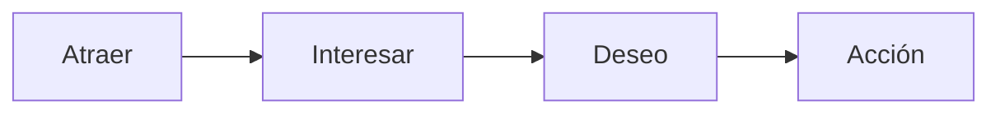

# Pitch o discurso de elevador (A.I.D.A.)

Proyecto: ___  Fecha: ___  Versión: borrador 1
Concepto (`CON-nn`): ___
Ante quién se presenta: ___  Formato (reunión, correo, video): ___  Qué se espera que haga al terminar: ___

## 1. Las cuatro letras

| Letra | Qué debe lograr | Tu texto | Evidencia o procedencia |
|---|---|---|---|
| **A**traer | Desde los primeros 7 segundos, captar la atención y convencer al público de que se habla con él | | |
| **I**nteresar | Indicar el problema y por qué el público debe escucharte (experiencia, solución, experticia) | | |
| **D**eseo | Presentar la solución, las evidencias de que es válida y los beneficios para quien escucha | | |
| **A**cción | Llamado a la acción concreto (registrarse, comprar, siguiente paso) | | |

Cada afirmación en Deseo lleva su etiqueta: **Hecho** (con evidencia), **Supuesto** o **Pendiente por validar**. No se inventan cifras ni testimonios.

## 2. Versión corta (para decir en voz alta)

> ___ (3 a 6 frases que unen las cuatro letras; sin tecnicismos)

## 3. Lista de calidad

- [ ] La apertura se dice en menos de 7 segundos y nombra a la persona
- [ ] El problema viene de la evidencia, no de la solución
- [ ] Deseo muestra evidencia real o reconoce lo que falta probar
- [ ] La acción es una sola y concreta
- [ ] Se puede decir en voz alta en menos de un minuto

## 4. Estructura

| Orden | Letra | Momento |
|---|---|---|
| 1 | Atraer | Primeros 7 segundos |
| 2 | Interesar | El problema y por qué escucharte |
| 3 | Deseo | La solución, la evidencia y los beneficios |
| 4 | Acción | El siguiente paso |

## 5. Pendientes por validar

- ___
